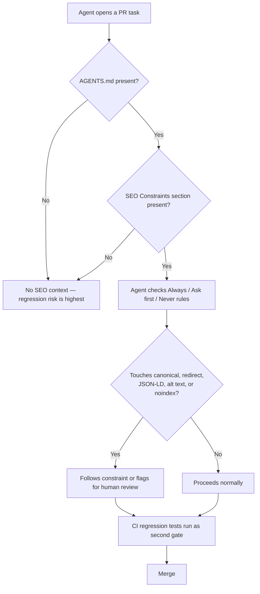

# The AGENTS.md SEO Rule-Pack Every Dev Team Needs in 2026

Here's a fun experiment to run on your own codebase: open your `AGENTS.md` file — if you have one — and search it for the word "canonical." Chances are good you'll get zero results. Search for "redirect," "noindex," or "structured data" while you're at it. Still nothing? That's the problem this article exists to fix.

AGENTS.md has quietly become the closest thing the AI coding world has to a universal standard. It started life in 2025 as an OpenAI convention for Codex CLI, and by this year it's governed by the Linux Foundation's Agentic AI Foundation, co-founded by OpenAI, Anthropic, and Block, with 146 member organizations as of February 2026. Over 25 tools read it natively now — Cursor, GitHub Copilot, Gemini CLI, Devin, Aider, Windsurf, Amp, and more than 60,000 open-source repositories ship one. And as of September 18, 2026, Claude Code joined the list too, reading AGENTS.md automatically whenever a project has no CLAUDE.md.

That last part is the news hook, but it's not really the point. The point is this: if 25+ tools are reading one file before they touch your codebase, and that file says nothing about SEO, you've got an open door you didn't know you left unlocked.

## Why This Matters Now, Not Later

[→ Read also: 8 SEO Regressions AI Coding Agents Keep Shipping in 2026](/blog/ai-coding-agents-seo-regressions-production-2026/) already walked through the failure modes: canonical tags copy-pasted during template duplication, slug renames shipping without a 301, alt text stripped during "cleanup" refactors, JSON-LD orphaned when a shared component gets extracted. None of that is hypothetical anymore — it's the normal cost of letting agentic tools loose on a mature, already-ranking codebase.

What's changed since that piece ran is the plumbing underneath it. Claude Code's new AGENTS.md support isn't a side feature — Anthropic built it as what they're calling a "mod," an open, inspectable piece of the harness living in `anthropic-code/claude-code` under `mods/agents-md`, with the source itself open to review. That's worth sitting with for a second: the instruction file your agent reads is no longer a vendor-specific black box. It's becoming infrastructure, the same way `.gitignore` or `package.json` are infrastructure. And infrastructure that doesn't carry SEO rules is infrastructure that will eventually ship an SEO regression, not because anyone was careless, but because nobody told the thing writing the code that `rel="canonical"` is sacred.

Google's own John Mueller made basically this point back in May, talking about AI-built sites on *Search Off The Record*: "You can always tell the AI system, now add some SEO to it" — except that's not a real strategy, it's a vague request that produces a vague result, whether the builder is a human contractor or an LLM. His fix was specific: define the domain, the canonical setup, the sitemap, and the robots.txt treatment up front, plus pre-publish checks. AGENTS.md is exactly where "up front" lives for an agentic workflow.

## What AGENTS.md Actually Is (and Isn't)

A quick reality check before you write anything: AGENTS.md is plain Markdown with zero required schema, no YAML front matter, no version field. It's read from the nearest file up the directory tree, which matters for monorepos — a `packages/blog/AGENTS.md` can override or add to the root one, so a Next.js app and a marketing site living in the same repo don't have to share identical SEO rules.

GitHub's engineering team analyzed over 2,500 public AGENTS.md files and found the single most common failure is a vague persona — "You are a helpful coding assistant" tells an agent almost nothing useful. What works, per that analysis, is a concrete role, executable commands listed early, real code examples instead of prose descriptions, and a three-tier boundary system: things to always do, things to ask about first, and things to never do. Keep that three-tier structure in mind — it's exactly the shape an SEO rule-pack should take, and it's what we'll build below.

Here's the part that should make you skeptical of the "just dump everything in there" instinct, though. A joint ETH Zurich / LogicStar.ai study (AGENTBENCH, built on 138 real-world Python tasks plus SWE-bench Lite) tested what context files actually do to agent performance. LLM-generated context files made things *worse* — about a 2% drop in task success on AGENTBENCH, plus roughly 20% higher inference cost from agents over-exploring the repo chasing broad architectural summaries. Human-written files helped, but only modestly — about 4% — and mainly in repos that were otherwise under-documented. The researchers' advice: don't auto-generate these files, and when you write one by hand, keep it to narrow, essential operational constraints instead of sweeping documentation.

That finding should shape exactly how you write your SEO rules. Not a philosophy essay on E-E-A-T. Short, enforceable, checkable constraints — the kind of thing a lint rule could verify.

## The Rule-Pack: What to Actually Paste In

Add an `## SEO Constraints` section to your root AGENTS.md (or a per-package one, for a monorepo blog/docs split) using the always / ask-first / never structure:

```markdown
## SEO Constraints

**Always:**
- Every page/route includes a self-referencing canonical tag — never omit one,
  even on pages with no known duplicates.
- Renaming or moving a URL ships a 301 redirect from the old path in the same PR.
- JSON-LD on a page stays intact if that page's component is refactored, split,
  or extracted into a shared component. Verify by diffing rendered <script
  type="application/ld+json"> output before/after.
- Images keep their existing alt text through any refactor. Empty alt="" is only
  valid for genuinely decorative images — never a side effect of cleanup.
- Sitemap entries are regenerated (or confirmed unchanged) whenever routes are
  added, removed, or restructured.

**Ask first:**
- Changing a page's title tag, meta description, or H1 structure.
- Adding or removing a noindex / X-Robots-Tag anywhere outside of staging
  environments.
- Changing URL parameter handling on paginated, filtered, or faceted routes.

**Never:**
- Never let staging's noindex/robots config ride along into a production
  deploy via shared environment config — treat this as a release blocker, not
  a warning.
- Never add rel="nofollow" to internal links as a "quick fix" for crawl-budget
  concerns — that's a canonicalization/pagination problem, not a link-attribute
  problem.
- Never commit a sitewide template change that alters output for more than a
  handful of pages without a before/after diff of title, meta, and canonical
  tags across a sample of affected routes.
```

Three things make this version different from the generic "SEO rules for AI" snippets already floating around in rule-sharing repos: it's scoped to *regressions in an existing, already-indexed site* rather than greenfield setup advice; it names the specific verification step for each rule (diff the rendered JSON-LD, sample the affected routes) instead of just stating the rule; and it matches the three-tier boundary pattern GitHub found actually works, instead of a flat bullet list an agent can skim past.

## SEO & Search Implications

The mechanism matters here, not just the outcome. A CI test (see [→ Read also: SEO Regression Testing in 2026: Guardrails for AI-Written Code](/blog/seo-regression-testing-2026-ci-guardrails-ai-code/)) catches a broken canonical *after* the agent writes the code, during the PR check. An AGENTS.md rule tries to prevent the agent from writing that code in the first place, because the constraint is sitting in its context window before it starts. Those aren't competing approaches — they're two different points in the same pipeline, and you want both. The CI gate is your safety net; the AGENTS.md rule-pack is your first line of defense, reducing how often the net actually has to catch something.

There's a crawlability wrinkle worth flagging too: AGENTS.md itself is just a markdown file sitting in your repo root. If your docs site or marketing site publishes its own engineering-process content (plenty of dev-tool blogs do), don't accidentally let a public-facing "here's our AGENTS.md" page get indexed as thin, duplicate boilerplate — treat it the same way you'd treat any other low-value utility page, with intentional indexability decisions rather than defaults.

## Common Mistakes (and a Better Default)

The single biggest mistake is the one the AGENTBENCH research flags directly: asking an LLM to generate your AGENTS.md SEO section for you. It's tempting — "write me SEO rules for my AGENTS.md" takes ten seconds — but the research found LLM-authored context files actively hurt task success and inflated cost. Write the rule-pack above by hand, trim it to what actually applies to your stack, and resist the urge to pad it with general SEO theory the agent doesn't need to do its job.

Second mistake: treating AGENTS.md and CLAUDE.md as if they stack automatically. By default, Claude Code's September 2026 update only falls back to AGENTS.md when there's *no* CLAUDE.md at all — a study of 283 top-starred repos that ship an AGENTS.md found 57% already had a counting CLAUDE.md, meaning the new fallback changed nothing for them. If you want both files honored, either flip the `claude-md-and-agents-md` setting to load both, or add a one-line `@AGENTS.md` import at the top of your CLAUDE.md — that trick works even on Claude Code versions older than 2.1.277.

Third: forgetting the monorepo case entirely. If your Next.js marketing site and your product app share a repo, a single root-level rule-pack either over-constrains the app (which doesn't care about canonicals) or under-constrains the site (which does). Nest a package-level AGENTS.md next to each app's root, and let the SEO constraints live only where SEO actually applies — consistent with the same scoped thinking behind [→ Read also: JavaScript SEO in 2026: How AI Crawlers Read React, Next.js, and Astro](/blog/javascript-seo-ai-crawlers-react-nextjs-astro/).



## FAQ

**Does adding SEO rules to AGENTS.md guarantee an agent won't break anything?**
No. Per the AGENTBENCH findings, even well-written context files only improve outcomes modestly, and they work best as narrow operational constraints rather than broad documentation. Pair the rule-pack with CI-level regression tests; don't treat it as a replacement for them.

**Does Claude Code read both CLAUDE.md and AGENTS.md by default?**
No. As of the September 18, 2026 update, Claude Code reads AGENTS.md only when there's no CLAUDE.md present in that project. Use the `claude-md-and-agents-md` setting, or a `@AGENTS.md` import line inside your CLAUDE.md, if you want both honored together.

**Should I let an AI tool write my AGENTS.md SEO rules for me?**
The research says no — LLM-generated context files reduced task success in controlled testing and raised inference cost. Write the constraints by hand and keep them short and checkable.

**Where should the SEO rules live in a monorepo?**
In a package-level AGENTS.md next to each app that actually has SEO surface area — a marketing site or blog — rather than the shared root file that an internal tool or admin app would also inherit.

**Is this a replacement for the regression-testing CI setup I already have?**
No — it's the layer that sits before it. AGENTS.md tries to stop the mistake at generation time; your CI suite catches whatever slips through.

## Conclusion

AGENTS.md isn't a passing trend you can wait out — it's rapidly becoming the shared language 25-plus coding tools speak before they touch a line of your code, Claude Code included as of last month. The teams that will quietly dodge the next round of agent-shipped SEO regressions aren't the ones with the fanciest CI pipeline. They're the ones who did the unglamorous thing first: open the file the agent already reads, and tell it, in plain, checkable language, which parts of the site's search visibility are not up for negotiation.

```json
{
  "@context": "https://schema.org",
  "@type": "BlogPosting",
  "headline": "The AGENTS.md SEO Rule-Pack Every Dev Team Needs in 2026",
  "description": "AGENTS.md is now read by 25+ AI coding tools, including Claude Code. Here's why most of them won't protect your SEO by default — and a copy-paste rule-pack that will.",
  "datePublished": "2026-10-10",
  "dateModified": "2026-10-10",
  "keywords": "AGENTS.md, AI Coding Agents, Technical SEO, SEO Regression Testing, JavaScript SEO"
}
```
