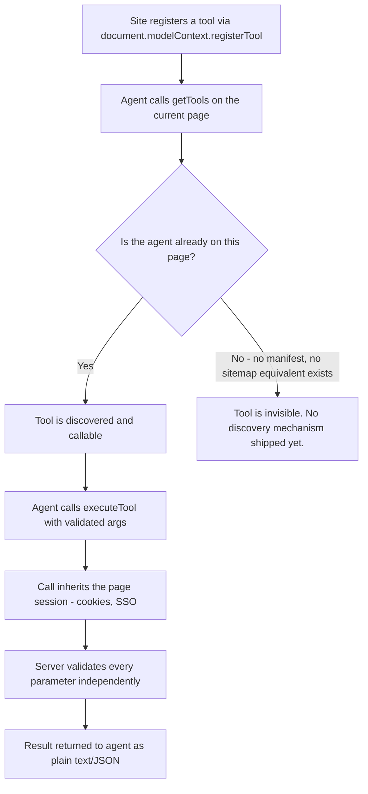

# WebMCP in 2026: Why AI Agents Still Can't Find Your Tools

Somewhere in the last eight months, "expose your website to AI agents" went from a weird sci-fi sentence to an actual line item on technical SEO checklists. WebMCP — the browser API that lets a page hand an AI agent a callable function instead of a page full of buttons — is the reason. It's genuinely exciting. It's also already changed its core API twice since the February 2026 draft, and the one problem its own spec authors admit is still unsolved happens to be the exact problem SEOs are supposed to care about: discovery.

## Why WebMCP Is Suddenly Everywhere

Here's the pitch, and it's a good one. Instead of an AI agent screenshotting your checkout page and guessing which pixel to click, your site registers a tool — `add_to_cart`, `search_flights`, `filter_products` — with a name, a plain-language description, and a JSON Schema describing its inputs. The agent reads that contract, fills in the parameters, and calls it directly. Early implementer testing puts structured tool calls at roughly 20–100 tokens versus 2,000+ for a screenshot-based interaction, which is most of why Dan Petrovic called it "the biggest shift in technical SEO since structured data" when Google and Microsoft first published the draft under the W3C Web Machine Learning Community Group in February 2026.

The timing isn't an accident. Perplexity's Comet and OpenAI's Atlas both turned into real adoption numbers fast — Atlas alone pulled 60x the downloads Comet got in its own launch window, and over a quarter of enterprises reportedly had at least one employee running it within weeks. Chrome's own Gemini-powered Auto Browse followed in January 2026. Agentic browsing stopped being a demo and started being traffic you can't see in your logs the normal way.

[→ Read also: The GA4 Blind Spot: Why AI Browsers and WebMCP Break Your Tracking](/blog/ga4-blind-spot-ai-browsers-webmcp-tracking-2026/)

That's the appeal. Now here's the part most "WebMCP for SEO" roundups skip entirely: the API you'd actually write code against has moved under everyone's feet, twice, since that February draft — which means a lot of what's currently ranking for "how to implement WebMCP" is already instructing you to ship deprecated code.

## The API Already Moved Twice. Here's What's Actually Current.

The original February 2026 draft lived on `navigator.modelContext`, and it registered tools in bulk with a method called `provideContext({ tools })`. That design had a real security hole: `provideContext` silently cleared the existing tool list before adding the new one, which meant a third-party script sharing the page could quietly swap out a legitimate tool, proxy its calls, and read whatever the user typed into it. The W3C group tracked this as issue #101 and closed it by removing `provideContext` and `clearContext` entirely in March 2026.

Then, in the July 2026 draft, the whole thing moved home. The spec authors decided a ModelContext belongs to a document, not a browser, so `navigator.modelContext` became `document.modelContext`. Chrome 149 shipped the origin trial on that corrected API; Chrome 150 formally deprecated the `navigator` version for anyone who built against the earlier shape.

What you should actually be writing today looks like this:

```javascript
const controller = new AbortController();

await document.modelContext.registerTool(
  {
    name: "add_to_cart",
    description: "Adds a product to the shopping cart by SKU and quantity.",
    inputSchema: {
      type: "object",
      properties: {
        sku: { type: "string", description: "Product SKU" },
        quantity: { type: "number", description: "Units to add" }
      },
      required: ["sku", "quantity"]
    },
    annotations: { readOnlyHint: false, consequentialHint: false },
    async execute({ sku, quantity }, { signal }) {
      const result = await cart.add(sku, quantity, { signal });
      return { success: true, cartTotal: result.total };
    }
  },
  { signal: controller.signal }
);

// To remove the tool later, you don't call unregisterTool() — there isn't one.
controller.abort();
```

There's no standalone `unregisterTool()` method in the current spec. You remove a tool by aborting the `AbortController` whose signal you passed in at registration — a pattern that'll feel familiar if you've used `fetch()` cancellation, and that'll throw an `InvalidStateError` if you try to register a duplicate tool name without it. There's also a declarative shortcut for existing HTML: forms can be exposed as tools using `toolname` and `tooldescription` attributes directly on the markup, no JavaScript required, though the spec text for that surface is still marked as a work in progress and the attribute names could still shift.

If any of that code looks different from a WebMCP tutorial you read a few months ago, that's not you misremembering — it's the tutorial. The origin trial is explicitly unstable by design: Chrome 153 changed how unregistering interacts with in-flight calls, and Chrome 155 is deprecating JSON-stringified arguments in favor of typed objects. Treat any WebMCP code sample without a 2026 date stamp as suspect, including, frankly, your own site's documentation if you wrote it before July.

## Security Isn't an Afterthought Here — It's Half the Spec

The thing that makes WebMCP different from a normal API integration is that the "client" calling your function is a language model, and language models can be talked into doing things by text they read, not just text a developer wrote. Chrome's own security guidance, published June 9, 2026, calls this indirect prompt injection: a model processes instructions and data as one token stream, so a malicious comment, review, or search result your tool returns can get interpreted as a new instruction rather than inert content.

That's what the `annotations` object on `registerTool` is actually for, and it's worth treating as mandatory rather than decorative:

- **`readOnlyHint`** — tell the agent up front when a tool has no side effects. Default assumption, per Chrome's own docs, is that a tool *does* change state unless you say otherwise.
- **`untrustedContentHint`** — flag output that contains data you don't control, like user reviews or scraped third-party content, so the agent can "spotlight" it as data instead of instructions.
- **`consequentialHint`** — mark anything significant or hard to reverse (bookings, payments, account changes) so the browser or agent can force a human confirmation step before it fires.
- **`debugging`** (Chrome 156+) — hide developer-only tools from end-user agents entirely.

Cross-origin access is locked down by default, too: a tool is invisible to other origins unless you explicitly list them in `exposedTo`, and the calling page has to name your origin back in `fromOrigins` to use it. Embedding your tool inside someone else's iframe requires an explicit `allow="tools"` permissions-policy grant. None of this is optional plumbing — skip it and you're one unvalidated parameter away from an agent executing a refund, a cart change, or a form submission it was tricked into requesting by content on the page it was never supposed to trust.

## The SEO & Search Implications: Discovery Is the Part Nobody Solved

Here's where this stops being a pure dev-docs story. WebMCP's own proposal says it outright: "there is no built-in mechanism for client applications to discover which sites provide callable tools without visiting or querying them directly." Translate that into SEO terms and it's a familiar problem wearing a new costume — it's the crawl-discoverability question, except there's no sitemap.xml, no robots.txt directive, and no `.well-known` manifest for it yet. An agent currently has to already be on your page, with the tab open, to find out you have tools at all.

That matters because WebMCP is shaping up as the action-layer equivalent of structured data: Schema.org told search engines what a page *is*; a tool registration tells an agent what a page can *do*. The gap is that structured data gets crawled and indexed ahead of any single user visit — it's discoverable at scale. A WebMCP tool, right now, is only discoverable one tab at a time, which means the categories everyone agrees are most exposed — ecommerce, travel booking, B2B lead capture, customer support — are investing in agent-callable functions that are effectively invisible to any agent that hasn't already landed on the page organically.

[→ Read also: Agentic Commerce SEO: UCP, ACP, and Your New Discovery Stack](/blog/agentic-commerce-seo-2026-ucp-acp-discovery-stack/)

Don't confuse this with a ranking signal — there's no announced link between registering WebMCP tools and how Google ranks your informational pages, and nobody credible is claiming otherwise. What it *does* affect is a narrower, newer kind of visibility: whether an agent completing a transactional task picks your site to act on, or picks a competitor's because that's the one its memory, its session history, or a separate discovery channel already pointed it toward. Until a real discovery layer ships, your best lever is the boring one — make sure your tools are documented in plain language on crawlable pages, consistent with how your site already describes those actions in regular content, so at minimum the semantic signal and the tool contract agree with each other.

[→ Read also: 7 Steps to Implement Web Bot Auth and Verify Googlebot in 2026](/blog/web-bot-auth-implementation-verify-googlebot-2026/)

## How to Implement This Without Shipping Dead Code in Six Weeks

If you're building this now, a few habits will keep you from relearning this whole article every time Chrome ships:

1. **Feature-detect, don't assume.** Check for `document.modelContext` first, and treat `navigator.modelContext` as a legacy fallback at most — it's deprecated, not guaranteed to disappear on a fixed date, but not something to build new code against either.
2. **Always pass an `AbortController` signal.** It's your only path to cleanly unregistering a tool, and it lets you cancel long-running `execute()` work via the `signal` your function receives as its second argument.
3. **Write every annotation, every time.** `readOnlyHint`, `untrustedContentHint`, and `consequentialHint` aren't optional metadata — they're the difference between an agent treating your tool as safe-to-call and treating it as something that needs a human to confirm.
4. **Validate server-side, no exceptions.** Tool calls inherit the page's existing session — cookies, SSO tokens, everything — which means an agent-supplied parameter deserves exactly as much skepticism as a raw form POST, not more trust just because a schema validated it client-side first.
5. **Keep a changelog for your own tools.** Given Chrome's cadence here — 153 changed unregister behavior, 155 is dropping JSON-stringified args, 156 adds a debugging annotation — your implementation needs the same kind of "last verified against Chrome N" dating you'd put on a browser-support table.

## Common Mistakes Worth Avoiding

The single most common mistake right now is architectural: teams bolt WebMCP onto a page as a side project disconnected from the actual content that already describes the same action, so the "add to cart" tool and the add-to-cart button tell two slightly different stories to two different audiences. Keep them in sync, or you've effectively built a second, undocumented API surface.

The second is treating the origin trial as a finished product. It's a Draft Community Group Report, not a W3C Standard, and Chrome itself says the shape can change at any time — it already has, twice. Pin a review date on any WebMCP code in your repo the same way you'd pin a dependency version.

The third, and the one with the sharpest downside, is skipping `consequentialHint` on anything that touches money, bookings, or account state because "it's just a demo for now." Demos go to production faster than security reviews get scheduled. Mark the stakes honestly from the first commit.

## Conclusion

WebMCP is a real, well-reasoned answer to a real problem — screenshot-driven browser automation is slow, brittle, and expensive in tokens, and giving agents a typed contract instead fixes that cleanly. But it's shipping in public, changing its own shape as it goes, and still missing the one piece — discoverability at scale — that would make it a true SEO play rather than a per-visit UX improvement. Build it with the current API, annotate it honestly, validate everything server-side, and treat "WebMCP implemented" as an ongoing maintenance commitment rather than a box you check once. The sites that get action-layer visibility right over the next year won't be the ones who shipped first — they'll be the ones who kept up.

[→ Read also: Structured Data in 2026: What Still Works After Google's Cuts](/blog/structured-data-2026-what-still-works-after-google-cuts/)



## Frequently Asked Questions

**Is WebMCP the same thing as MCP (Model Context Protocol)?**
No. MCP is a backend protocol that AI tools use to call external servers via JSON-RPC, with no browser or human required. WebMCP runs client-side inside an active browser tab, requires a present user, and currently only covers tool calling — not MCP's resources or prompts. They're designed to complement each other, not replace one another.

**Which browsers support WebMCP right now?**
Chrome ships it as a public origin trial starting at version 149, with `document.modelContext` as the current correct entry point. Edge support is anticipated but not formally shipped. Firefox and Safari haven't committed to it as of this writing.

**Does adding WebMCP tools help my Google ranking?**
Not in any announced, direct way. There's no confirmed link between registering tools and organic ranking for informational queries. Where it matters is agent-driven transactional visibility — whether an in-browser agent can complete an action on your site at all — which is a different, narrower kind of discoverability than classic SEO ranking.

**What's the biggest security risk with WebMCP?**
Indirect prompt injection — malicious instructions hidden in content a tool returns (a user review, a search result, scraped third-party text) that an LLM can't reliably distinguish from a legitimate instruction. Use `untrustedContentHint` on any output you don't fully control, and never skip server-side validation just because a client-side schema already checked the input shape.

**Can AI agents discover my WebMCP tools without visiting my page first?**
Not yet. The spec's own authors acknowledge there's no discovery mechanism — no manifest, no sitemap equivalent — for finding callable tools without already being on the page. Until that ships, the closest thing to a mitigation is keeping your tool descriptions consistent with crawlable, plain-language content describing the same actions elsewhere on the page.

```json
{
  "@context": "https://schema.org",
  "@type": "FAQPage",
  "mainEntity": [
    {
      "@type": "Question",
      "name": "Is WebMCP the same thing as MCP (Model Context Protocol)?",
      "acceptedAnswer": {
        "@type": "Answer",
        "text": "No. MCP is a backend protocol used over JSON-RPC with no browser or human required. WebMCP runs client-side inside an active browser tab, requires a present user, and currently covers tool calling only, not MCP's resources or prompts."
      }
    },
    {
      "@type": "Question",
      "name": "Which browsers support WebMCP right now?",
      "acceptedAnswer": {
        "@type": "Answer",
        "text": "Chrome ships it as a public origin trial starting at version 149, with document.modelContext as the current entry point. Edge support is anticipated but not formally shipped; Firefox and Safari have not committed."
      }
    },
    {
      "@type": "Question",
      "name": "Does adding WebMCP tools help my Google ranking?",
      "acceptedAnswer": {
        "@type": "Answer",
        "text": "There is no confirmed, announced link between registering WebMCP tools and organic ranking for informational queries. It affects agent-driven transactional visibility, a different kind of discoverability than classic SEO ranking."
      }
    },
    {
      "@type": "Question",
      "name": "What's the biggest security risk with WebMCP?",
      "acceptedAnswer": {
        "@type": "Answer",
        "text": "Indirect prompt injection, where malicious instructions hidden in tool output are interpreted by an LLM as legitimate commands. Use the untrustedContentHint annotation and always validate parameters server-side."
      }
    },
    {
      "@type": "Question",
      "name": "Can AI agents discover WebMCP tools without visiting the page first?",
      "acceptedAnswer": {
        "@type": "Answer",
        "text": "Not yet. WebMCP's own spec authors acknowledge there is no discovery mechanism, such as a manifest or sitemap equivalent, for finding callable tools without already being on the page."
      }
    }
  ]
}
```
