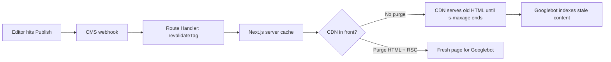

# 7 Next.js ISR Mistakes That Serve Stale Pages to Googlebot

You hit "Publish" in your CMS. The webhook fires, the logs say `revalidated: true`, and you go grab coffee. Two days later, the old headline is still sitting in Google's snippet, and the price you changed is still wrong in the index.

Nothing crashed. No error was thrown. The page just quietly kept serving the old version to the one visitor you most need to impress: the crawler.

That's the sneaky thing about Next.js ISR SEO. Incremental Static Regeneration is built to favor availability over strict consistency, and the Next.js docs say so plainly: the system "prioritizes availability over strict consistency." Great for users. Risky for search, because a stale page that returns a clean 200 gives crawlers no reason to doubt it.

This list covers seven mistakes we see most often in revalidation setups, ranked by how much damage they do to crawling and indexing. The criteria: how likely the mistake is in a typical headless-CMS-plus-Next.js stack, how long the stale content can survive, and how hard it is to notice. For the dev-to-SEO handoff, each item ends with a concrete fix.

If your stack is headless, pair this with our earlier piece on [8 Headless CMS SEO Mistakes That Kill Indexing in 2026](/blog/headless-cms-seo-mistakes-2026-indexing-fixes/). That one covers the indexing failures. This one covers what happens after the content ships.



## 1. Revalidating the App Cache but Not the CDN

This is the big one, and it's the easiest to miss. According to the Next.js CDN caching guide, `revalidateTag()` and `revalidatePath()` invalidate the Next.js server cache. A CDN sitting in front keeps serving its own copy "until the `s-maxage` TTL expires."

Think of it like updating the menu in the kitchen while the printed menus on the tables stay the same. Your webhook did its job. Googlebot never sees it.

ISR pages ship with `s-maxage={revalidate}` plus `stale-while-revalidate={expire - revalidate}`, and the default `expire` is one year. So the edge can legitimately hold a page for a long time unless you purge it.

**SEO impact:** Googlebot fetches through the CDN. Stale HTML at the edge means stale titles, stale prices, stale structured data, and a stale picture of your internal links.

**Fix:** call your CDN purge API in the same webhook, right after the revalidate call. Purge both the HTML and the RSC variants, as the docs recommend. And don't cache HTML and RSC with different TTLs, because mismatched pairs can cause content inconsistencies during client-side navigation.

```ts
// app/api/revalidate/route.ts
import { revalidateTag } from 'next/cache'
import { NextResponse } from 'next/server'

export async function POST(req: Request) {
  const secret = req.headers.get('x-webhook-secret')
  if (secret !== process.env.REVALIDATE_SECRET) {
    return NextResponse.json({ ok: false }, { status: 401 })
  }

  const { slug } = await req.json()

  // 1. Invalidate the Next.js cache (stale-while-revalidate)
  revalidateTag(`post:${slug}`, 'max')
  revalidateTag('sitemap', 'max')

  // 2. Purge the edge too, HTML and RSC variants
  await purgeCdn([`/blog/${slug}`, `/blog/${slug}.rsc`])

  return NextResponse.json({ ok: true, slug })
}
```

(`purgeCdn` is your provider's purge call, whether that's Cloudflare, Fastly, or CloudFront. The shape differs per vendor. The principle doesn't.)

## 2. Forgetting That Revalidation Is Local in Multi-Instance Setups

If you self-host behind a load balancer, listen up. The docs state that "revalidation events are local by default": calling `revalidateTag()` on instance A only invalidates the cache on instance A. Instance B keeps serving the old page until it learns otherwise.

Googlebot doesn't care which instance it lands on. Sometimes it gets the fresh page. Sometimes it gets the old one. Congratulations, you've built a slot machine for your indexing.

**SEO impact:** inconsistent responses for the same URL across crawls. You'll see it as a title that flips back and forth in Search Console's inspection tool, or as a `lastmod` that doesn't match what the crawler actually received.

**Fix:** implement the `updateTags()` and `refreshTags()` hooks in a custom `cacheHandlers` entry backed by shared storage such as Redis. One caution straight from the docs: wrap `refreshTags()` in error handling. If it throws, the exception propagates as a request failure, and a Redis hiccup becomes a 500 for your crawler.

## 3. Using `updateTag` in a Webhook (and Wondering Why Nothing Works)

The names are confusingly close, so here's the quick version. Per the Next.js revalidation guide, `updateTag` immediately expires cached data for read-your-own-writes scenarios, but it "can only be used in Server Actions." `revalidateTag` works in both Server Actions and Route Handlers, with stale-while-revalidate semantics.

A CMS webhook hits a Route Handler. So `revalidateTag` is your only option there. If someone copies a snippet using `updateTag` from a tutorial about form submissions, the webhook path simply won't behave the way they expect.

**SEO impact:** the failure is silent in production if the endpoint swallows errors. Content never refreshes, and nobody notices until a campaign page is still showing last quarter's offer.

**Fix:** webhooks use `revalidateTag(tag, 'max')`. Server Actions that editors trigger from inside your own app can use `updateTag`. Write that rule in your contributing docs. (Worth reading alongside [The AGENTS.md SEO Rule-Pack Every Dev Team Needs in 2026](/blog/agents-md-seo-rule-pack-2026/), since coding agents mix these two up easily.)

## 4. Forgetting That the First Request Still Gets the Old Page

Here's the part that surprises people. Stale-while-revalidate means what it says: the stale version is served immediately while the fresh one builds in the background. The docs describe it exactly that way, and the second argument to `revalidateTag` sets how long stale content may be served while fresh content generates.

So the first request after your webhook fires, which could easily be Googlebot, may still receive the old page. A recrawl right after publishing can therefore record the version you just replaced.

**SEO impact:** you pushed an urgent correction (a legal fix, a wrong price, a retraction) and the crawler's very next visit captured the wrong one. Recovery takes another crawl cycle.

**Fix:** for content where wrong-for-a-few-minutes isn't acceptable, don't rely on a crawler to be the one that triggers regeneration. After revalidating, send a warm-up request yourself (a plain `fetch` to the URL from the webhook handler, or from a queue worker) so the fresh render exists before any external visitor arrives. Then request indexing in Search Console only after you've confirmed the live HTML has changed.

## 5. Putting a Dishonest `lastmod` in Your Sitemap

Revalidation fixes the page. The sitemap tells Google when to look again, and many sitemaps lie.

Google's sitemap documentation says it uses `<lastmod>` "if it's consistently and verifiably accurate," and defines it as the last *significant* update to the page, meaning main content, structured data, or links. A footer copyright change doesn't count. The same page says Google ignores `<priority>` and `<changefreq>`.

The classic mistake is `lastmod: new Date()` in the sitemap generator. Every URL claims it changed right now, on every build. Google learns the signal is noise and stops trusting it, so your genuinely updated pages lose their only fast lane.

**SEO impact:** slower pickup of real updates, because the one field that was supposed to announce them has a track record of being wrong.

**Fix:** drive `lastmod` from the CMS's real `updatedAt`, and tag the sitemap so it refreshes with the content.

```ts
// app/sitemap.ts
import { cacheTag, cacheLife } from 'next/cache'
import type { MetadataRoute } from 'next'

export default async function sitemap(): Promise<MetadataRoute.Sitemap> {
  'use cache'
  cacheTag('sitemap')
  cacheLife('max')

  const posts = await cms.getAllPosts() // your CMS client
  return posts.map((p) => ({
    url: `https://example.com/blog/${p.slug}`,
    lastModified: new Date(p.updatedAt), // real edit time, not build time
  }))
}
```

The webhook from mistake #1 already calls `revalidateTag('sitemap', 'max')`, so the sitemap and the page move together. Keep each file under the documented limits of 50,000 URLs or 50 MB uncompressed, and split into a sitemap index when you outgrow them.

## 6. Letting Metadata and JSON-LD Run on a Different Clock Than the Body

Body content, `<title>`, canonical, Open Graph tags, and JSON-LD often come from different fetches in the same route. If the body is tagged and revalidated, but `generateMetadata` calls a separate uncached or differently-tagged function, you get a page whose headline says one thing and whose `dateModified` or `offers.price` says another.

This is a pattern problem, not a documented Next.js bug, so treat it as a code-review item rather than a guaranteed failure. But we see it often enough in real codebases to put it on the list.

**SEO impact:** Google compares what your structured data claims with what the visible page shows. A mismatch between markup and content is a classic reason rich results quietly disappear. We covered the broader picture in [Structured Data in 2026: What Still Works After Google's Cuts](/blog/structured-data-2026-what-still-works-after-google-cuts/).

**Fix:** one data function per entity, one tag per entity, and everything on the page (body, metadata, JSON-LD, related-post links) reads from it. If it's one fetch with one `cacheTag`, it gets invalidated in one shot.

## 7. Having No Safety Net When the Webhook Fails

Webhooks fail. Deliveries get dropped, retried, duplicated, or arrive out of order. An unauthenticated endpoint gets hammered by bots. And if your whole freshness strategy is "the webhook will always work," the first outage turns into weeks of stale pages.

The docs actually suggest the opposite for CMS content: tag it, give it a long `cacheLife` such as `max` (30-day revalidate window), and trigger `revalidateTag` from a webhook. That's efficient, but it means a missed webhook can leave a page stale for as long as that window allows.

**SEO impact:** the failure mode is invisible, long-lived, and scattered across random URLs, which is the hardest kind to debug from Search Console alone.

**Fix:** pair on-demand revalidation with a shorter time-based fallback (a day or a week, depending on how fast your content changes), verify the secret header, make the handler idempotent so duplicate deliveries are harmless, and configure retries in the CMS. Heads up: if you go very short, a cache using the `seconds` profile, `revalidate: 0`, or `expire` under five minutes is treated as short-lived and excluded from prerenders, becoming a dynamic hole instead. Keep your primary, indexable content out of those and in the static shell.

## Honorable Mentions

**Deployment skew.** During rolling deploys, a client built on deploy A can talk to a server on deploy B. Setting `deploymentId` makes the client do a hard navigation when it detects a mismatch. It's more of a UX issue than a crawling one, but worth a line in your config review.

**Over-broad `revalidatePath`.** The docs recommend tag-based revalidation over path-based when possible, because it's more precise and avoids over-invalidating. Path invalidation also reaches ancestor layout soft tags, so a careless call can force a wave of re-renders, which is not something you want when a crawler is hitting you at the same time. Our [9 Next.js 16.3 Changes That Quietly Affect Your SEO](/blog/nextjs-16-3-seo-changes-2026/) piece has more on the version-specific behavior.

## How to Audit Your Own Setup in 20 Minutes

You don't need new tooling to find out where you stand.

1. Publish a harmless edit to a test page and change something visible (a timestamp in the body works well).
2. `curl -sI` the production URL a few times over five minutes. Watch `Cache-Control`, `Age`, and any cache-status header your CDN adds. If `Age` keeps climbing after your webhook fired, the edge never purged.
3. Fetch the page from two different regions or hit different instances. If the content differs, you have mistake #2.
4. Compare the `<lastmod>` for that URL in your sitemap with the CMS's real edit time.
5. View source and confirm the body, title, and JSON-LD all show the new version.
6. Check your server logs (see [9 Things Your Server Logs Reveal That Search Console Can't](/blog/server-log-analysis-seo-2026-what-search-console-misses/)) for Googlebot's first fetch after publishing, and see which version it got.

If you run Cloudflare Workers in front of Next.js, also read [Cloudflare Workers Cache in 2026: The SEO Risk Hiding in Your Cache Key](/blog/cloudflare-workers-cache-2026-seo-cache-key-risk/), since cache keys cause a closely related family of problems.

## Conclusion: Fresh Content Only Counts If the Crawler Sees It

ISR is a great default. It keeps pages fast, which helps Core Web Vitals, and it keeps servers calm under crawl spikes. But "revalidated" in your logs and "fresh in Google's eyes" are two different things, with a CDN, a load balancer, a sitemap, and a stale-while-revalidate window in between.

If you only fix one thing this week, fix #1: make the webhook purge the edge as well as the app cache. If you fix two, make `lastmod` honest. Those two alone close most of the gap between publishing and being re-indexed correctly, which is the whole point of Next.js ISR SEO done properly.

Your content team ships updates for a reason. Make sure Googlebot gets the memo.

## FAQ

### Does ISR hurt SEO?

No, ISR itself is fine for SEO. Pages are served as complete HTML, which crawlers read easily. The risk comes from stale content surviving longer than you intend because of CDN layers, multi-instance deployments, or webhook failures.

### How fast does Google pick up a revalidated page?

That depends on Google's crawl scheduling, which nobody outside Google controls. What you control is making sure that when Google does visit, it receives the new HTML, and that your sitemap `lastmod` is accurate so the signal isn't ignored.

### Should I use `revalidatePath` or `revalidateTag`?

Prefer tags. The Next.js docs recommend tag-based revalidation over path-based because it's more precise and avoids over-invalidating. Use `revalidatePath` when you genuinely don't know which tags are involved.

### Do I need both time-based and on-demand revalidation?

For most production sites, yes. On-demand gives you speed. A time-based fallback gives you a safety net for the day a webhook silently fails.

### Does Google use `changefreq` or `priority` in sitemaps?

No. Google's documentation says it ignores both. Focus on an accurate `lastmod` instead.

```json
{
  "@context": "https://schema.org",
  "@type": "ItemList",
  "name": "7 Next.js ISR Mistakes That Serve Stale Pages to Googlebot",
  "description": "Next.js ISR SEO goes wrong when revalidation stops at the app cache. 7 mistakes that show Googlebot stale pages, plus webhook, CDN and sitemap fixes.",
  "datePublished": "2026-10-12",
  "dateModified": "2026-10-12",
  "keywords": "Next.js, ISR, Technical SEO, JS SEO, Caching, Sitemaps, Listicle",
  "itemListElement": [
    {"@type": "ListItem", "position": 1, "name": "Revalidating the App Cache but Not the CDN"},
    {"@type": "ListItem", "position": 2, "name": "Forgetting That Revalidation Is Local in Multi-Instance Setups"},
    {"@type": "ListItem", "position": 3, "name": "Using updateTag in a Webhook"},
    {"@type": "ListItem", "position": 4, "name": "Forgetting That the First Request Still Gets the Old Page"},
    {"@type": "ListItem", "position": 5, "name": "Putting a Dishonest lastmod in Your Sitemap"},
    {"@type": "ListItem", "position": 6, "name": "Letting Metadata and JSON-LD Run on a Different Clock Than the Body"},
    {"@type": "ListItem", "position": 7, "name": "Having No Safety Net When the Webhook Fails"}
  ]
}
```
