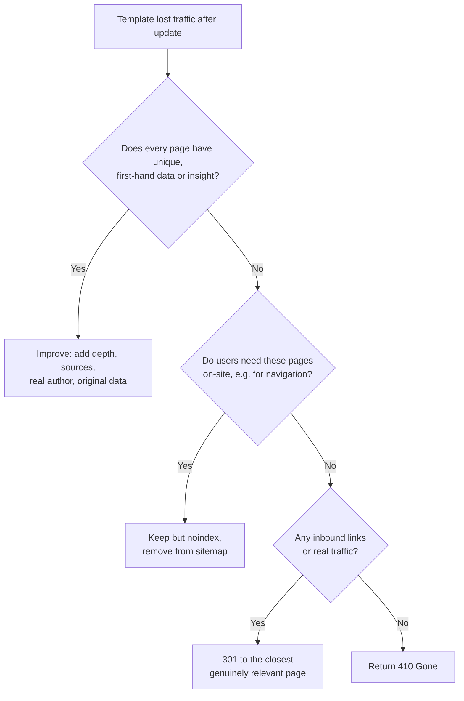

# Google Spam Update Recovery: A Developer's Audit Playbook

Google's September 2026 spam update started rolling out on September 24 at 9:15 a.m. Pacific, and by most trackers' accounts it wrapped up around October 8. If your organic traffic fell off a ledge somewhere in that window, you've probably already read three or four explainers telling you to "audit your content" and "focus on quality."

Great advice. Also completely useless at 11 p.m. when you're staring at a Search Console graph and a codebase with 40,000 generated pages.

Here's the thing: spam updates punish *patterns*, and patterns live in your code. Templates, route handlers, sitemap generators, CMS fields. That makes Google spam update recovery a developer problem as much as an editorial one. This playbook shows you how to find the damage by URL template, decide what to fix, noindex, or delete, and ship the changes without making things worse.

## What the September 2026 Spam Update Actually Told Us (And What It Didn't)

Let's start with honesty, because a lot of posts skip it. Google's dashboard entry for this update didn't say what it targeted. It was logged as global and applying to all languages, and that's about it. Anyone telling you exactly which signal moved is inferring, not reporting.

What we do know is useful context:

- It was the fourth announced spam update of 2026, after March (about 19.5 hours), June (just over two days), and August (two days and 16 hours), according to [Coalition Technologies' tracking](https://coalitiontechnologies.com/blog/will-another-google-core-update-coming-after-the-september-2026-spam-update).
- Google said this one could take up to two weeks. That's a much longer window than the earlier 2026 spam updates.
- Google published no new spam policies alongside it. Read it as refined detection of existing policies, not a new rulebook.

The best evidence for *what kind* of sites get hit comes from the previous round. Glenn Gabe's [August 2026 spam update case studies](https://gsqi.com/marketing-blog/august-2026-google-spam-update-case-studies/) described sites losing 14,000 to 200,000+ queries, with a recurring combination: massive programmatic scaling plus large blocks of AI-generated text. One product-info site had about 85% of its 1.5 million indexed URLs sitting in a programmatic section, and the drop spread across the whole site rather than staying in one folder.

That last detail matters. And Google's own John Mueller said something similar on September 7, as [reported by TechWyse](https://www.techwyse.com/news/search-seo/google-john-mueller-programmatic-seo-site-trust-recovery): when a site is built from generated pages, Google's systems may "possibly lose faith" in the site as a whole, and regaining trust "tends to take time and significant effort." He was talking about one specific setup (pages generated from combinations of domain names, technologies, and attributes), not all programmatic SEO. But the principle travels.

## Step 1: Rule Out the Boring Causes First

Before you blame the spam update, spend an hour eliminating the explanations that are actually your fault. In practice, a surprising number of "spam update drops" turn out to be a deploy.

1. **Check the Manual Actions report.** Algorithmic demotions don't show up here and have no reconsideration form. A manual action does, and it comes with an explanation. If it's empty, move on.
2. **Check what you shipped.** Compare the drop date against your release log: new templates, canonical changes, redirect rules, robots.txt edits, a sitemap rebuild. If you've set up [SEO regression testing in CI](/blog/seo-regression-testing-2026-ci-guardrails-ai-code/), this is a five-minute lookup instead of an archaeology project.
3. **Compare year over year, not week over week.** Seasonality fools everyone. And as we covered in [Search Console anomalies and year-over-year reporting](/blog/search-console-anomalies-2026-year-over-year-reporting/), 2026 comparisons come with their own data quirks.
4. **Look at the shape of the drop.** A step change that lines up with the rollout and clusters by page type smells algorithmic. A gradual slide smells like decay or competition.

If those four come back clean, you're probably dealing with a quality-system reassessment. Now the real work starts.

## Step 2: Segment by URL Template, Not by Page

Here's the mistake I see most often: people open the Performance report, sort by clicks lost, and start rewriting the top 50 pages. That's the wrong unit of analysis.

Spam systems judge sites and sections, not individual URLs. Your unit should be the **template**: the route pattern that generated the page. `/tools/[slug]`, `/compare/[a]-vs-[b]`, `/city/[name]/plumbers`, `/glossary/[term]`.

The cleanest way to do this at scale is the Search Console bulk export to BigQuery. If you haven't set that up, our [GSC BigQuery SQL cookbook](/blog/gsc-bigquery-sql-cookbook-cannibalization-decay-striking-distance/) walks through the schema. Once it's flowing, bucket URLs by template and compare the two weeks before September 24 to the two weeks after the rollout ended:

```sql
-- Impressions and clicks by URL template, before vs. after the update
WITH bucketed AS (
  SELECT
    data_date,
    CASE
      WHEN REGEXP_CONTAINS(url, r'^https://example\.com/compare/') THEN 'compare'
      WHEN REGEXP_CONTAINS(url, r'^https://example\.com/glossary/') THEN 'glossary'
      WHEN REGEXP_CONTAINS(url, r'^https://example\.com/city/')     THEN 'city-landing'
      WHEN REGEXP_CONTAINS(url, r'^https://example\.com/blog/')     THEN 'blog'
      ELSE 'other'
    END AS template,
    SUM(impressions) AS impressions,
    SUM(clicks)      AS clicks
  FROM `project.searchconsole.searchdata_url_impression`
  WHERE search_type = 'WEB'
    AND data_date BETWEEN '2026-09-10' AND '2026-10-22'
  GROUP BY 1, 2
)
SELECT
  template,
  SUM(IF(data_date BETWEEN '2026-09-10' AND '2026-09-23', clicks, 0)) AS clicks_before,
  SUM(IF(data_date BETWEEN '2026-10-09' AND '2026-10-22', clicks, 0)) AS clicks_after,
  SAFE_DIVIDE(
    SUM(IF(data_date BETWEEN '2026-10-09' AND '2026-10-22', clicks, 0)),
    SUM(IF(data_date BETWEEN '2026-09-10' AND '2026-09-23', clicks, 0))
  ) - 1 AS pct_change
FROM bucketed
GROUP BY template
ORDER BY pct_change;
```

Adjust the dates once the Search Status Dashboard confirms the rollout is complete, and use the same query set on both sides. If one template lost 70% while your editorial blog is flat, you've found your problem. And you've found it in an afternoon.

Server logs are your second lens. [Your server logs reveal things Search Console can't](/blog/server-log-analysis-seo-2026-what-search-console-misses/), and one of them is whether Googlebot has quietly reduced its crawl rate on a template it no longer trusts.

## Step 3: Score Each Template Against Google's Actual Policies

Now take the losing templates and hold them up against Google's [spam policies](https://developers.google.com/search/docs/essentials/spam-policies). Three are most relevant for developer-built sites.

**Scaled content abuse.** Google defines it as many pages generated for the primary purpose of manipulating rankings, including using generative AI tools to produce many pages without adding value for users. Notice the test: it's *purpose*, not volume and not whether AI was involved. A 10,000-page documentation site with genuinely distinct content is fine. A 10,000-page site where each page swaps a city name into the same paragraph is not.

**Site reputation abuse.** Third-party content published on your domain mainly to borrow your ranking signals. If you run a `/partners/` or `/coupons/` section written by someone else, audit it.

**Expired domain abuse.** Buying an old domain and repurposing it to rank. If your site's history includes an acquisition or domain consolidation, check that the content actually relates to what the domain was before.

For each losing template, ask a blunt question: *If I deleted this template tomorrow, would a real user lose anything they can't get from the top three results?* Be honest. This is where the Gabe case studies are instructive. Affiliate category pages built from the same product-feed data, some without product images, and "a photo plus information available elsewhere" pages are what got flagged.

## Step 4: The Fix-or-Remove Decision Tree

You have three tools: improve, noindex, or delete. The mistake is reaching for "improve" on everything, because adding more generated text to a thin template doesn't fix the underlying problem. Mueller was explicit about that.



Google's own spam documentation says that if you host scaled content you don't want ranking, you should exclude it from Search. That's your permission slip to noindex.

Here's a Next.js (App Router) pattern that does it at the template level, so it's one change instead of 40,000:

```ts
// app/compare/[pair]/page.tsx
import type { Metadata } from 'next';
import { getComparison } from '@/lib/comparisons';

export async function generateMetadata({ params }: { params: { pair: string } }): Promise<Metadata> {
  const data = await getComparison(params.pair);

  // Only index pages with real, distinct substance.
  const isSubstantive =
    data !== null &&
    data.editorialSummary.length > 600 &&   // human-reviewed text, not boilerplate
    data.uniqueDataPoints >= 5;             // first-party data, benchmarks, test results

  return {
    title: data?.title,
    robots: isSubstantive
      ? { index: true, follow: true }
      : { index: false, follow: true },
  };
}
```

And your sitemap generator should mirror the same rule, otherwise you're sending Google contradictory signals:

```ts
// app/sitemap.ts
import { getAllComparisons } from '@/lib/comparisons';

export default async function sitemap() {
  const all = await getAllComparisons();
  return all
    .filter((c) => c.editorialSummary.length > 600 && c.uniqueDataPoints >= 5)
    .map((c) => ({
      url: `https://example.com/compare/${c.slug}`,
      lastModified: c.reviewedAt, // only change when a human actually reviewed it
    }));
}
```

That `lastModified` comment is not decoration. Faking freshness is its own kind of low-trust signal. If your pipeline is also stamping dates on revalidation, the cache pitfalls that serve stale pages to Googlebot are worth a read before you redeploy: see [our Cloudflare Workers cache guide](/blog/cloudflare-workers-cache-2026-seo-cache-key-risk/).

Use a shared predicate (one function, imported by metadata, sitemap, and internal-link components) so the three can't drift apart.

## SEO & Search Implications: Why This Hits Your AI Visibility Too

One more reason not to treat this as a pure rankings story. The August case studies noted that affected sites also lost visibility in AI Overviews and AI Mode, and that content grounded through Google in ChatGPT can decline as well. If your template pages were feeding AI answers, a spam demotion can quietly shrink that exposure.

The flip side is a quiet opportunity. The pages that survive a purge are the ones with something citable: original numbers, named authors, clear sourcing. If you're already thinking about [author entity signals for AI-written drafts](/blog/author-entity-seo-2026-ai-written-content-bylines/), this is the moment to apply them to your surviving templates rather than your doomed ones.

## Step 5: Ship Safely, Then Wait (Yes, Really)

Deployment hygiene matters more than usual here, because a botched cleanup creates a second incident on top of the first.

- **Stage the change by template.** Noindex one template, watch the Page Indexing report, then move to the next. Mass changes make it impossible to attribute what helped.
- **Never block with robots.txt what you want de-indexed.** A disallowed URL can't be crawled, so Google never sees your `noindex`. Let it crawl, let it see the tag.
- **Keep a changelog with dates.** You'll need it to separate your fixes from the next core update. Google's last core update started May 21, and with seven ranking updates announced in 2026 through September (versus four in all of 2025, per Coalition's count), overlapping signals are the norm now.
- **Measure on a schedule, not on a whim.** Compare the two weeks after the dashboard marks completion against the two weeks before September 24, using the same queries.

And then the hard part: patience. Recovery from spam-related demotions is measured in months. Gabe cites a five-month example. Google's guidance for algorithmic actions offers no reconsideration shortcut. Daily ranking checks during this period are a way to stay anxious, not a way to get information.

## Common Mistakes That Make Recovery Slower

**Rewriting with another LLM pass.** If the problem is that the page exists for rankings rather than for users, regenerating the body text changes nothing that matters.

**Deleting everything in a panic.** Pages with real traffic, real backlinks, or real conversions deserve a deliberate decision, not a purge. Redirect only to genuinely relevant destinations, never to the homepage as a catch-all.

**Disavowing links as a reflex.** Unless the Gabe-style diagnosis points to link spam, cleaning links won't restore anything. Most 2026 cases he reviewed were content-policy problems.

**Changing everything at once.** Leave your strong pages, schema, and internal linking alone unless you find a specific defect. Collateral edits just muddy the data.

**Ignoring the preventive layer.** The cheapest fix is a guardrail. A CI check that fails the build when a new template ships with under N words of unique content, or when a sitemap includes a noindexed URL, prevents the next incident. That's the same idea behind our [AGENTS.md SEO rule-pack](/blog/agents-md-seo-rule-pack-2026/), applied to the content-quality side.

## Conclusion

Google spam update recovery isn't mysterious once you stop treating it as a content problem you can solve by staring at individual pages. It's a pattern-detection problem, and patterns have addresses in your codebase. Segment by template. Score each against Google's actual policies. Then improve, noindex, or remove with a single shared rule instead of thousands of one-off edits.

Be honest about what's unknown: Google didn't say what this update targeted, and no one outside Google can promise a recovery timeline. What you *can* control is whether every page you ask Google to index earns its place. Do that, document it, and let the next rollout find a cleaner site than the last one did.

## FAQ

### How long does Google spam update recovery take?
There's no official timeline. Google has said recovery can take months after significant changes, and published case studies cite examples around five months. Algorithmic demotions also have no reconsideration request, so improvements are simply reassessed over time.

### Is all programmatic SEO considered spam?
No. Google's policy tests *purpose* and *value to users*, not whether pages are generated by code. Mueller's recent comments addressed one specific setup of low-value pages built from attribute combinations. Programmatic pages with genuinely unique data and clear utility remain legitimate.

### Should I noindex or delete thin template pages?
If users still need the pages for on-site navigation, noindex them and remove them from your sitemap. If they have no users, no links, and no value, return 410. If they have backlinks or traffic, 301 them to the closest genuinely relevant page.

### Can I check whether I was hit by the spam update or a manual action?
Open the Manual Actions report in Search Console. A manual action appears there with an explanation. An algorithmic spam demotion won't, so you identify it by a step-change in the Performance report that lines up with the rollout and clusters by page template.

### Does a spam update affect AI Overviews visibility?
Published case studies from the August 2026 update reported that affected sites also lost visibility in AI Overviews and AI Mode, so it's worth tracking AI-surface citations alongside classic rankings.

```json
{
  "@context": "https://schema.org",
  "@type": "BlogPosting",
  "headline": "Google Spam Update Recovery: A Developer's Audit Playbook",
  "description": "Google spam update recovery for developers: segment Search Console data by URL template, find scaled-content risk in your programmatic pages, and fix it with code.",
  "datePublished": "2026-10-13",
  "dateModified": "2026-10-13",
  "keywords": "Technical SEO, Spam Update, Programmatic SEO, Scaled Content Abuse, Google Search Console, Web Development"
}
```
