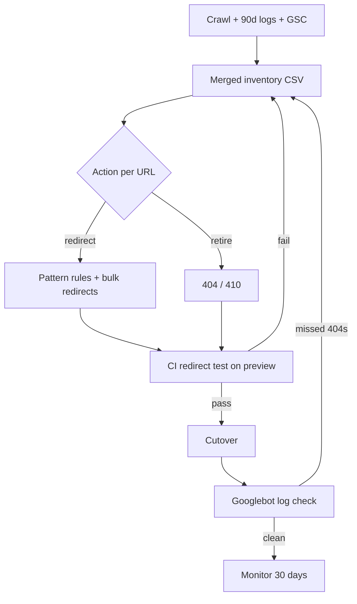

# Site Migration Redirect Map: Test It in CI and Logs

Every replatform story ends the same way. The new site looks gorgeous, Core Web Vitals are green, the team celebrates on Friday. By the following Wednesday, Search Console shows a cliff. Thousands of old URLs return 404, a handful loop forever, and a chunk of your best blog posts now redirect to the homepage, which Google quietly treats as a soft 404.

Nobody was careless. The **site migration redirect map** existed. It was a spreadsheet, reviewed by three people, and it looked fine. The problem is that a spreadsheet is a *claim* about how your server behaves, not proof of it.

This guide treats the redirect map as what it really is: code that needs tests. We'll build the map from three data sources, ship it on Next.js and Vercel without hitting platform limits, write a CI test that fails the build on bad redirects, and then verify in real server logs that Googlebot actually sees what you intended.

## Why Redirect Maps Fail (Even Good Ones)

Google's own documentation on site moves with URL changes is blunt about the fundamentals. Map each old URL to its closest relevant new page, use server-side permanent redirects (301 or 308), avoid chains, and keep the redirects for at least a year, longer if you can. It also warns against dumping many URLs onto one unrelated page, because that can be treated as a soft 404.

Most teams know all of that. They still fail, and the reasons are boring:

- **The inventory was incomplete.** The map covers what was in the sitemap, not what actually earned traffic and links.
- **Normalization drifted.** The old site served `/Pricing/` and the new one serves `/pricing`. The map lists one form; real traffic arrives in four.
- **Rules interact.** A trailing-slash rule, a locale rule, and a legacy redirect combine into a three-hop chain nobody designed.
- **Nobody re-tested after launch.** A later deploy changes routing and quietly breaks forty rules.

If you've read our piece on [SEO regression testing in CI](/seo-regression-testing-2026-ci-guardrails-ai-code/), this will feel familiar. Redirects are the highest-stakes SEO behavior in a migration, and they're also the easiest to test automatically.

## Step 1: Build the Inventory From Three Sources, Not One

A sitemap lists the URLs you *want* indexed. It says nothing about URLs that earn clicks or backlinks today. Google's guidance suggests building your mapping from sitemaps, server logs, analytics, and your CMS. In practice, three sources catch almost everything:

1. **Crawl output** (Screaming Frog, Sitebulb, or your own crawler): every URL reachable from internal links, including images, PDFs, and CSS/JS.
2. **90 days of server or CDN logs**: every URL that real users and bots actually requested, including legacy query-string URLs and old campaign links.
3. **Search Console and backlink exports**: URLs with impressions, clicks, or external links, even if they're orphaned.

Merge them into one table and keep a few columns that matter later:

```csv
old_path,source,hits_90d,gsc_clicks_90d,ref_domains,action,new_path
/blog/2019/04/seo-basics/,crawl+logs,1840,212,37,redirect,/blog/seo-basics
/old-promo?utm_source=fb,logs,95,0,0,redirect,/
/tag/misc/,crawl,3,0,0,gone,
```

Notice the `action` column. Not everything deserves a redirect. Content you're retiring should return a deliberate **410 or 404**, and Google says the same: return 404 or 410 for content you aren't moving. Redirecting a dead tag page to the homepage is worse than letting it die.

Sort by `hits_90d + clicks + ref_domains`. The top 5% of that list gets hand-reviewed. The long tail gets pattern rules. This single sort is the best prioritization trick in any migration.

## Step 2: Choose Where the Redirects Live

On a headless or JavaScript-framework stack, redirects can live in the framework config, at the CDN, or in a middleware/proxy layer. The right answer depends on count and complexity. Here's how it breaks down on Next.js and Vercel, using current documentation:

| Approach | Good for | Hard limit / catch |
|---|---|---|
| `redirects()` in `next.config.js` | Pattern rules (`/old-blog/:slug` to `/news/:slug`), wildcards, `has`/`missing` conditions | Vercel caps configuration redirects at **2,048** entries |
| Vercel Bulk Redirects | Thousands of exact path-to-path moves | No wildcard or header matching; Pro includes 1,000, Enterprise 10,000, up to **1,000,000** per project |
| Middleware / proxy + edge data | Huge or dynamic maps, CMS-driven redirects | You own latency, caching, and correctness |

Two details trip people up. First, in Next.js, `permanent: true` produces a **308**, and `permanent: false` produces a **307**. Both 301 and 308 are permanent redirects as far as Google is concerned, so 308 is fine for SEO. Just don't leave `permanent` unset, because a 307 tells crawlers the move is temporary.

Second, Vercel's Bulk Redirects default to `permanent: false` and a 307. If you import ten thousand redirects from a CSV and forget the flag, you've shipped ten thousand temporary redirects. Set it explicitly:

```jsonl
{"source":"/blog/2019/04/seo-basics","destination":"/blog/seo-basics","permanent":true}
{"source":"/Pricing","destination":"/pricing","permanent":true,"caseSensitive":false}
```

A sane architecture for most replatforms: pattern rules in `next.config.js`, exact one-to-one moves in bulk redirects (or an edge store if you're not on Vercel), and nothing else. If you're on Cloudflare, the same split applies with Redirect Rules for patterns and a list for exact matches. For the edge side of this, see our guide to [edge SEO with Cloudflare Workers](/cloudflare-workers-cache-2026-seo-cache-key-risk/).

## Step 3: Write the Redirect Test Suite

Here's the mindset shift. Your map is data, so test it like data. Every row asserts three things: the old URL returns a single permanent redirect, the `Location` header equals the expected destination, and the destination returns 200 with a self-referencing canonical and no stray `noindex`.

A minimal Node script (Node 20+) does the job. Run it against the preview deployment in CI:

```js
// scripts/test-redirects.mjs
import { readFileSync } from 'node:fs';
import { parse } from 'csv-parse/sync';

const BASE = process.env.BASE_URL;            // preview deployment URL
const rows = parse(readFileSync('redirect-map.csv'), { columns: true })
  .filter(r => r.action === 'redirect');

const PERMANENT = new Set([301, 308]);
const failures = [];

async function hop(url) {
  const res = await fetch(url, { redirect: 'manual' });
  return { status: res.status, location: res.headers.get('location') };
}

for (const row of rows) {
  const start = new URL(row.old_path, BASE).toString();
  const first = await hop(start);

  if (!PERMANENT.has(first.status)) {
    failures.push(`${row.old_path}: expected 301/308, got ${first.status}`);
    continue;
  }

  const target = new URL(first.location, BASE);
  const expected = new URL(row.new_path, BASE);
  if (target.pathname !== expected.pathname) {
    failures.push(`${row.old_path}: went to ${target.pathname}, expected ${expected.pathname}`);
    continue;
  }

  // One hop only: the destination must resolve directly.
  const final = await fetch(target, { redirect: 'manual' });
  if (final.status !== 200) {
    failures.push(`${row.old_path}: destination returned ${final.status} (chain or broken target)`);
    continue;
  }

  const html = await final.text();
  const canonical = html.match(/<link[^>]+rel="canonical"[^>]+href="([^"]+)"/i)?.[1];
  if (canonical && new URL(canonical, BASE).pathname !== target.pathname) {
    failures.push(`${row.old_path}: canonical points to ${canonical}, not the redirect target`);
  }
  if (/<meta[^>]+name="robots"[^>]+noindex/i.test(html)) {
    failures.push(`${row.old_path}: destination has noindex`);
  }
}

if (failures.length) {
  console.error(failures.join('\n'));
  process.exit(1);
}
console.log(`OK: ${rows.length} redirects verified`);
```

Add a second small test for the rows marked `gone`: they should return 404 or 410, never 200 and never a redirect. Then wire it into your pipeline as a required check:

```yaml
# .github/workflows/redirects.yml
name: redirect-map
on: [pull_request]
jobs:
  test:
    runs-on: ubuntu-latest
    steps:
      - uses: actions/checkout@v4
      - uses: actions/setup-node@v4
        with: { node-version: 22 }
      - run: npm ci
      - run: node scripts/test-redirects.mjs
        env:
          BASE_URL: ${{ vars.PREVIEW_URL }}
```

Run it with limited concurrency if your list is large, since a preview environment can rate-limit you. Ten thousand sequential requests is slow but fine for a nightly job; for pull requests, sample the top 500 rows by traffic plus every row touched in the diff.

## Step 4: Test the Cases a Spreadsheet Never Lists

The map covers URLs. Real traffic arrives in *variants*. Add a small fixture list that hits the normalization edge cases:

- Trailing slash and no trailing slash
- Uppercase paths (`/Pricing` vs `/pricing`)
- `http://` and `www.` variants of the old domain, if the domain is changing
- Query strings: tracking parameters should survive or be dropped *consistently*
- Locale prefixes, if you have hreflang alternates
- Encoded characters and double slashes

The goal is that every variant reaches the final URL in a single hop. Google says to keep chains to no more than three hops and fewer than five at the outside, but the target for a migration is one. Each extra hop is latency for users and a wasted fetch for Googlebot.

Case sensitivity is worth a special mention. Vercel's bulk redirect `caseSensitive` flag defaults to false, which is usually what you want for legacy URLs. But your *destination* routes are probably case-sensitive. Test both.

## Step 5: Verify the Launch in Logs, Not Just Dashboards

CI proves the map works in a preview. It doesn't prove production behaves the same, and it can't tell you what Googlebot is actually doing. After cutover, logs are the ground truth. Search Console reports are sampled and delayed, which we covered in [server log analysis for SEO](/server-log-analysis-seo-2026-what-search-console-misses/).

Filter requests to verified Googlebot (reverse DNS or Google's published IP ranges, not just the user-agent string) and group by status code:

```bash
# Status distribution for Googlebot over the last 24h
awk '$0 ~ /Googlebot/ {print $9}' access.log | sort | uniq -c | sort -rn

# Top 404s Googlebot is hitting that are NOT in the redirect map
awk '$0 ~ /Googlebot/ && $9==404 {print $7}' access.log \
  | sort | uniq -c | sort -rn | head -50
```

Take that 404 list and diff it against the map. Anything with real hits that isn't in the map is a missed redirect, and the fix is usually a pattern rule rather than a single row. Anything returning a 200 for an old URL is a leak: the legacy path is still live and creating duplicates.

Expect crawl intensity to spike. Google warns that Googlebot crawls more heavily after a migration, and that insufficient server capacity is a classic failure mode. If your origin or edge function sits behind the redirects, watch response times as closely as status codes.

## What to Monitor for the First 30 Days

Keep it small and daily for the first two weeks:

1. **Googlebot 404 and 5xx counts** from logs, trended per day.
2. **Redirect hit counts per rule**, so you know which rules matter and which are dead weight.
3. **Search Console Page Indexing** report for new "Page with redirect" and "Soft 404" entries.
4. **Sitemap hygiene**: the new sitemap should list only final 200 URLs. Google suggests submitting it once redirects are live and keeping the old one temporarily to watch the transition.
5. **Top 50 revenue URLs**: rank and click tracking, daily.

Expect fluctuation. Google notes that ranking and visibility changes during a move are normal and usually settle. A steady decline past the first few weeks is not normal, and the logs will usually tell you why.

## Common Mistakes (That Pass Code Review)

**Shipping 307s as if they were 301s.** Framework defaults are temporary. Make `permanent: true` a lint rule or a CI assertion, which the test above already does.

**Redirecting everything unmatched to the homepage.** It feels safe. It's the exact pattern Google describes as risky for soft 404s. Return a real 404 or 410.

**Forgetting non-HTML assets.** PDFs, images, and downloadable files earn backlinks too. Put them in the crawl and the map.

**Leaving staging directives behind.** A stray `noindex` or a `Disallow: /` from the dev environment will undo everything. Test for it, as the script above does for `noindex`.

**Changing too many things at once.** Domain, URL structure, design, and CMS in one weekend means you can't attribute any loss. Google's advice is to change one thing at a time where you can.

**Treating the CMS as the source of truth for URLs.** In a headless setup, slugs can change after launch when an editor renames a page. Without a rule that auto-creates a redirect on slug change, you rebuild the problem six months later. Our look at [headless CMS SEO mistakes](/headless-cms-seo-mistakes-2026-indexing-fixes/) goes deeper, and if you use incremental regeneration, check [Next.js ISR revalidation pitfalls](/nextjs-isr-revalidation-seo-mistakes-stale-content-2026/) so old pages don't linger in cache.

## A Migration Flow You Can Reuse



The loop matters more than any single step. Logs feed the map, the map feeds the tests, and the tests protect you from the next deploy.

## Conclusion

A site migration redirect map isn't a deliverable you hand over and forget. It's a living contract between your old URLs and your new site, and the only way to know it holds is to test it. Build the inventory from crawl, logs, and Search Console. Put pattern rules in your framework config and exact moves in a bulk store, watching platform limits like Vercel's 2,048-entry cap. Fail the pull request when a redirect is temporary, chained, or lands on a noindexed page. Then confirm in production logs what Googlebot actually receives.

None of this guarantees your rankings survive. Nothing can. But it turns the scariest weekend in a site's life into a checklist with a pass/fail result, which is the best deal in technical SEO.

## FAQ

**Should I use 301 or 308 for a migration?**
Both are permanent. Frameworks like Next.js emit 308 when you set `permanent: true`, which also preserves the request method. Either is fine for SEO; what matters is that it isn't a 307 or 302.

**How long should I keep the redirects?**
Google's guidance is at least a year, and longer if you can afford it. Users with old bookmarks and sites with old links benefit indefinitely.

**What if I have more than 2,048 redirects on Vercel?**
Use Bulk Redirects for exact path-to-path moves, or move the logic into middleware that reads from an edge data store. Keep wildcard rules in config.

**Can I redirect retired pages to the homepage?**
You can, but Google may treat mass redirects to an unrelated page as soft 404s. Return 404 or 410 for content with no true equivalent.

**How do I know Googlebot sees my redirects?**
Check your server or CDN logs for verified Googlebot requests and compare status codes against your map. Search Console is useful but delayed.

```json
{
  "@context": "https://schema.org",
  "@type": "BlogPosting",
  "headline": "Site Migration Redirect Map: Test It in CI and Logs",
  "description": "Your site migration redirect map is only as good as your tests. Learn how to validate it in CI, ship it on Next.js or Vercel, and verify it in logs.",
  "datePublished": "2026-10-14",
  "dateModified": "2026-10-14",
  "keywords": "SEO, Web Development, Developer Tools, JavaScript, Technical SEO, Site Migration, Redirects"
}
```
