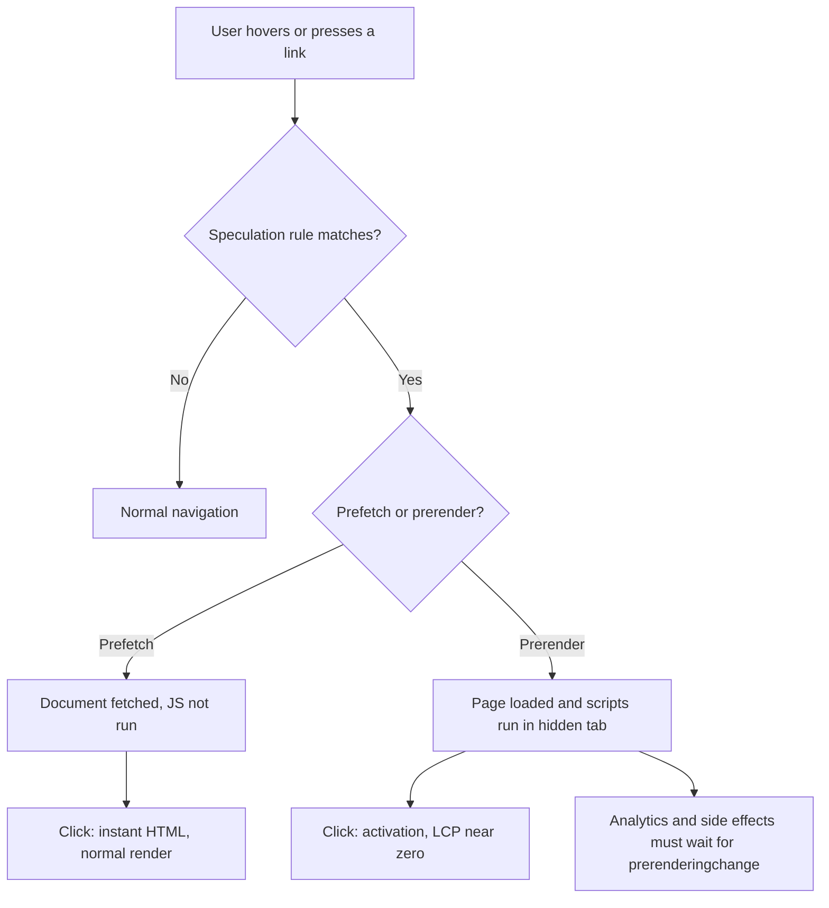

# Speculation Rules SEO: Faster Pages, Messier Data in 2026

Add twelve lines of JSON to your `<head>` and your next page can open in what feels like zero milliseconds. That's the pitch of the Speculation Rules API, and for once the pitch is mostly true. The catch nobody mentions in the "make your site instant" tutorials: the same twelve lines quietly change your Core Web Vitals field data, inflate your pageviews, and pollute your server logs.

If you care about organic performance, that's a Speculation Rules SEO problem, not just a frontend trick. Let's look at what the API actually does, where the SEO upside is real, and the data-quality traps you need to close before you flip the switch.

## What Speculation Rules Actually Do

Speculation Rules let a page tell Chromium: "the user will probably go *here* next, get ready." You declare that in a `<script type="speculationrules">` block (or a `Speculation-Rules` HTTP header), and the browser does one of two things.

**Prefetch** downloads the next document and holds it in memory. It doesn't render it and doesn't run its JavaScript. **Prerender** goes all the way: it loads the page in a hidden tab, runs the scripts, and swaps it in on click. According to Chrome's documentation, prerendering returned in Chrome 108, and today's version is a much more controlled beast than the old `<link rel="prerender">`.

You control how aggressive it is with `eagerness`:

- `conservative`: fires on pointer or touch down
- `moderate`: fires after roughly 200 ms of hover on desktop
- `eager`: fires after about 10 ms of hover (behavior changed in Chrome 143)
- `immediate`: fires as soon as the rules are parsed

Document rules default to `conservative`; list rules default to `immediate`. Chrome also caps speculation: `immediate` allows up to 50 prefetches and 10 prerenders, while the other three levels allow only two of each, first-in-first-out.

Support is Chromium-only. Chrome and Edge (109+) cover roughly 79% of global traffic per Can I Use, Firefox hasn't shipped it, and Safari's implementation sits behind a flag. Treat it as progressive enhancement, which is exactly how it behaves: no support, no harm.

## The Upside: Real Gains on Real Sites

The case studies are better than I expected. Ray-Ban prerendered product listing pages at `moderate` eagerness and cut mobile LCP from 4.69 s to 2.66 s, a 43% improvement. Shopify has run conservative prefetch site-wide since June 2025, with A/B tests showing 130 ms (desktop) and 180 ms (mobile) paint gains on average. Cloudflare reports a 45% LCP reduction on sites with successful Speed Brain prefetches.

CoreDash's field data shows the shape of it: prerendered navigations had a p75 LCP of 320 ms versus 1,800 ms for standard ones. But notice the other number from the same dataset: only about 28% of navigations on `moderate` sites were successfully prefetched or prerendered. Speculation helps the clicks it predicts. It does nothing for the rest.

That distinction matters for the next section.

## Speculation Rules SEO: What Actually Changes in Search

Here's where I'll be careful, because a lot of SEO content gets sloppy.

**Does Googlebot use Speculation Rules?** Neither Chrome's prerender documentation nor its implementation guide says anything about search crawlers, and I couldn't find Google documentation stating that Googlebot acts on them. Googlebot fetches and renders pages to index them; it isn't a human clicking around, so there's no "next click" to predict. My working assumption, and it's an inference rather than a documented fact, is that speculation rules neither help nor hurt crawling directly. Verify it in your own logs (more below).

**So where's the SEO value?** It's indirect, through user experience and field data.

Core Web Vitals in Chrome are measured from the moment of *activation* for a prerendered page, which is why prerendered navigations show near-zero LCP. Because Core Web Vitals field data comes from real Chrome users, a site where a decent share of navigations are speculated can see its CrUX distribution shift. That's good for your page experience signals. It's also, importantly, partly *synthetic* improvement: the page isn't magically lighter, it was just loaded before the user asked for it.

Two consequences:

1. **Your slowest pages stay slow for non-speculated visits.** Entry-from-search landings (the traffic SEO actually cares about) are never prerendered, because there's no previous page on your site to speculate from. Your landing-page LCP doesn't improve one bit.
2. **Your internal navigation gets better.** Depth of visit, pages per session, and return-to-SERP behavior can benefit when second and third pageviews feel instant. Treat that as plausible, not guaranteed. I can't point you to a study that isolates a ranking effect, and the sources I reviewed don't claim one.

In short: Speculation Rules are a genuine UX win and a modest, indirect SEO tailwind. Don't let anyone sell them as a ranking hack.

> [Core Web Vitals RUM in 2026: Build Your Own INP Pipeline](/core-web-vitals-rum-pipeline-2026-loaf-inp-attribution/)

## The Hidden Cost: Your Analytics Just Got Noisy

Prerendered pages execute JavaScript. Your analytics snippet runs, fires a pageview, and the user may never actually see that page.

Google Analytics and Google Publisher Tags handle this automatically, but the rest of your stack probably doesn't: that custom event tracker, the A/B testing SDK, the heatmap tool, the "recently viewed" API call. Sentry's engineering write-up lists the failure modes well: inflated pageviews and conversions, skewed experiments because variants are assigned on prerender, expired auth tokens by the time of activation, and render-time side effects like inventory holds firing for pages nobody opened.

The fix is a pattern you should copy into every tracker:

```js
function onActivated(fn) {
  if (document.prerendering) {
    document.addEventListener('prerenderingchange', fn, { once: true });
  } else {
    fn();
  }
}

onActivated(() => {
  // pageview, experiment assignment, impression beacons
  trackPageview(location.pathname);
});
```

Note that `prerenderingchange` only covers prerender. Plain prefetch doesn't execute JS, so it doesn't fire your tags, but it *does* hit your server, which brings us to logs.

> [The GA4 Blind Spot: Why AI Browsers and WebMCP Break Your Tracking](/ga4-blind-spot-ai-browsers-webmcp-tracking-2026/)

## The Other Hidden Cost: Server Logs and Crawl Analysis

If you do log-file analysis (and for technical SEO you should), speculation changes what a "request" means.

A prefetch or prerender request is a real GET to your origin. It carries the `Sec-Purpose: prefetch;prerender` header (prefetch-only requests carry `prefetch`), so you can identify it, but your default log format probably doesn't record that header. Result: your logs show a jump in human-browser traffic hitting URLs that no one actually visited. If you're using logs to estimate which pages users (or bots) care about, those hits are noise.

Three actions:

- Add `Sec-Purpose` to your access log format at the CDN or web server.
- Segment speculative requests out before computing any "most requested URL" report.
- Watch for the opposite problem as well: if you ever see Googlebot user-agent requests carrying that header, that's worth a screenshot and a post, because it'd contradict the current documentation.

Servers can also refuse speculation. Chrome treats any non-2xx response as a failed prerender (204 and 205 are not valid for prerendering), so returning a 4xx/5xx or a 403 for `Sec-Purpose` requests on expensive routes is a legitimate throttle. Cloudflare's Speed Brain takes a different route, only allowing speculations for content that's already cached at the edge so the request never reaches your origin.

> [9 Things Your Server Logs Reveal That Search Console Can't](/server-log-analysis-seo-2026-what-search-console-misses/)

## A Safe Starter Config

Start conservative. This rule prefetches internal links on pointer-down and excludes nofollow links and stateful paths:

```html
<script type="speculationrules">
{
  "prefetch": [{
    "source": "document",
    "where": {
      "and": [
        { "href_matches": "/*" },
        { "not": { "href_matches": ["/cart*", "/checkout*", "/account*", "/logout", "/api/*"] } },
        { "not": { "selector_matches": "a[rel~='nofollow']" } },
        { "not": { "selector_matches": "[data-no-prefetch]" } }
      ]
    },
    "eagerness": "conservative"
  }]
}
</script>
```

Once your data looks clean, add a small prerender rule for high-probability links only, say the primary CTA or "featured product" cards:

```html
<script type="speculationrules">
{
  "prerender": [{
    "source": "document",
    "where": { "selector_matches": "a[data-prerender]" },
    "eagerness": "moderate"
  }]
}
</script>
```

Two implementation notes from the docs. First, if you run a strict CSP, rules in the initial HTML aren't covered by the `inline-speculation-rules` source; you must inject them from a nonced or hashed script. Second, anything that changes state on GET (a `/logout` link is the classic) must be excluded, no exceptions.



## How to Measure Whether It Worked

Site-wide p75 metrics can hide the gain, so segment. The Chrome guide recommends watching CrUX for a rising share of `navigate_cache` and `prerender` navigation types, and splitting RUM data so speculated navigations are compared against the rest.

Use `performance.getEntriesByType('navigation')[0].activationStart` to flag prerendered-and-activated visits in your RUM beacon. Then track three numbers:

1. **Hit rate:** speculated URLs versus URLs actually visited. Low hit rate means wasted server work.
2. **LCP for activated versus non-activated navigations.** Expect a huge gap, and don't mistake it for page weight improving.
3. **Origin load:** requests with `Sec-Purpose` as a share of total traffic, especially around peak events.

## Common Mistakes

**Prerendering everything.** A page full of links on `eager` or `immediate` is a thundering herd of full SSR renders, and your origin pays for it. Start conservative, increase gradually.

**Ignoring logged-in state.** Prerendered pages can use current cookies; a short-lived token can expire before activation. Refresh your session on activation.

**Celebrating CrUX gains on landing pages.** They aren't prerendered. Your search-entry LCP is still a function of TTFB, image weight, and render-blocking resources. Fix those first.

**Treating this as a framework replacement.** Next.js and Nuxt already prefetch by default; SvelteKit and Remix need configuration. When both are active in Chromium, speculation rules take precedence and avoid duplicate fetches. They complement framework prefetching, covering Chromium's prerender, which framework `<Link>` prefetching doesn't do.

## Conclusion

Speculation Rules are one of the highest-leverage performance features shipped in years, and the field-data gains from Ray-Ban, Shopify, and Cloudflare make a solid case for using them. But treat them as what they are: a way to make *internal navigation* feel instant, with an indirect SEO benefit and a real data-hygiene bill attached.

Ship the conservative prefetch config, make every tracker prerender-aware, log `Sec-Purpose`, and measure before you escalate to prerender. Do that and you get the speed without the Speculation Rules SEO headaches: inflated pageviews, polluted logs, and a CrUX report you can't fully explain.

## FAQ

### Do Speculation Rules improve rankings directly?
No source I reviewed claims a direct ranking effect. The benefit is indirect, through faster internal navigation and better field data for Chrome users.

### Does Googlebot follow Speculation Rules?
Google hasn't documented that it does. Check your logs for `Sec-Purpose` headers on Googlebot requests to confirm for your own site.

### Prefetch or prerender?
Prefetch is cheaper and safe for most links. Prerender is for a handful of high-probability destinations.

### Will it break Google Analytics?
GA handles prerendering automatically. Other scripts may not, so wrap them with `document.prerendering` checks.

### What about Safari and Firefox?
They don't support it, so those users get a normal navigation. Nothing breaks.

```json
{
  "@context": "https://schema.org",
  "@type": "BlogPosting",
  "headline": "Speculation Rules SEO: Faster Pages, Messier Data in 2026",
  "description": "Speculation Rules SEO guide: how prerender and prefetch change Core Web Vitals, analytics, and server logs, plus safe rules you can ship today.",
  "datePublished": "2026-10-16",
  "dateModified": "2026-10-16",
  "keywords": "Speculation Rules, Core Web Vitals, Technical SEO, Web Performance, Analytics, JavaScript"
}
```
