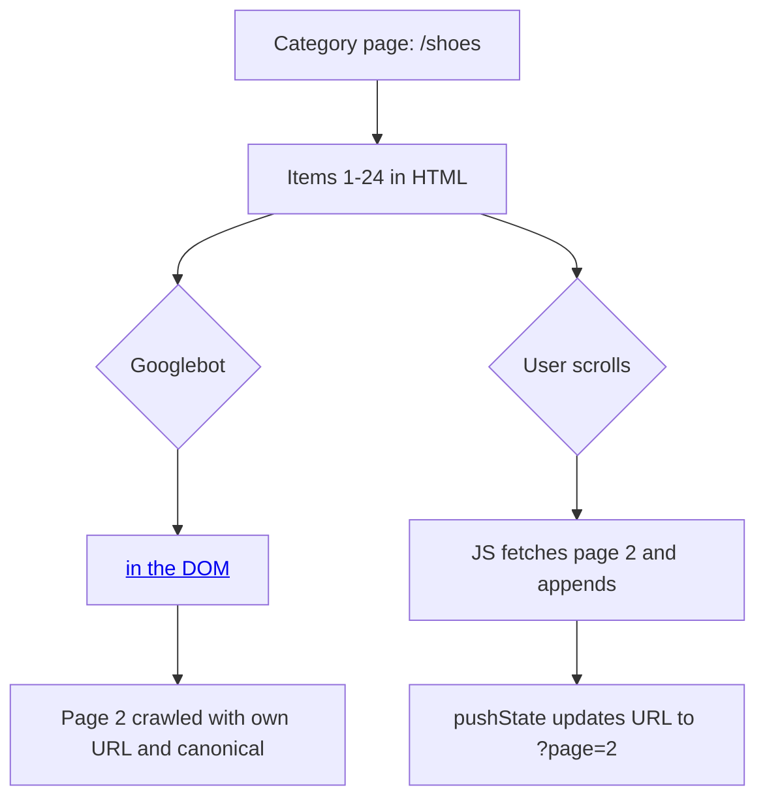

# Pagination vs Infinite Scroll SEO: A Developer's 2026 Fix Guide

Your category page looks fantastic. Smooth scroll, products sliding in as you go, not a single "Next" button in sight. Product managers love it. Users love it. And Googlebot? Googlebot may be quietly looking at the first dozen items and walking away.

That's the uncomfortable truth behind **pagination vs infinite scroll SEO**. The UX pattern you pick decides whether deep products, articles, and listings ever get discovered, indexed, and ranked. Get it wrong and your best long-tail pages become orphans nobody can reach, including crawlers.

The good news: you don't have to give up the smooth experience. You just need to build it on top of a crawlable foundation. In this guide you'll see what Google actually says (and what it doesn't), how to choose between pagination, load more, and infinite scroll, a working Next.js pattern, and a quick log check to prove it works.

## Why This Still Trips Teams Up in 2026

Infinite scroll is a front-end decision that quietly becomes an indexing decision. A developer swaps a paginated list for an `IntersectionObserver` that fetches more items. Nothing breaks in the browser. Rankings for deep products slowly sink weeks later, and nobody connects the two events.

Part of the confusion comes from outdated advice. Many guides still talk about `rel="next"` and `rel="prev"`, which Google's own documentation says it no longer uses to understand page relationships. Others skip the mechanics entirely. One popular short-form explainer, for example, covers the `pushState` idea but offers no framework code, no canonical guidance, and no way to verify crawling in logs. Another tool-driven post leans on unsourced statistics and contradicts itself on whether Googlebot executes JavaScript.

So let's ground this in what's documented, and flag clearly where it's inference.

## What Google Actually Says

Google's ecommerce documentation on pagination and incremental page loading is refreshingly concrete. The key points:

- Google generally crawls URLs found in the `href` attribute of `<a>` elements.
- Google's crawlers don't click buttons or trigger JavaScript that needs a user action. Content that only appears after a click or scroll interaction may never be found.
- Every page in a sequence needs its own unique URL, such as `?page=2`. Don't use URL fragments (`#page=2`) because Google ignores them.
- Don't use the first page of a sequence as the canonical for every page. Each page gets its own canonical URL.
- `rel="next"` and `rel="prev"` are no longer used by Google. Other search engines may still use them.
- Paginated pages can share the same title and description. Google tries to recognize the sequence.
- Link each page to the next, and link back to the first page.

On infinite scroll specifically, John Mueller said in a 2022 office-hours session that Google renders with a very tall viewport and that "whatever ends up being loaded there that would be what we would be able to index." He also noted Google might only capture a couple of "pages" worth of loaded content, and recommended checking with the URL Inspection tool.

Here's the catch. That's a 2022 comment, not a spec. Nobody outside Google can tell you exactly how many items a given render will trigger. So the safe engineering assumption is simple: **treat anything that requires scrolling or clicking as invisible until proven otherwise.**

## The Three Patterns Compared

| Pattern | Crawlable by default? | Best for | Main SEO risk |
|---|---|---|---|
| Classic pagination | Yes, if links are real `<a href>` | Large catalogs, archives, blogs | Weak internal links to deep pages |
| "Load more" button | Only the first batch, unless you add link fallbacks | Mid-size lists (a few hundred items) | Content behind a click is not discovered |
| Infinite scroll | Only what loads without interaction | Feeds, social-style browsing | Deep items orphaned entirely |

Google's own docs note that load more and infinite scroll can't handle very large result sets well, and that pagination gives users a clearer sense of result size and position. For SEO, pagination wins on predictability. For engagement, scroll patterns often feel better. The hybrid below gives you both.



## The Hybrid Pattern: Smooth for Users, Crawlable for Bots

The rule of thumb: **paginated URLs are the source of truth; infinite scroll is a progressive enhancement.** Every chunk of content must be reachable at a normal URL that returns server-rendered HTML with real links. The scroll behavior then layers on top.

Here's a minimal Next.js App Router version. The server component renders the current page and real pagination links:

```tsx
// app/shoes/page.tsx
import Link from "next/link";
import { getProducts } from "@/lib/products";

const PAGE_SIZE = 24;

export async function generateMetadata({ searchParams }) {
  const page = Math.max(1, Number((await searchParams).page ?? 1));
  const base = "https://example.com/shoes";
  return {
    title: page > 1 ? `Shoes - Page ${page}` : "Shoes",
    // Each page canonicalizes to ITSELF, never to page 1.
    alternates: { canonical: page > 1 ? `${base}?page=${page}` : base },
  };
}

export default async function ShoesPage({ searchParams }) {
  const page = Math.max(1, Number((await searchParams).page ?? 1));
  const { items, total } = await getProducts({ page, pageSize: PAGE_SIZE });
  const lastPage = Math.ceil(total / PAGE_SIZE);

  return (
    <>
      <ProductGrid items={items} />
      <nav aria-label="Pagination">
        {page > 1 && <Link href={page === 2 ? "/shoes" : `/shoes?page=${page - 1}`}>Previous</Link>}
        {page < lastPage && <Link href={`/shoes?page=${page + 1}`}>Next</Link>}
        <Link href="/shoes">First page</Link>
      </nav>
    </>
  );
}
```

Those are plain `<a href>` links in server-rendered HTML. No JavaScript required to discover page 2, 3, 4. If you've read our [JavaScript SEO guide for AI crawlers](/javascript-seo-ai-crawlers-react-nextjs-astro/), you know why this matters beyond Google: many AI crawlers don't execute JavaScript at all, so server-rendered links are your only shot with them.

Now the enhancement. A small client component watches a sentinel element, fetches the next page, and updates the URL as the user moves through content:

```tsx
"use client";
import { useEffect, useRef } from "react";

export function ScrollEnhancer({ nextPage, containerId }) {
  const sentinel = useRef(null);

  useEffect(() => {
    if (!nextPage) return;
    const io = new IntersectionObserver(async ([entry]) => {
      if (!entry.isIntersecting) return;
      io.disconnect();
      const res = await fetch(`/shoes?page=${nextPage}`, { headers: { "x-partial": "1" } });
      const html = await res.text();
      // ...parse and append items into #containerId...
      history.pushState({}, "", `/shoes?page=${nextPage}`);
    }, { rootMargin: "600px" });
    if (sentinel.current) io.observe(sentinel.current);
    return () => io.disconnect();
  }, [nextPage]);

  return <div ref={sentinel} aria-hidden="true" />;
}
```

A few details people miss. Keep the pagination `<nav>` in the DOM even when scroll is active (hide it visually if you must, but don't remove it). Make sure the footer is reachable, since endless feeds famously push it out of reach. And use `pushState` so that every state a user lands on has a shareable, crawlable URL. Google also suggests preload, preconnect, or prefetch to speed the jump to the next page, and prefetching `?page=2` is exactly that.

## SEO & Search Implications

This is where pagination decisions turn into ranking outcomes.

**Orphaned deep pages.** If product 300 is only reachable by scrolling past 299 others, it has no stable crawl path. Pages that crawlers can't reach get little or no organic traffic, and long-tail categories suffer most.

**Canonical mistakes.** Pointing every paginated URL's canonical to page 1 tells Google to treat the rest as duplicates. Items that only appear on those pages can fall out of consideration. Self-referencing canonicals are what Google documents.

**Noindex on page 2+.** Tempting, but risky. Pages marked noindex are eventually treated as not worth following, so you can lose the discovery path to the products listed on them. Save noindex for filter and sort variations, as Google's docs suggest, and handle those with the approach in our [faceted navigation guide](/faceted-navigation-seo-2026-crawl-budget-ecommerce/).

**Sitemaps as a safety net.** Google's docs point to sitemaps (or a Merchant Center feed) to help discover all products. List the product and article URLs themselves, not just the list pages.

**Core Web Vitals.** Infinite scroll can hurt performance if you never virtualize or cap the DOM. Thousands of nodes mean worse INP. See the [INP optimization guide](/inp-optimization-2026-developer-guide/) for the debugging workflow. Also reserve space for appended items to avoid layout shift.

**AI search.** Citation engines pull from pages they can actually fetch. Content behind scroll events is invisible to non-rendering bots, which is another argument for server-rendered, link-based pagination.

## Which Pattern Should You Choose?

Keep it practical:

- **Under roughly 50 items:** show everything on one page. No pagination needed.
- **Blogs, archives, and large catalogs:** classic pagination, with optional prefetch. It's predictable, measurable, and kind to crawlers.
- **Mid-size lists with an engagement goal:** hybrid load more, where the button is a real link (`<a href="?page=2">`) that JavaScript intercepts.
- **Feeds and social-style browsing:** infinite scroll with URL updates plus a paginated fallback and sitemap coverage.

Notice the pattern: every option ends with a real link. That's the whole trick.

## Common Mistakes to Avoid

1. **Fragment URLs.** `#page=2` never reaches the server and Google ignores fragments.
2. **Button-only load more.** A `<button onClick>` creates no crawlable URL. Use an anchor and enhance it.
3. **Canonical to page 1.** Self-reference instead.
4. **Relying on `rel="next"`.** Harmless, but Google doesn't use it. Don't treat it as your fix.
5. **Blocking the paginated parameter in robots.txt.** You'd cut off the very path you rely on.
6. **Soft 404s for out-of-range pages.** If `?page=999` doesn't exist, return a real 404 rather than an empty 200 page.
7. **Skipping verification.** Assuming it works is how deep pages disappear.

## How to Verify It Works

Don't trust the browser. Check three things.

First, run **URL Inspection** on `?page=2` and `?page=5`. Confirm the rendered HTML contains the items and the pagination links.

Second, fetch the raw HTML with JavaScript disabled:

```bash
curl -s "https://example.com/shoes?page=3" | grep -c 'href="/shoes?page='
```

If that returns zero, your links depend on JavaScript.

Third, check your server logs for verified Googlebot hits on deep pages (verification steps are in our [server log analysis guide](/server-log-analysis-seo-2026-what-search-console-misses/)):

```bash
grep "Googlebot" access.log | grep -E "page=[0-9]+" | awk '{print $7}' | sort | uniq -c | sort -rn | head -20
```

If Googlebot hits page 1 daily but rarely touches page 5 and beyond, your internal link structure is too shallow or too slow to follow. Consider adding links to a few deeper pages (for example, "pages 1, 2, 3, ... last"), or surfacing top items in curated hub pages. You can also bake the curl check into CI; the approach is covered in [SEO regression testing with CI guardrails](/seo-regression-testing-2026-ci-guardrails-ai-code/).

**Tool idea:** a small CLI that crawls a list page with JavaScript off, follows only `<a href>` links, and reports "reachable in N clicks" per item. It would flag exactly the orphaned-deep-page problem described above, and it's a weekend-sized build with Playwright plus a link graph.

## Conclusion

The **pagination vs infinite scroll SEO** debate isn't really about which pattern is better. It's about whether every piece of content has a real URL reachable through a real link. Build that foundation with server-rendered pagination, self-referencing canonicals, and sitemap coverage, then add scroll as an enhancement. You keep the smooth UX, and Googlebot (and AI crawlers) keep a path to your deep pages.

One caveat worth repeating: Google's comments on how much it renders for infinite scroll are loose and dated, so verify with URL Inspection and logs on your own site rather than relying on anyone's rule of thumb, including ours.

## FAQ

### Does Google still use rel="next" and rel="prev"?
No. Google's documentation states it no longer uses these tags to identify page relationships. Other search engines may still read them, so they're harmless but not a fix.

### Should paginated pages be noindexed?
Generally no. Noindex on page 2+ can weaken discovery of the items listed there. Use noindex or robots rules for filter and sort variations instead.

### Should every paginated page canonicalize to page 1?
No. Google's guidance is that each page in the sequence gets its own canonical URL.

### Can Googlebot crawl infinite scroll?
Partly. Google has said it renders with a tall viewport and indexes whatever loads, but may only capture limited content. Provide paginated URLs and links so nothing depends on scrolling.

### Do paginated pages need unique titles?
Not necessarily. Google says they can share titles and descriptions, though adding "Page N" helps users and is a common practice.

```json
{
  "@context": "https://schema.org",
  "@type": "BlogPosting",
  "headline": "Pagination vs Infinite Scroll SEO: A Developer's 2026 Fix Guide",
  "description": "Pagination vs infinite scroll SEO explained for developers: what Googlebot can actually crawl, plus crawlable load-more code for Next.js and a log check.",
  "datePublished": "2026-10-17",
  "dateModified": "2026-10-17",
  "keywords": "Pagination SEO, Infinite Scroll, Technical SEO, Crawlability, Next.js, JavaScript SEO"
}
```
