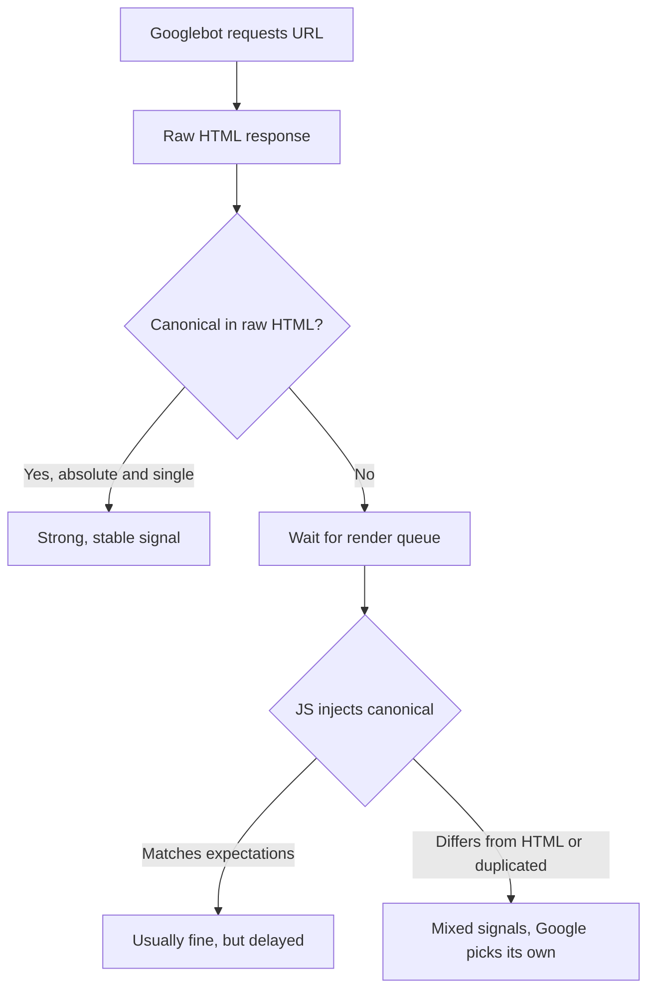

# Canonical Tags in Next.js and Astro: A 2026 Dev Guide

You shipped the redesign. Lighthouse is green, the pages are fast, and the content is better than ever. Three weeks later, Search Console starts filling up with "Duplicate, Google chose different canonical than user." Pages you care about are being folded into URLs you never meant to promote.

Welcome to the world of **canonical tags in JavaScript frameworks**. The tag itself is one line of HTML. Getting that one line to be correct, consistent, and present at the right moment in a modern React, Next.js, or Astro app is where things go sideways.

Most canonical guides were written for WordPress and Shopify. They explain what `rel="canonical"` is, then list the plugin settings to tick. This one is for developers who generate `<head>` tags with code, and for the SEOs who have to audit what that code actually produces.

## Why Canonicals Break More Often in Modern Stacks

A canonical tag tells Google which URL is the "main" version when several URLs show the same or very similar content. Google's own documentation calls `rel="canonical"` a strong signal and the preferred tool for handling duplicates. Redirects are also strong. Sitemap inclusion is only a weak hint.

Here's the catch. A strong signal is only as good as its consistency. Google weighs your canonical against everything else it sees: your redirects, your internal links, your sitemap, your hreflang clusters, and whether the page even looks like a duplicate of the target. If your framework contradicts itself, Google stops trusting any of it and picks a canonical on its own.

Traditional CMS sites rarely contradict themselves because one plugin owns the tag. Framework sites have many owners. A layout sets a default. A page overrides it. A component library injects another. A middleware rewrite changes the URL after the fact. Each is individually reasonable, and together they produce mixed signals.

That's why this belongs in your engineering checklist, not only the SEO audit. If you've read our piece on [how AI crawlers read React, Next.js, and Astro](/javascript-seo-ai-crawlers-react-nextjs-astro/), you already know that what your server sends and what a browser eventually builds are two different documents. Canonicals live right in that gap.

## The Rule Google Actually Gives You

Google's JavaScript SEO guidance is blunt: the best way to set the canonical URL is in HTML. If you must use JavaScript, the injected canonical should match the one in the original HTML. And keep one canonical tag only, because conflicting or multiple tags may lead to unexpected results.

Three practical consequences follow.

**First, the raw HTML is the source of truth.** Googlebot crawls first and renders later. Pages with a 200 status are queued for rendering, and the wait can range from seconds to much longer. Whatever canonical your server sends in the initial response is what Google has during that window.

**Second, never swap the canonical on the client.** A server-rendered `<link rel="canonical" href="/a">` that a script rewrites to `/b` after hydration is the classic mixed-signal bug. Google may see either one, depending on timing.

**Third, don't count on JavaScript to fix a bad `noindex` or a bad canonical.** Google notes that when it sees a `noindex`, it may skip rendering and JavaScript execution entirely. If your fix depends on a script running, it may never run.

The practical default: **render the canonical on the server, once, as an absolute URL, and leave it alone.**



## Setting Canonicals in Next.js (App Router)

In the App Router, the cleanest path is the Metadata API with `metadataBase` set once at the root. That gives you absolute URLs everywhere without hand-typing your domain on every page.

```ts
// app/layout.tsx
import type { Metadata } from "next";

export const metadata: Metadata = {
  metadataBase: new URL("https://www.example.com"),
};
```

```ts
// app/blog/[slug]/page.tsx
import type { Metadata } from "next";

export async function generateMetadata(
  { params }: { params: Promise<{ slug: string }> }
): Promise<Metadata> {
  const { slug } = await params;
  return {
    alternates: {
      canonical: `/blog/${slug}`,
    },
  };
}
```

That renders a single absolute `<link rel="canonical" href="https://www.example.com/blog/my-post" />` in the server response. No client JavaScript involved.

A few Next.js traps worth knowing:

- **Forgetting `metadataBase`.** Without it, relative values can resolve against the wrong origin, especially on preview deployments. Google supports relative canonicals but advises absolute ones, partly because a crawlable test site can end up declaring itself canonical.
- **Setting `alternates.canonical` in the root layout.** A layout-level canonical is inherited by every child route that doesn't override it. Suddenly, 4,000 pages all claim the homepage as canonical. Set it per route, not globally.
- **Canonicals that ignore query strings.** If `/shoes?sort=price` and `/shoes` render the same list, the canonical should point to `/shoes`. If the filter produces genuinely distinct content, it deserves its own strategy, which we cover in the [faceted navigation guide](/faceted-navigation-seo-2026-crawl-budget-ecommerce/).
- **Mixing ISR and dynamic params carelessly.** If a cached page was generated with the wrong host or path, it can keep serving the wrong canonical until revalidation. Our post on [Next.js ISR mistakes that serve stale pages](/nextjs-isr-revalidation-seo-mistakes-stale-content-2026/) covers how that happens.

## Setting Canonicals in Astro

Astro renders to static HTML by default, which is great for this problem. The canonical is simply part of the file. The main job is building the URL correctly.

```astro
---
// src/layouts/BaseLayout.astro
const { pathname } = Astro.url;
const canonicalURL = new URL(pathname, Astro.site);
---
<head>
  <link rel="canonical" href={canonicalURL.href} />
</head>
```

This depends on `site` being set in `astro.config.mjs`. If it isn't, `Astro.site` is undefined and you get a build error or a broken URL, depending on the version.

Where Astro projects go wrong:

- **Trailing slash drift.** Your config says `trailingSlash: "never"`, but the canonical helper builds URLs with a slash. The canonical then points to a URL that redirects, which is a weak, noisy signal.
- **Island components injecting head tags.** If a React or Vue island manages its own `<head>` via a helper library, you may end up with two canonical tags: one static, one from the island. Pick one owner.
- **Pagination.** Pointing page 2 and page 3 at page 1 is a common instinct and a known mistake. Each paginated URL should self-canonicalize. More on that in our [pagination and infinite scroll fix guide](/pagination-infinite-scroll-seo-2026-crawlable-load-more-nextjs/).

## SEO & Search Implications

Canonical problems rarely look like errors. They look like quiet underperformance, which is exactly why they last so long.

**Index bloat or index loss.** Wrong or missing canonicals let duplicates compete with the page you want ranking. Alternatively, a stray site-wide canonical to one URL collapses hundreds of pages into one.

**Wasted crawl and diluted signals.** When internal links, sitemaps, and canonicals each point to a slightly different URL (trailing slash, `www` vs non-`www`, uppercase paths), Google has to reconcile them. Its own guidance says to link internally to the canonical URL and always include a self-referential canonical on the canonical page.

**Conflicts with other signals.** Google specifically warns against listing a different URL in your sitemap than the one in `rel="canonical"`, and against using `noindex` to choose a canonical within a site. Robots.txt is also not a canonicalization tool: a disallowed URL can still be indexed without its content, and Google can't read a canonical tag on a page it's blocked from fetching.

**International sites.** Canonical and hreflang must agree. Google ignores `rel="canonical"` with hreflang attributes, and it prefers URLs inside a reciprocal hreflang cluster. If every language version canonicalizes to English, the translations vanish. See [7 hreflang mistakes that make Google ignore your translations](/hreflang-mistakes-google-ignores-translations-2026/) for the details.

**Migrations.** After a replatform, stale canonicals pointing at old hostnames are one of the most common causes of "why didn't the new URLs rank?" Pair canonical checks with the redirect-map testing in our [site migration redirect map guide](/site-migration-redirect-map-testing-ci-log-validation-2026/).

One honest caveat: a canonical is a strong *hint*, not a command. Google can and will override it when other signals disagree, or when pages aren't actually near-duplicates. Fixing the tag removes your contribution to the confusion. It doesn't guarantee Google agrees with you.

## How to Test Canonicals Before Google Does

You can't audit what you can't see, and the two views differ. Check both.

**1. Raw HTML check.** This is what Googlebot has first.

```bash
curl -sL https://www.example.com/blog/my-post \
  | grep -io '<link[^>]*rel="canonical"[^>]*>'
```

You want exactly one match, with an absolute `https` URL, that points to the URL you intend.

**2. Rendered DOM check.** Compare against what a browser ends up with.

```ts
// canonical.spec.ts (Playwright)
import { test, expect } from "@playwright/test";

const urls = ["/", "/blog/my-post", "/shoes?sort=price"];

for (const path of urls) {
  test(`canonical is single and stable: ${path}`, async ({ page, request }) => {
    const base = "https://www.example.com";

    const raw = await (await request.get(base + path)).text();
    const rawMatches = raw.match(/<link[^>]+rel=["']canonical["'][^>]*>/gi) ?? [];

    await page.goto(base + path, { waitUntil: "networkidle" });
    const rendered = await page
      .locator('link[rel="canonical"]')
      .evaluateAll((els) => els.map((e) => (e as HTMLLinkElement).href));

    expect(rawMatches).toHaveLength(1);
    expect(rendered).toHaveLength(1);
    expect(rendered[0]).toMatch(/^https:\/\/www\.example\.com\//);
  });
}
```

If raw and rendered disagree, you've found your bug. Wire this into CI as one of the guardrails in our [SEO regression testing guide](/seo-regression-testing-2026-ci-guardrails-ai-code/), especially if AI coding agents touch your layouts.

**3. Search Console URL Inspection.** Compare "User-declared canonical" with "Google-selected canonical" on a sample of important URLs. A mismatch is a lead, not always a bug, but it tells you where to dig.

**4. Sitemap-to-canonical diff.** Pull every URL from your sitemap, fetch each, and confirm its canonical equals itself. A few lines of Node will do. Any page that canonicalizes elsewhere shouldn't be in the sitemap.

## Common Mistakes Checklist

Run through these on your next audit:

1. **Layout-level canonical inherited by every page.** Check the root layout first.
2. **Relative or wrong-host canonicals** on preview, staging, or after a domain change.
3. **Multiple canonical tags**, usually from a layout plus a component or SEO plugin.
4. **Canonical in the `<body>`.** Tags outside `<head>` are ignored. A broken or unclosed element upstream can push it there.
5. **Client-side canonical rewrites** after hydration.
6. **Canonical pointing at a redirect or 4xx page.** Point at the final, live, 200 URL.
7. **HTML canonical plus an HTTP header canonical with different values.** Google supports both, but advises choosing one.
8. **Canonicalizing all paginated pages to page 1.**
9. **`noindex` combined with a canonical to another URL.** Contradictory instructions.
10. **HTTP canonicals on HTTPS pages**, or HTTPS-to-HTTP redirects, which push Google toward HTTP.

## A Tool Idea Worth Building

Here's one that doesn't seem to exist in a good form: a **canonical consistency checker as a CLI or GitHub Action**. Feed it your sitemap, and for each URL it compares the raw-HTML canonical, the rendered canonical, the HTTP header canonical, the final redirect target, and the sitemap entry, then prints a table of every disagreement. Playwright plus a sitemap parser gets you an MVP in a weekend. Add a Search Console API call to pull Google's selected canonical and you have a genuinely useful audit tool.

## Conclusion

Canonical tags in JavaScript frameworks aren't hard because the tag is complicated. They're hard because many pieces of code can touch it, and Google only rewards consistency. Render one absolute canonical on the server, make sure it agrees with your redirects, internal links, sitemap, and hreflang, and test the raw HTML as carefully as the rendered page.

Start small this week: pick your ten most valuable URLs, run the curl check, compare it with URL Inspection, and look for any mismatch. If you find one, you've just found a ranking problem that no amount of new content would have fixed.

## FAQ

### Does Google respect canonical tags added with JavaScript?

Generally yes, after rendering, but Google recommends setting it in HTML. If you inject it with JavaScript, it must match the HTML canonical and appear only once. Server-rendering it avoids the render-queue delay entirely.

### Should every page have a self-referencing canonical?

Yes. Google recommends a self-referential canonical on the canonical page itself, and linking internally to that canonical URL.

### Can I use both an HTML canonical and an HTTP header canonical?

Google supports both, but using them together is error-prone. Choose one method and keep it consistent.

### Why does Google ignore my canonical?

A canonical is a strong hint, not a directive. Google may override it if your redirects, internal links, sitemap, or hreflang point elsewhere, or if the pages aren't actually near-duplicates.

### Should paginated pages canonicalize to page one?

No. Each paginated URL should normally have a self-referencing canonical, otherwise items deep in the series can lose their path to being crawled and indexed.

```json
{
  "@context": "https://schema.org",
  "@type": "BlogPosting",
  "headline": "Canonical Tags in Next.js and Astro: A 2026 Dev Guide",
  "description": "Canonical tags in JavaScript frameworks break in quiet ways. Learn how to set, test, and monitor rel=canonical in Next.js and Astro without mixed signals.",
  "datePublished": "2026-10-18",
  "dateModified": "2026-10-18",
  "keywords": "Canonical Tags, Technical SEO, JavaScript SEO, Next.js, Astro, Indexing"
}
```
