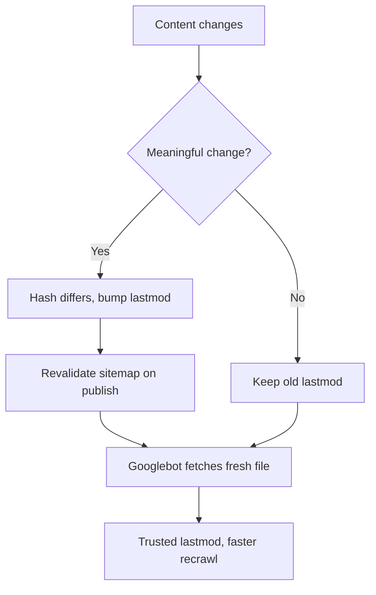

# 7 XML Sitemap Mistakes That Make Google Ignore Your lastmod

Your sitemap is probably the most boring file on your site. Nobody reviews it in pull requests, nobody brags about it, and most CMS plugins generate it the day you install them and never touch it again. That's exactly why it's quietly broken on so many sites.

Here's the part that should get your attention. In 2026, Google has been unusually blunt about how it treats sitemaps. In July, Gary Illyes said on Bluesky that site owners are better off leaving `lastmod` out entirely when the dates are wrong. In October, John Mueller and Martin Splitt devoted an episode of *Search Off the Record* to the question "do sitemaps still matter?", and the honest answer was: yes, but only the parts that are accurate.

So this list is about the most common **XML sitemap mistakes** we see on real sites, ranked by how much damage they do to crawling and indexing. We ranked each one using three criteria: how often it shows up, how badly it distorts the signals Google reads, and how easy it is to fix in code. Every item has a concrete search outcome attached, because a sitemap exists for exactly one reason: to help the right URLs get discovered, crawled, and indexed faster.

## 1. Stamping every URL with today's date

This is the classic. A build script runs, and `lastmod` for all 4,000 URLs becomes the build timestamp. Technically valid XML. Practically useless.

Mueller's take, as summarized from the episode, is that Google only uses `lastmod` when the dates look reasonable. If every page claims it changed today, Google ignores the field and falls back to its own crawl scheduling. He was careful to say it's "not a spam thing," just noise. But noise has a cost: you've thrown away your one chance to tell Google which pages actually changed.

A real-world write-up on DEV Community shows how bad it gets. One site had 402 URLs in its sitemap, but a bulk database update had rewritten the modified date on almost all of them. Only 87 distinct `lastmod` values existed across the whole file, and new posts sat in "Discovered – currently not indexed" for months. After the team switched to content-based dates, the distinct values jumped to 337, and the largest group sharing one timestamp dropped from hundreds to eight.

**Search impact:** wasted crawl signal and slower discovery of pages that genuinely changed.

**Fix:** derive `lastmod` from a hash of the content that matters, not from a database "updated_at" column that gets touched by every bulk operation.

## 2. Treating a CMS "modified" column as the truth

This one is sneakier than the first. Your dates aren't all identical, but they're still wrong, because the column you read from changes for reasons that have nothing to do with what a visitor sees. A plugin re-saves posts. A migration touches every row. An editor fixes a typo in the footer widget and every page using that template gets a new timestamp.

Google's own documentation says `lastmod` should reflect *significant* updates, and it explicitly calls out minor changes like updating a copyright year as things that shouldn't move the date. Illyes's July comment pushes that further: if you can't guarantee accuracy, skipping the field beats shipping a misleading freshness signal.

Here's a simple pattern for a headless setup. Store a content hash next to each entry and only bump the date when the hash changes.

```ts
// lib/content-dates.ts
import { createHash } from "node:crypto";

export function contentHash(post: { title: string; body: string }) {
  return createHash("sha256")
    .update(post.title + "\n" + post.body)
    .digest("hex");
}

// On save: compare with the stored hash, update changedAt only if different.
export function nextChangedAt(
  prev: { hash: string; changedAt: Date } | null,
  post: { title: string; body: string }
) {
  const hash = contentHash(post);
  if (prev && prev.hash === hash) return { hash, changedAt: prev.changedAt };
  return { hash, changedAt: new Date() };
}
```

**Search impact:** a `lastmod` signal Google can actually trust, which is the only version of it Google reads.

**Fix:** hash what users see (title, main content, key structured data), and ignore templates, widgets, and boilerplate.

## 3. Still shipping priority and changefreq

Let's keep this one short, because it's settled. Google ignores both `<priority>` and `<changefreq>`. Mueller's explanation was almost funny: when SEOs rank their own pages, every URL ends up at maximum priority, and sites mark everything as always fresh. The fields stopped carrying information.

Leaving them in isn't harmful, exactly. But it bloats the file, it signals that nobody has reviewed the generator in years, and it can give your team false confidence that they're "managing crawl priority." They aren't. Real crawl priority comes from internal links, server response times, and demonstrated page quality.

**Search impact:** none from the tags themselves, but it distracts from the levers that do work.

**Fix:** delete both tags from your generator. Keep `loc` and an honest `lastmod`.

## 4. Listing URLs that contradict your canonicals

A sitemap is a list of URLs you're recommending as the canonical version of each page. Mueller noted that listing a URL makes Google somewhat more likely to choose it as the canonical. That's a real signal, and many sites sabotage it.

Common offenders: URLs with tracking parameters, `http` versions on an `https` site, trailing-slash variants that redirect, pages carrying `noindex`, and pages whose `rel="canonical"` points somewhere else. Each of these tells Google two different things at once, and Google will resolve the conflict on its own terms.

Run a quick check in CI. Fetch every sitemap URL, follow no redirects, and fail the build on anything that isn't a clean 200 with a self-referencing canonical and no `noindex`.

```ts
// scripts/check-sitemap.ts
const xml = await (await fetch("https://example.com/sitemap.xml")).text();
const urls = [...xml.matchAll(/<loc>(.*?)<\/loc>/g)].map((m) => m[1]);

for (const url of urls) {
  const res = await fetch(url, { redirect: "manual" });
  if (res.status !== 200) {
    console.error(`${res.status} ${url}`);
    process.exitCode = 1;
    continue;
  }
  const html = await res.text();
  const canonical = html.match(/<link[^>]+rel="canonical"[^>]+href="([^"]+)"/)?.[1];
  const noindex = /<meta[^>]+name="robots"[^>]+noindex/i.test(html);
  if (canonical !== url || noindex) console.error(`conflict: ${url}`);
}
```

If you're working in a JavaScript framework, the canonical side of this has its own traps, which we covered in detail.

[→ Read also: Canonical Tags in Next.js and Astro: A 2026 Dev Guide](/blog/canonical-tags-javascript-frameworks-nextjs-astro-2026/)

**Search impact:** cleaner canonical selection and fewer "Duplicate, Google chose different canonical" surprises.

**Fix:** treat the sitemap as an output of your indexability rules, not a separate system.

## 5. Forgetting the hard limits (and the sitemap index)

Google's documented limits haven't changed: 50,000 URLs and 50 MB uncompressed per file. Compression doesn't help with the size cap, because it's measured after decompression. Large e-commerce catalogs and programmatic sites blow past this without anyone noticing, and a truncated or rejected file means part of your catalog is simply never submitted.

The fix is a sitemap index that points to child sitemaps. Mueller mentioned that indexes can nest one level deep, and that you can submit several files in Search Console. In Next.js, `generateSitemaps` handles the splitting for you.

```ts
// app/products/sitemap.ts
import type { MetadataRoute } from "next";
import { getProductCount, getProducts } from "@/lib/products";

const PER_FILE = 40000; // leave headroom under 50,000

export async function generateSitemaps() {
  const total = await getProductCount();
  return Array.from({ length: Math.ceil(total / PER_FILE) }, (_, id) => ({ id }));
}

export default async function sitemap({ id }: { id: number }): Promise<MetadataRoute.Sitemap> {
  const products = await getProducts(id * PER_FILE, PER_FILE);
  return products.map((p) => ({
    url: `https://example.com/products/${p.slug}`,
    lastModified: p.contentChangedAt, // real content date, not updated_at
  }));
}
```

Splitting by content type (products, categories, articles) rather than alphabetically also gives you something valuable: in Search Console, each sitemap reports its own indexed-versus-submitted counts, so you can see which section has an indexing problem.

**Search impact:** full catalog coverage and per-section diagnostics.

**Fix:** cap files well below the limit and split by template type.

## 6. Letting a stale cache serve an old sitemap

Your code might generate perfect dates, and an edge cache or ISR layer can still hand Googlebot yesterday's file. We see this constantly with statically generated sitemaps that only rebuild on deploy, or CDN rules that cache `/sitemap.xml` for a week because "it's just XML."

The failure is quiet. New pages go live, the sitemap doesn't mention them, and discovery falls back to internal links alone. Mueller also flagged the "Couldn't fetch" status in Search Console and said the usual causes are host load and low crawl demand, with crawl demand often tied to the perceived quality of the site. So a fetch error doesn't always mean the file is broken. Sometimes it means Google isn't very interested yet, and no amount of XML tinkering will fix that.

Tie sitemap regeneration to the same event that publishes content, and give the route a short cache lifetime.

[→ Read also: 7 Next.js ISR Mistakes That Serve Stale Pages to Googlebot](/blog/nextjs-isr-revalidation-seo-mistakes-stale-content-2026/)

**Search impact:** faster discovery of new URLs, and no mismatch between what's live and what's declared.

**Fix:** revalidate the sitemap on publish, cache it for minutes rather than days, and confirm with your server logs that Googlebot is fetching the current version.

[→ Read also: 9 Things Your Server Logs Reveal That Search Console Can't](/blog/server-log-analysis-seo-2026-what-search-console-misses/)

## 7. Expecting llms.txt or an HTML sitemap to do the job

When llms.txt came up, Mueller's answer to "can it replace an XML sitemap?" was a flat no. Google's systems can't use it as a sitemap because it doesn't follow a strict format, and he said the hope is bigger than the reality. HTML sitemaps are the same story: great for users, useless as a submission format.

There's an AI-crawler angle worth knowing, though. Mueller pointed out that AI training crawlers usually have no Search Console equivalent where you can submit a file, so the conventional `/sitemap.xml` path and a `Sitemap:` line in `robots.txt` make your URLs easier for them to find. He said he has seen AI crawlers fetch his sitemap and RSS files in his own logs. That's an observation from one site, not a guarantee, but it's a cheap thing to do.

```txt
# robots.txt
User-agent: *
Allow: /

Sitemap: https://example.com/sitemap.xml
```

RSS and Atom feeds also count as valid sitemap formats for Google, and they're handy for news-style sites because they list only the latest 10 to 20 changed URLs.

**Search impact:** discoverability for both Google and any crawler that reads standard files.

**Fix:** keep the plain, standard sitemap path, reference it in robots.txt, and stop waiting for a newer file format to rescue you.

## Honorable Mentions

Two issues almost made the list. First, image and video sitemap extensions are still supported, although Mueller questioned how much they matter now, so audit them instead of expanding them. Second, hreflang can live in your sitemap instead of your HTML, which is easier to maintain at scale, but it breaks the same way as any other hreflang setup.

[→ Read also: 7 Hreflang Mistakes That Make Google Ignore Your Translations](/blog/hreflang-mistakes-google-ignores-translations-2026/)

## How to Audit Your Sitemap This Week

If you only do three things, make it these. Check how many distinct `lastmod` values your file contains compared with how many URLs it lists. A ratio near 1:1 is healthy, and a handful of repeated timestamps is a red flag. Crawl every listed URL and confirm it's a 200, indexable, and self-canonical. Then compare the sitemap's URL count with what you see under Indexing in Search Console.



Also worth saying out loud: a small site with a clean internal link structure may not need a sitemap at all. Mueller said as much, while adding that there's no harm in keeping the CMS-generated one. The stakes rise with scale, with frequent changes (e-commerce prices, news), and with sites where pages sit several clicks deep.

The bigger takeaway is a mindset shift. A sitemap isn't a place to shout "crawl everything." It's a statement of confidence about which URLs matter and when they last meaningfully changed. Get that statement right and Google will actually listen to it. Get it wrong, and you've taught the crawler to ignore you.

Skip one thing from this list and do the first two. Honest dates and canonical-clean URLs make up most of the benefit.

## FAQ

### Does Google still use lastmod in 2026?

Yes, but conditionally. Google's documentation says it uses `lastmod` only when dates are consistently accurate and tied to significant content updates. If the values look unreliable, Google falls back to its own crawl scheduling.

### Should I remove lastmod if I can't make it accurate?

According to Gary Illyes's July 2026 comment, omitting wrong values is better than sending misleading freshness signals. Add it back once you can derive it from real content changes.

### Do I need an XML sitemap for a small site?

Probably not, according to Mueller, but a CMS-generated one does no harm. Larger, fast-changing, or deep sites benefit most.

### Is a sitemap a ranking factor?

No. A sitemap helps discovery and crawl scheduling. It doesn't boost rankings, and submitting one is a hint, not a guarantee that Google will crawl it.

```json
{
  "@context": "https://schema.org",
  "@type": "ItemList",
  "name": "7 XML Sitemap Mistakes That Make Google Ignore Your lastmod",
  "description": "These 7 XML sitemap mistakes quietly teach Google to distrust your lastmod dates. Here's how to fix each one, with Next.js code you can ship today.",
  "datePublished": "2026-10-19",
  "dateModified": "2026-10-19",
  "keywords": "SEO, Web Development, Frontend",
  "numberOfItems": 7,
  "itemListElement": [
    {"@type": "ListItem", "position": 1, "name": "Stamping every URL with today's date"},
    {"@type": "ListItem", "position": 2, "name": "Treating a CMS modified column as the truth"},
    {"@type": "ListItem", "position": 3, "name": "Still shipping priority and changefreq"},
    {"@type": "ListItem", "position": 4, "name": "Listing URLs that contradict your canonicals"},
    {"@type": "ListItem", "position": 5, "name": "Forgetting the hard limits and the sitemap index"},
    {"@type": "ListItem", "position": 6, "name": "Letting a stale cache serve an old sitemap"},
    {"@type": "ListItem", "position": 7, "name": "Expecting llms.txt or an HTML sitemap to do the job"}
  ]
}
```

---

Sources: Google Search Central, "Build and submit a sitemap"; Relevant Audience coverage of *Search Off the Record* episode 114 (Oct 1, 2026); seo-day.de on Gary Illyes's lastmod comment (Jul 16, 2026); DEV Community case study on lastmod timestamps.
