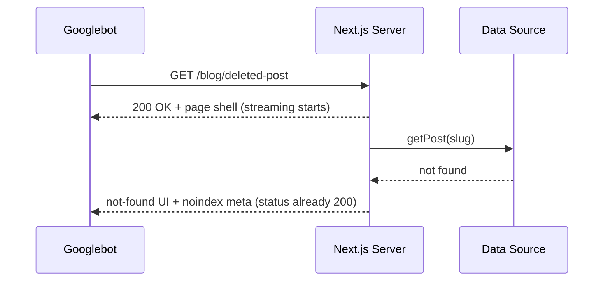

# Next.js Soft 404s: When notFound() Still Returns 200

You did the responsible thing. Your product page checks whether the record exists, and if it doesn't, it calls `notFound()`. The browser shows a lovely "Page not found" screen. Ticket closed, right?

Not necessarily. Open your network tab and look at the status code of that response. If you wrapped your data fetch in a `<Suspense>` boundary, there's a decent chance it says **200 OK**. To a human, that page is a 404. To Googlebot, it's a successful response that happens to look like an error, which is exactly the textbook definition of a soft 404.

This guide is about **Next.js soft 404** behavior in the App Router: why streaming changes the rules, what Google actually does with these pages, and how to fix and test it so deleted content leaves the index instead of lingering for months.

## Why Soft 404s Are Worth Your Attention

Google's own documentation is blunt about how status codes work. A `200` means "content passed on to indexing." A `404` or `410` means "the content doesn't exist," and previously indexed URLs get removed while crawl frequency for them gradually decreases. If a page returns 200 but looks like an error or is basically empty, Search Console files it under **Soft 404**.

So what's the harm? A few things, none of them dramatic on their own, all of them annoying together:

- Dead URLs stay in the crawl queue longer, eating crawl budget that should go to pages you actually care about.
- Stale listings (a discontinued product, a deleted article) can keep showing in results, sending people to a dead end.
- Your Page Indexing report fills with "Soft 404" noise that hides real problems.
- If your error template is thin and repeated across thousands of URLs, you've effectively built a duplicate-content generator.

None of this is a penalty. It's just wasted attention, and attention is the one thing you can't buy more of from Google.

[→ Read also: 7 XML Sitemap Mistakes That Make Google Ignore Your lastmod](/blog/xml-sitemap-mistakes-lastmod-google-ignores-2026/)

## The Streaming Catch Nobody Mentions in Tutorials

Most older tutorials teach a simple rule: call `notFound()` when your data is missing and Next.js returns a 404. That's true, with a condition attached.

An HTTP response has a status line and headers first, then the body. Once the server sends the status line, it can't take it back. With React streaming, Next.js starts sending the page shell as early as it can, and that includes the `200`.

The current Next.js docs for `notFound()` spell this out. Calling it **before streaming starts** returns a 404. But if you call it inside a component wrapped in `<Suspense>`, the response has already begun streaming from the Suspense boundary. In the docs' words, it "keeps its 200 status," and Next.js adds a `noindex` tag instead.

Here's the pattern that bites people:

```tsx
// app/blog/[slug]/page.tsx
import { Suspense } from 'react'
import { notFound } from 'next/navigation'

async function Article({ slug }: { slug: string }) {
  const post = await getPost(slug)   // calls notFound() internally when missing
  return <article><h1>{post.title}</h1></article>
}

export default async function PostPage({ params }) {
  const { slug } = await params
  return (
    <Suspense fallback={<p>Loading...</p>}>
      <Article slug={slug} />
    </Suspense>
  )
}
```

Great for perceived performance, since the shell and skeleton arrive instantly. Terrible for status codes, since the shell is sent with a 200 before anyone knows the post is gone.



## What Google Does With That Response

This is where honesty matters: nobody outside Google can tell you precisely how this combination is processed at scale. What the documentation does let us say:

1. The response is a `200`, so it flows into the indexing pipeline.
2. Google renders the page and sees the `noindex` meta tag Next.js injected. Pages with `noindex` are dropped from the index.
3. The page also reads like an error, which is the signal Search Console uses to label soft 404s.

So in many cases, the end state is fine: the URL doesn't stay indexed. But "fine eventually" is a long way from "fixed." A real 404 is an unambiguous, first-byte signal. A 200 with a late `noindex` depends on rendering, and Google's JavaScript SEO docs note that a `noindex` can cause Google to skip rendering altogether, which makes late-injected tags a shaky foundation. You're trading a deterministic signal for a probabilistic one, and you'd never choose that deal on purpose.

There's a second wrinkle. Other consumers don't render JavaScript or care about meta tags the way Google does. Uptime monitors, link checkers, CDN caches, and a good chunk of AI crawlers read the status line and move on. A 200 tells all of them the page is healthy.

## Fix 1: Check Existence Before You Stream

The cleanest fix is also the least glamorous: decide whether the resource exists **before** the first byte leaves, and only stream the slow stuff afterward.

```tsx
// app/blog/[slug]/page.tsx
import { Suspense } from 'react'
import { notFound } from 'next/navigation'
import { postExists, getPostBody } from '@/lib/posts'

export default async function PostPage({ params }) {
  const { slug } = await params

  // Fast, cheap existence check: awaited BEFORE streaming starts
  if (!(await postExists(slug))) notFound()

  return (
    <Suspense fallback={<ArticleSkeleton />}>
      <ArticleBody slug={slug} />   {/* heavy fetch can stream */}
    </Suspense>
  )
}
```

The trick is splitting one data call into two: a lightweight `exists` lookup (an indexed ID query, a cached key check) that blocks, and the expensive content fetch that streams. You keep your fast shell for real pages and get a true 404 for missing ones.

If your existence check is expensive, that's a signal to cache it, not to move it into Suspense.

## Fix 2: Gate Dynamic Routes in Proxy

For routes where the check is cheap and you'd rather not touch page code, the Next.js docs point to doing a request-time check in Proxy (the successor to what used to be called middleware) before the page renders. You can rewrite known-dead patterns to a path that returns a genuine 404, or return a 410 for content you've deliberately removed.

```ts
// proxy.ts
import { NextResponse } from 'next/server'
import type { NextRequest } from 'next/server'

const REMOVED = new Set(['/blog/old-launch-post', '/blog/retired-guide'])

export function proxy(req: NextRequest) {
  if (REMOVED.has(req.nextUrl.pathname)) {
    return new NextResponse('Gone', { status: 410 })
  }
  return NextResponse.next()
}
```

Keep the lookup list small or backed by something fast like edge config. Doing a database round trip on every request defeats the point.

## Fix 3: Pre-render Known Paths and Let Unknown Ones 404

If your content set is finite, `generateStaticParams` combined with `dynamicParams = false` makes unknown slugs return a 404 without any runtime logic at all:

```tsx
export const dynamicParams = false

export async function generateStaticParams() {
  const posts = await getAllSlugs()
  return posts.map((slug) => ({ slug }))
}
```

The tradeoff: new content requires a rebuild or revalidation path, so this suits catalogs that change on a schedule better than ones that change by the minute. If you rely on ISR, double-check how stale pages behave after deletion.

[→ Read also: 7 Next.js ISR Mistakes That Serve Stale Pages to Googlebot](/blog/nextjs-isr-revalidation-seo-mistakes-stale-content-2026/)

## The Other Soft 404 Sources You Should Check While You're Here

Streaming is the new culprit, but the classic ones haven't gone anywhere.

**Empty-state pages with a 200.** A category with zero products, a search results page with no results, a tag archive with no posts. Google's guidance applies: if the page is effectively empty, either return a 404 for URLs that should never exist, or keep the URL valid and add enough real content (related items, navigation, a useful message) that it isn't an error in disguise. Pick deliberately.

**Client-side routing in SPAs.** If part of your app is a client-rendered SPA, the server often returns 200 for every path and lets JavaScript decide what to show. Google's JavaScript SEO docs describe two workable options here: redirect with JavaScript to a URL that returns a real 404, or add a `noindex` robots meta tag to error views. Both are workarounds for the fact that you can't set the status from the client.

**Redirecting everything to the homepage.** It feels friendly. Google treats mass redirects from dead URLs to an irrelevant page as soft 404s too. Redirect to a genuinely equivalent page, or let the URL die cleanly.

**Custom error pages that return 200.** Check that your `not-found.tsx` isn't being served by a hosting layer or reverse proxy that rewrites the status. Some CDN "custom error page" features do exactly that.

[→ Read also: Site Migration Redirect Map: Test It in CI and Logs](/blog/site-migration-redirect-map-testing-ci-log-validation-2026/)

## SEO and Search Implications

Let's connect this back to rankings and discoverability, because "status codes" can sound like plumbing trivia.

**Crawl efficiency.** Google's docs say 404-class responses cause crawl frequency for those URLs to drop gradually. Soft 404s can take longer to get the same treatment, so dead URLs keep absorbing requests. On a large catalog with churn, that's real crawl budget.

**Index hygiene.** Every dead URL that lingers is a potential stale snippet. For ecommerce and publishers, a result that lands people on "Post not found" quietly teaches searchers to distrust your listings.

**Reporting clarity.** A clean Page Indexing report is a diagnostic tool. When "Soft 404" is empty, a sudden spike means something just broke. When it's always noisy, you stop looking.

**Beyond Google.** Other crawlers and monitoring tools read the status line, not your meta tags. A 404 is understood everywhere; a 200 with an error message is understood almost nowhere.

## How to Detect Soft 404s Before Google Reports Them

Don't wait for Search Console. It's a lagging indicator.

**Spot-check with curl.** Request a URL that should not exist and read the first line:

```bash
curl -s -o /dev/null -w "%{http_code}\n" https://example.com/blog/this-does-not-exist-123
```

You want `404`. Run it against a URL that exists in the database but was deleted yesterday too, since that's the case caching can break.

**Test the streaming path specifically.** A random gibberish slug may be caught by routing, while your real "valid shape, missing record" case goes through the Suspense path. Test both.

**Add it to CI.** A tiny Playwright test catches regressions when someone refactors a page into Suspense:

```ts
import { test, expect } from '@playwright/test'

test('missing blog post returns a real 404', async ({ request }) => {
  const res = await request.get('/blog/definitely-not-a-real-post')
  expect(res.status()).toBe(404)
})

test('missing product returns 404, not 200 + noindex', async ({ request }) => {
  const res = await request.get('/products/deleted-sku-0000')
  expect(res.status()).toBe(404)
})
```

If you're letting AI coding agents refactor your routes, this is exactly the kind of regression they introduce without noticing. A two-line test is cheap insurance.

[→ Read also: SEO Regression Testing in 2026: Guardrails for AI-Written Code](/blog/seo-regression-testing-2026-ci-guardrails-ai-code/)

**Check your logs.** Filter for Googlebot requests to URLs that return 200 with a very small or template-identical response size. Identical byte counts across thousands of URLs are a soft 404 fingerprint.

## Common Mistakes and Advanced Tips

**Wrapping `notFound()` in try/catch.** The function works by throwing. A catch block swallows it, and you render an empty page with a 200. If you must catch errors nearby, rethrow the framework's control-flow errors first.

**Calling it inside an un-awaited promise.** The docs warn that this throws where nothing catches it, so no not-found UI renders at all.

**Using 404 where 410 is better.** Google treats both as "doesn't exist" and doesn't document different handling, so don't expect a ranking benefit from 410. It's still useful as a clear internal signal for deliberately removed content.

**Returning 403 or 401 to "block" crawlers from dead pages.** Google specifically warns against using 401 or 403 to limit crawling. Use proper status codes for what a page is, not to steer crawlers.

**Forgetting about 5xx.** If your data source is down and your page throws, make sure that surfaces as a 5xx, not a cached 404. Google slows crawling on 5xx but keeps indexed URLs for a while; a wrongly served 404 can get a healthy page removed.

**Don't fix it only in production.** Streaming behavior differs between dev and a real deployment behind a CDN. Verify against the deployed environment.

## FAQ

### Does a soft 404 hurt my rankings?
Not directly as a penalty. The cost is indirect: wasted crawl attention, stale results, and noisier diagnostics. On small sites it's minor; on large, high-churn catalogs it adds up.

### Is a `noindex` tag from `notFound()` good enough?
Often it works out, but it's a weaker signal than a real 404 status because it depends on Google rendering the page. Whenever you can, return a genuine 404 before streaming begins.

### Should I use 404 or 410?
Either removes the URL. Google's docs don't describe a meaningful difference in handling, so choose based on your own clarity: 410 for intentionally removed content, 404 for everything else.

### Will `generateStaticParams` solve this for good?
For finite content sets, yes, with `dynamicParams = false`. For content that changes constantly, use an up-front existence check instead.

## Conclusion

The fix for a **Next.js soft 404** is mostly about ordering. Decide whether the page exists before the first byte goes out, stream the heavy content after that, and treat the status code as part of your SEO surface, not an afterthought. Pair it with a cheap CI check so a well-meaning Suspense refactor can't quietly turn your 404s back into 200s.

Do this once and your index gets cleaner, your crawl budget goes further, and your Search Console reports start telling you the truth. That's a pretty good return for a handful of lines of code.

```json
{
  "@context": "https://schema.org",
  "@type": "BlogPosting",
  "headline": "Next.js Soft 404s: When notFound() Still Returns 200",
  "description": "Next.js soft 404s happen when notFound() fires after streaming starts and the page keeps a 200 status. Here's how to detect, fix, and test it.",
  "datePublished": "2026-10-20",
  "dateModified": "2026-10-20",
  "keywords": "SEO, Web Development, Frontend, Soft 404, Next.js, JS SEO, HTTP Status Codes, Streaming SSR"
}
