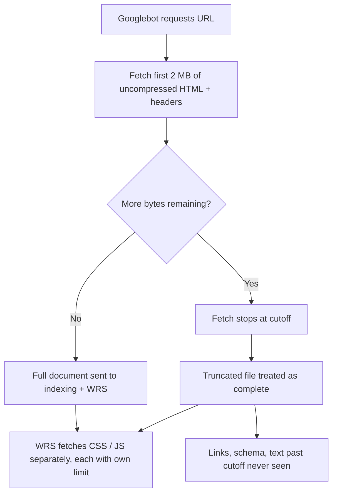

# Googlebot's 2 MB HTML Limit: Check If Your Pages Get Cut Off

Picture a long novel where the printer simply stops at page 200 and nobody tells the author. The story still gets published. It just ends mid-sentence, and the readers never notice what's missing.

That's roughly what the **Googlebot 2 MB limit** can do to a bloated web page. In March 2026, Google's Gary Illyes published a post called "Inside Googlebot" that spelled out how many bytes Googlebot actually reads from a URL. For most sites the answer is "more than enough." For a specific kind of modern, framework-heavy page, it's a quiet indexing risk that never shows up as an error in Search Console.

This guide walks through what Google actually said, what the independent tests found (they don't fully agree), which parts of your HTML are most likely to blow the budget, and how to measure and fix it in an afternoon.

## What Google Actually Said About the 2 MB Limit

Here's the short version, based on Google's post and the coverage of it from Search Engine Journal and others:

- Googlebot fetches up to **2 MB per URL**, excluding PDFs. PDFs get 64 MB. Crawlers with no specified limit default to 15 MB.
- **HTTP request headers count** toward that 2 MB.
- Googlebot doesn't reject an oversized page. It **stops at the cutoff** and passes the truncated file to indexing and the Web Rendering Service (WRS), which treat it as if it were the whole file.
- Anything past the cutoff is **never fetched, rendered, or indexed**.
- External resources like CSS and JavaScript files have **their own byte counters**. They don't eat into the parent page's 2 MB.
- WRS runs your JavaScript and pulls in JS, CSS, and XHR requests, but it doesn't request images or videos, and it works statelessly, clearing local and session storage between requests.

Illyes also noted the limit "is not set in stone and may change over time." So treat 2 MB as today's number, not a permanent law.

One more detail worth underlining: the cap applies to **uncompressed** data. Gzip or Brotli make the transfer smaller, but the budget is measured after decompression. A page that ships as 400 KB over the wire can still be 2.3 MB once it's unpacked.

## Should You Actually Worry? The Honest Answer

Probably not, if you run a typical blog or brochure site. DebugBear's analysis puts median uncompressed HTML at roughly 20 KB, with the 90th percentile around 392 KB. Another 2026 write-up cites a median of about 30 KB. Either way, the vast majority of pages sit nowhere near 2 MB.

But "most pages are fine" is a statistical comfort, not a plan. The pages that do hit the ceiling tend to be exactly the ones that matter commercially: giant category listings, programmatic pages with hundreds of records, and apps that serialize their whole state into the document.

There's also a nuance the SERP mostly glosses over: the evidence on *how strictly* Google enforces this is mixed.

- Spotibo built a 3 MB test page and found the indexed version was cut off after 2 MB, mid-word, while Search Console still reported "Page is indexed" with no warning. Their 16 MB file wasn't fetched at all and returned a generic error.
- The same test noted that URL Inspection's live test showed the full 3 MB document. The author suspects that tool uses a different fetch path with the larger 15 MB limit, so a clean live test doesn't prove your indexed copy is complete.
- DebugBear reported the opposite experience in its own tests, with no truncation in the URL Inspection live test, and a forum report of a 2.4 MB file cut near 1.9 MB muddied things further.

What does that tell us? That you can't rely on Search Console to alert you, and you can't rely on URL Inspection to clear you. The only dependable approach is to measure your own HTML and keep the important stuff early. We don't know exactly how Google handles every edge case, so plan for the strict reading.

## The Real Culprits: What Bloats HTML

The 2 MB budget isn't consumed by your visible text. It's eaten by things users never see. These are the usual suspects:

**1. Hydration payloads.** Server-rendered frameworks serialize data into the document so the client can hydrate. In Next.js that's `__NEXT_DATA__` (Pages Router) or the RSC payload chunks pushed through inline scripts (App Router). If you pass an entire CMS response, a full product catalog, or unused fields into props, the payload can reach several hundred KB and sometimes pass 1 MB.

**2. Inline SVGs.** One detailed illustration or icon sprite can run around 200 KB. Ten of them on a page adds up fast.

**3. Base64 images and fonts.** Data URIs feel convenient, but they turn a cacheable file into permanently inlined weight on every single page.

**4. Inline CSS and JS.** Critical CSS is fine at a few KB. A whole utility stylesheet inlined per page is not.

**5. Mega-menus and repeated markup.** A navigation tree that renders every category, every subcategory, and every promo on every page can add 100 KB+ before your actual content begins.

**6. Per-item schema on huge listings.** A category page with 500 products, each with a full Product JSON-LD block and review data, is a classic offender. We covered the schema side of that in [→ Read also: Category Page Schema Markup in 2026: What Actually Works](/blog/category-page-schema-markup-2026-what-actually-works/).



## SEO & Search Implications: What Gets Lost First

This is where the limit stops being a trivia fact and starts costing you rankings.

Because truncation is positional, the damage depends on what lives at the *bottom* of your HTML. In a typical server-rendered page, that's:

- **Footer and "related" links.** Internal links past the cutoff don't exist as far as Google is concerned. If your deep category or product links sit in a late-rendered block, they can't pass signals or help discovery. That connects directly to crawl efficiency, a theme we dig into in [→ Read also: Faceted Navigation SEO in 2026: Crawl Budget for E-commerce](/blog/faceted-navigation-seo-2026-crawl-budget-ecommerce/).
- **JSON-LD placed at the end of `<body>`.** Many tag managers and component libraries append structured data last. If it falls past 2 MB, your rich result eligibility goes with it.
- **Long-tail content.** Reviews, FAQs, and "read more" text that load below the fold in the markup.
- **Canonical and meta tags injected late.** A `rel="canonical"` or `robots` meta placed after a huge inline blob is a risk you really don't want.

There's also an AI-search angle. Answer engines that rely on a Google-style fetch can only cite what was fetched. If the passage that would earn you a citation sits past the cutoff, it's invisible to them. We can't point to hard data on how every AI crawler handles size limits, so the safe move is the same: put the answer-bearing content early.

Finally, size has a softer cost even below 2 MB. DebugBear and others point to crawl slowdowns for heavier documents, and Bing reports an "HTML size is too long" error in Bing Webmaster Tools (with a guidance figure around 1 MB, though that's less firmly documented). If you care about Bing and DuckDuckGo, the cushion is thinner.

## How to Measure Your HTML Size (Correctly)

The most common mistake is checking the wrong number. In Chrome DevTools, the Network tab's **Size** column shows the compressed transfer size. The number that matters is the **Content** column (decompressed), which you may need to reveal via the column header menu.

For something repeatable, script it. This Node snippet fetches a URL the way a crawler would, with compression on, then reports the decompressed byte count:

```js
// check-html-size.mjs  (Node 18+)
const LIMIT = 2 * 1024 * 1024; // 2,097,152 bytes

async function check(url) {
  const res = await fetch(url, {
    headers: { "User-Agent": "Mozilla/5.0 (compatible; size-check/1.0)" },
  });
  // fetch() decompresses automatically, so arrayBuffer length is the real size
  const bytes = (await res.arrayBuffer()).byteLength;
  const pct = ((bytes / LIMIT) * 100).toFixed(1);
  const flag = bytes > LIMIT ? "OVER" : bytes > 1_000_000 ? "URGENT" : bytes > 500_000 ? "REVIEW" : "ok";
  console.log(`${flag.padEnd(6)} ${String(bytes).padStart(9)} B  ${pct.padStart(5)}%  ${url}`);
  return bytes;
}

const urls = process.argv.slice(2);
for (const u of urls) await check(u);
```

Run it with `node check-html-size.mjs https://example.com/category/shoes`. The thresholds (review above 500 KB, urgent above 1 MB) are practical rules of thumb from industry write-ups, not Google numbers.

Then go beyond one URL:

1. **Pull your biggest templates.** Test one URL per template: home, category, product, article, search results, tag pages. Pagination and filtered URLs deserve a spot too.
2. **Crawl at scale.** Screaming Frog and Sitebulb both report HTML size (Sitebulb has a dedicated hint for pages exceeding 2 MB). Sort descending.
3. **Check the tail of the document.** Fetch the page and look at what sits in the last 300 KB. If that's your JSON-LD or your related-links block, that's your risk map.

If you want to verify what Google actually stored, compare the cached/rendered HTML in Search Console's URL Inspection against your source, keeping in mind the caveat above that its live test may not mirror indexing.

## Fixing It: A Priority Order That Works

Start with the cheapest, highest-impact changes.

### 1. Trim hydration payloads

Only send the client what the client renders. In Next.js, select fields on the server instead of passing whole objects:

```tsx
// Before: ships the entire CMS record (and every field in it) into the HTML
export async function getServerSideProps() {
  const product = await cms.getProduct(slug);
  return { props: { product } };
}

// After: pick only what the component renders
export async function getServerSideProps() {
  const p = await cms.getProduct(slug);
  return {
    props: {
      product: { id: p.id, name: p.name, price: p.price, image: p.image.url, summary: p.summary },
    },
  };
}
```

If a long list (reviews, specs, related items) isn't needed for first paint, fetch it client-side or paginate it, as long as the content that matters for search is still in the initial HTML or on its own crawlable URL.

### 2. Move weight out of the document

Replace base64 images and fonts with real files. Move large inline CSS and JS into external files, where each gets its own byte counter and gets cached across pages. Convert repeated inline SVGs to a sprite or `` reference.

### 3. Re-order the `<head>` and critical markup

Illyes' own recommendation: place meta tags, titles, canonicals, and structured data higher in the HTML. Put `<title>`, canonical, robots meta, and hreflang before any heavy inline script. Where your framework allows, emit JSON-LD near the top of `<body>` or in `<head>` rather than at the very bottom.

### 4. Slim the navigation

Render top-level categories in the global nav, and load deeper levels on interaction or on the category's own page, while keeping real `<a href>` links where you need discovery. Don't hide links purely behind JavaScript events just to save bytes. Our guide on [→ Read also: JavaScript SEO in 2026: How AI Crawlers Read React, Next.js, and Astro](/blog/javascript-seo-ai-crawlers-react-nextjs-astro/) covers why that trade-off backfires.

### 5. Split oversized listings

If a category page really does carry 500 items, paginate it into crawlable URLs instead of one monster document. Don't rely on `rel="next"` and `rel="prev"` for this: Google no longer uses them as an indexing signal, so the paginated pages need ordinary links to each other.

### 6. Add a size budget to CI

Fixing it once isn't enough, because the next feature (or the next AI-generated component) will quietly add 80 KB. Add a test that fails the build when a key template's HTML crosses a budget, say 500 KB. This slots neatly into the guardrails we outlined in [→ Read also: SEO Regression Testing in 2026: CI Guardrails for AI-Written Code](/blog/seo-regression-testing-2026-ci-guardrails-ai-code/).

```js
// size-budget.test.mjs (Vitest)
import { test, expect } from "vitest";

const BUDGET = 500 * 1024;
const pages = ["/", "/category/shoes", "/product/example"];

test.each(pages)("HTML under budget: %s", async (path) => {
  const res = await fetch(`http://localhost:3000${path}`);
  const bytes = (await res.arrayBuffer()).byteLength;
  expect(bytes).toBeLessThan(BUDGET);
});
```

## Common Mistakes to Avoid

**Trusting the Network tab's "Size" column.** It shows compressed bytes. Look at decompressed content.

**Assuming a clean URL Inspection live test means you're safe.** As the Spotibo test suggested, it may use a different fetch path than the one feeding the index.

**"Fixing" it by cloaking.** Serving Googlebot a trimmed version of the page while users get the bloated one is cloaking. The fix is making the page itself lighter, for everybody.

**Panic-rewriting everything.** If your templates all sit under 300 KB, you have bigger fish to fry. Measure first, then decide.

**Forgetting the soft errors.** If truncation breaks the HTML mid-tag, odd parsing can follow, including the kind of status and content mismatches we discussed in [→ Read also: Next.js Soft 404s: When notFound() Still Returns 200](/blog/nextjs-soft-404-notfound-streaming-status-code-2026/). Worth checking your server logs for strange crawl patterns, a technique we outline in [→ Read also: Server Log Analysis for SEO in 2026: What Search Console Misses](/blog/server-log-analysis-seo-2026-what-search-console-misses/).

## FAQ

### What is the Googlebot 2 MB limit?

Googlebot reads up to 2 MB per URL (excluding PDFs, which get 64 MB). Past that point it stops fetching, and the truncated file is treated as complete by indexing and rendering systems. Headers count toward the 2 MB.

### Is the limit measured before or after compression?

After. The cap applies to uncompressed data, so Gzip or Brotli don't buy you extra room.

### Do CSS and JavaScript files count toward a page's 2 MB?

No. External resources have their own byte counters. But each is subject to its own limit, so a single giant JS bundle can still be truncated by itself.

### Will Search Console warn me if my page is truncated?

Based on independent tests, not reliably. One test showed a page indexed with no warning even though the stored copy was cut off after 2 MB.

### Can the limit change?

Yes. Google said the number "is not set in stone and may change over time." Build around a budget well below it.

## Conclusion

The Googlebot 2 MB limit won't touch most pages. It will, however, hit the heavy ones, and it hits them silently: no error, no alert, just a document that ends before your schema, links, or best content get a chance to be read.

The fix isn't glamorous, and that's the good news. Measure decompressed HTML for each template, trim hydration payloads, move heavy assets into external files, put canonicals and structured data early, and lock in a budget with a CI check. An hour of measurement will tell you whether this is a non-issue or the explanation for that one category section that never seems to rank.

If you only do one thing today, run the script above on your five biggest templates. You might be surprised which one comes back red.

*Sources: Google Search Central blog ("Inside Googlebot", March 2026); Search Engine Journal (March 31, 2026); DebugBear; Spotibo; CaptainDNS; Sitebulb.*

```json
{
  "@context": "https://schema.org",
  "@type": "BlogPosting",
  "headline": "Googlebot's 2 MB HTML Limit: Check If Your Pages Get Cut Off",
  "description": "Googlebot's 2 MB HTML limit can silently cut off links, schema, and content. Learn how to measure your pages, find the bloat, and fix truncation fast.",
  "datePublished": "2026-10-21",
  "dateModified": "2026-10-21",
  "keywords": "SEO, Web Development, Frontend, JavaScript, Googlebot, Crawling, Page Size, Next.js"
}
```
