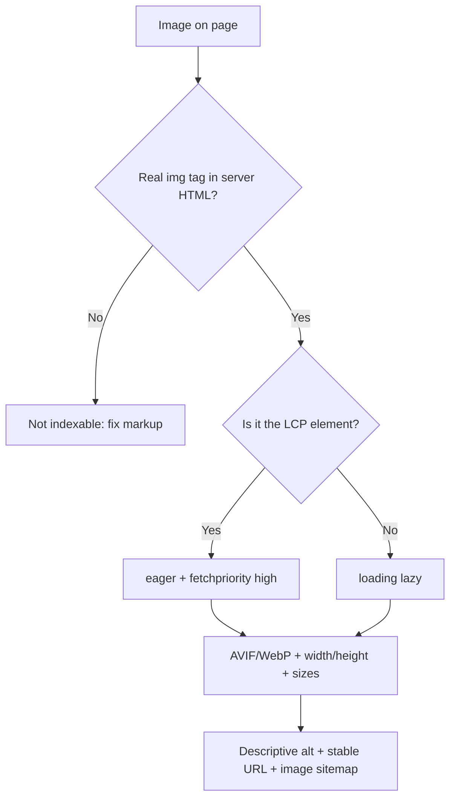

# Image SEO in 2026: Make Next.js Images Indexable and Fast

Open any "image SEO checklist" and you'll find the same advice: write alt text, compress your files, done. That advice isn't wrong. It's just a decade out of date, and it skips the part where modern frameworks quietly break things for you.

Here's the pattern we see on JavaScript-heavy sites. The team ships a gorgeous hero image through a component library. It's lazy-loaded by default, delivered as a CSS background, or swapped in by a client-side script. LCP crawls. Google Images never picks the file up. Nobody notices, because the page *looks* perfect in the browser.

This guide is about **image SEO** from a developer's seat: what Google actually documents, what your framework does by default, and how to build a setup that is both indexable and fast. We'll use Next.js 16 and Astro for the code, but the principles travel.

## Why image SEO still matters (and where it pays off)

Images touch search in three separate ways, and it helps to keep them apart:

1. **Ranking signals via speed.** The hero image is often your Largest Contentful Paint element, so image delivery feeds directly into Core Web Vitals. If that's your sore spot, our guide on [8 LCP fixes that actually move Core Web Vitals scores in 2026](/blog/lcp-optimization-2026-fixes-core-web-vitals-rankings/) goes deeper on the metric itself.
2. **Image discovery.** Google Images, product results and visual surfaces only work if Googlebot can find the file and understand what it shows.
3. **Page understanding.** Alt text, filenames and captions give Google context about the page, not just the picture.

The honest caveat: for a text-heavy blog, Google Images is rarely the traffic jackpot. For ecommerce, recipes, travel, design and anything visual, it can be a real channel. Decide which camp you're in before you spend a sprint on it. The speed and indexing hygiene below are worth doing either way.

## What Google actually says (the short, verified version)

Skip the folklore. Google's own image guidance boils down to a handful of rules:

- Google finds images in the `src` attribute of ``, including an `` nested inside `<picture>`.
- **Google doesn't index CSS images.** Google's docs literally label a `div` with `background-image` as the "bad" example.
- Supported formats in `src` are BMP, GIF, JPEG, PNG, WebP, SVG and **AVIF**. The file extension should match the real file type.
- Alt text is described as the most important attribute for image metadata. Make it descriptive and relevant to the page, and don't stuff keywords.
- If you use `srcset` or `<picture>`, always include a plain `src` fallback, because some browsers and crawlers don't understand the fancier syntax.
- Image sitemaps can surface URLs Google might not otherwise discover, and they may point to images hosted on another domain (handy with a CDN, as long as you verify the CDN domain in Search Console).
- To influence the preferred image for a page, use `primaryImageOfPage`, a main-entity image or `og:image`. Avoid logos, text-heavy graphics and extreme aspect ratios.
- If one image appears on several pages, reference it with the same URL so Google can cache and reuse it.

Notice what's missing: no magic format bonus, no "AVIF ranks higher" claim. Format choice helps through page weight and speed, not through some direct ranking switch.

## The three framework traps that break image SEO

### Trap 1: The LCP image gets lazy-loaded

Native `loading="lazy"` is great for below-the-fold images. Applied to your hero, it tells the browser to wait, which delays the very element Core Web Vitals is measuring. Several image-SEO write-ups claim exact penalties (one cites 200-800 ms) but don't source them, so treat those numbers as directional, not gospel.

What *is* sourced: Chrome's fetch priority documentation shows that images start at low priority and only get boosted after layout, and that adding `fetchpriority="high"` lets the important image start at high priority immediately. In the Google Flights case study, boosting the hero image's priority cut LCP from 2.6 s to 1.9 s.

In Next.js 16, the old `priority` prop is deprecated in favor of `preload`. The docs add a nuance worth reading twice: in most cases you should use `loading="eager"` or `fetchPriority="high"` instead of `preload`. So a hero looks like this:

```tsx
// app/page.tsx
import Image from "next/image";
import hero from "@/public/hero.jpg";

export default function Home() {
  return (
    <Image
      src={hero}
      alt="Roasted beets with whipped feta on a blue plate"
      sizes="(max-width: 768px) 100vw, 1200px"
      fetchPriority="high"
      loading="eager"
    />
  );
}
```

Only one or two images per page should get this treatment. If everything is "high priority", nothing is. Chrome's docs also recommend `fetchpriority="low"` for off-screen carousel slides rather than relying on lazy loading alone.

### Trap 2: Images that only exist as CSS backgrounds

Design systems love `background-image` because it makes cover-fit layouts trivial. For SEO it's a dead end: Google doesn't index those files. If the image carries meaning (a product, a recipe, a person), render it with a real ``.

In Next.js, `fill` plus `object-fit` gives you the same visual result with a real image element:

```tsx
<div className="relative aspect-[16/9]">
  <Image
    src="/products/ceramic-mug.jpg"
    alt="Matte white ceramic mug with a wooden handle"
    fill
    sizes="(max-width: 768px) 100vw, 50vw"
    className="object-cover"
  />
</div>
```

If you absolutely must keep a CSS background as the LCP element, Chrome's guidance is to preload it with `fetchpriority="high"`. But treat it as decoration, not as an image you want in search.

### Trap 3: Images injected by client-side JavaScript

Galleries, sliders and "load more" grids frequently build their `` tags in the browser. If the image isn't in the server-rendered HTML, you're relying on Google's renderer to find it, and you're invisible to any crawler that doesn't run JavaScript at all. We covered that wider rendering gap in [JavaScript SEO in 2026: how AI crawlers read React, Next.js, and Astro](/blog/javascript-seo-ai-crawlers-react-nextjs-astro/). The image-specific rule is simple: if it matters, it should be in the initial HTML.

## Format and sizing: configure it on purpose

Next.js negotiates the output format from the request's `Accept` header, and the order of your `formats` array matters because the first match wins. The official docs give you a useful reality check: AVIF takes roughly 50% longer to encode but compresses about 20% smaller than WebP, and the docs still recommend WebP for most use cases. With multiple formats, each one is cached separately, so storage grows.

A sensible config for most content sites:

```js
// next.config.js
module.exports = {
  images: {
    formats: ["image/avif", "image/webp"],
    qualities: [60, 75, 85],
    minimumCacheTTL: 2678400, // 31 days for images that rarely change
    remotePatterns: [
      { protocol: "https", hostname: "cdn.example.com" },
    ],
  },
};
```

Two details trip people up here. First, `qualities` is required starting with Next.js 16, and a `quality` prop outside your list is coerced to the nearest allowed value. Second, the docs warn there's no mechanism to invalidate the optimized image cache, so a long `minimumCacheTTL` plus a re-uploaded file at the same URL equals stale images. Prefer static imports (which hash the content) or change the `src` when the image changes.

For Astro, the built-in `<Picture />` component handles multi-format output and keeps a proper `` fallback:

```astro
---
import { Picture } from "astro:assets";
import hero from "../assets/hero.jpg";
---
<Picture
  src={hero}
  formats={["avif", "webp"]}
  alt="Roasted beets with whipped feta on a blue plate"
  widths={[480, 960, 1440]}
  sizes="(max-width: 768px) 100vw, 1200px"
  loading="eager"
  fetchpriority="high"
/>
```

Always set width and height (or let the framework infer them) so the browser reserves space. That's the cheapest layout-shift fix there is, and it ties straight into [Cumulative Layout Shift in 2026: why CLS now tanks your whole site](/blog/cumulative-layout-shift-2026-fix-guide-site-wide-cwv/).

## SEO and search implications: what to do for crawlers specifically

Everything above makes your images fast. These steps make them *findable*.

**Write alt text for the page, not the keyword.** Describe what is in the image and why it's on this page. "Roasted beets with whipped feta on a blue plate" beats "best beet recipe beets feta recipe". AI-generated alt text is tempting at scale, but vision models can be confidently wrong, so review a sample before you ship thousands of them. Decorative images get an empty `alt=""`.

**Use descriptive filenames.** Google's own example is `my-new-black-kitten.jpg` over `IMG00023.JPG`. If your CMS renames uploads to hashes, make sure the original descriptive name survives somewhere, or at least that alt text compensates.

**Keep image URLs stable.** If a CDN or build step rotates the URL on every deploy, Google has to re-discover and re-evaluate the file each time. Content-hashed URLs are fine, but only change them when the pixels change. Serving images from your own hostname (a CNAME in front of the CDN) also lets you switch providers without changing public URLs.

**Add an image sitemap for important images.** If your images load from a different domain, or are surfaced through JavaScript galleries, an image sitemap is cheap insurance. Here's a minimal entry:

```xml
<url>
  <loc>https://example.com/recipes/roasted-beets</loc>
  <image:image>
    <image:loc>https://cdn.example.com/beets-feta.avif</image:loc>
  </image:image>
</url>
```

Remember that sitemaps work best when they're clean. Our write-up on [XML sitemap mistakes that make Google ignore your lastmod](/blog/xml-sitemap-mistakes-lastmod-google-ignores-2026/) covers the traps that apply here too.

**Signal the preferred image.** Set `og:image`, and if you use structured data, make the image property consistent with what's on the page. For products, mismatches between markup, feed and visible page hurt trust.

**Make sure Googlebot can fetch the files.** Images blocked by robots.txt or hidden behind auth cookies simply won't be indexed. Check your CDN's robots rules separately, because a CDN hostname has its own robots.txt.

## A quick audit script you can run today

Before buying a tool, run a lightweight check on your key templates. This Node script fetches a page's raw HTML (the same thing a non-rendering crawler sees) and flags the usual suspects:

```js
// audit-images.mjs  (Node 20+)
const url = process.argv[2];
const html = await (await fetch(url)).text();

const imgs = [...html.matchAll(/]*>/gi)].map((m) => m[0]);
console.log(`Found ${imgs.length}  tags in raw HTML`);

imgs.forEach((tag, i) => {
  const issues = [];
  if (!/\balt=/.test(tag)) issues.push("missing alt");
  if (!/\bsrc=/.test(tag)) issues.push("no src (srcset/JS only)");
  if (!/\bwidth=/.test(tag) || !/\bheight=/.test(tag)) issues.push("no width/height");
  if (i === 0 && /loading=["']lazy["']/.test(tag)) issues.push("FIRST image is lazy");
  if (issues.length) console.log(`#${i + 1}: ${issues.join(", ")}`);
});

const bg = html.match(/background-image:\s*url\(/gi)?.length ?? 0;
if (bg) console.log(`${bg} inline CSS background images (not indexed by Google)`);
```

It's deliberately crude. Treat the output as a to-do list, then wire the same checks into CI so a future refactor doesn't undo your work. We laid out that approach in [SEO regression testing in 2026: guardrails for AI-written code](/blog/seo-regression-testing-2026-ci-guardrails-ai-code/), and AI coding assistants are notorious for swapping an `` for a background `div` when they "clean up" a layout.



## Common mistakes and advanced tips

- **Stripping every byte of metadata.** Blanket stripping is too blunt. Remove bulky camera data, but think about keeping copyright and creator information if you publish original photography.
- **Over-trusting a format.** AVIF is supported by Google in `src`, but a smaller file isn't automatically a better page. Measure LCP in field data, not just Lighthouse.
- **Using one giant file for every screen.** Without `sizes`, the browser assumes the image fills the viewport and may download far more than it needs. Write `sizes` to match your real layout.
- **Forgetting the fallback.** Whatever fancy `<picture>` setup you use, keep a plain `` inside it.
- **Treating alt text as the whole job.** Surrounding text, headings and captions help Google understand the image too.

## Conclusion

Good image SEO in 2026 is mostly plumbing. Render real `` elements in the server HTML, keep the hero eager and high priority, lazy-load the rest, serve modern formats at the right size, and give every meaningful image a descriptive alt, a sane filename and a stable URL. None of this needs a new tool or a big rewrite. It needs someone to look at the raw HTML once and say, "wait, where did the image go?"

If you do only one thing this week, run the audit script above on your homepage, top category page and top article. You'll probably find one lazy hero and one background-image product shot. Fixing those two is a better use of your Friday than another hour of alt-text keyword research.

## FAQ

**Does AVIF improve Google rankings directly?**
No documented ranking bonus exists. Google lists AVIF as a supported format, and the benefit comes indirectly through smaller files and faster loading.

**Should I lazy-load every image for performance?**
No. Lazy-load below-the-fold images only. The LCP image should load eagerly, ideally with `fetchpriority="high"`.

**Does Google index CSS background images?**
No. Google's documentation says it doesn't index CSS images, so use a real `` for anything you want discoverable.

**Do I need an image sitemap?**
Not always, but it helps when images are loaded via JavaScript or hosted on another domain such as a CDN.

**Is `priority` still valid in Next.js 16?**
It's deprecated in favor of `preload`, but the Next.js docs recommend `loading="eager"` or `fetchPriority="high"` for most cases.

```json
{
  "@context": "https://schema.org",
  "@type": "BlogPosting",
  "headline": "Image SEO in 2026: Make Next.js Images Indexable and Fast",
  "description": "Image SEO in 2026 is more than alt text. Learn how to ship indexable, fast AVIF/WebP images in Next.js and Astro without hurting LCP or Google Images.",
  "datePublished": "2026-10-23",
  "dateModified": "2026-10-23",
  "keywords": "Image SEO, Technical SEO, Core Web Vitals, Next.js, Astro, JS SEO"
}
```
