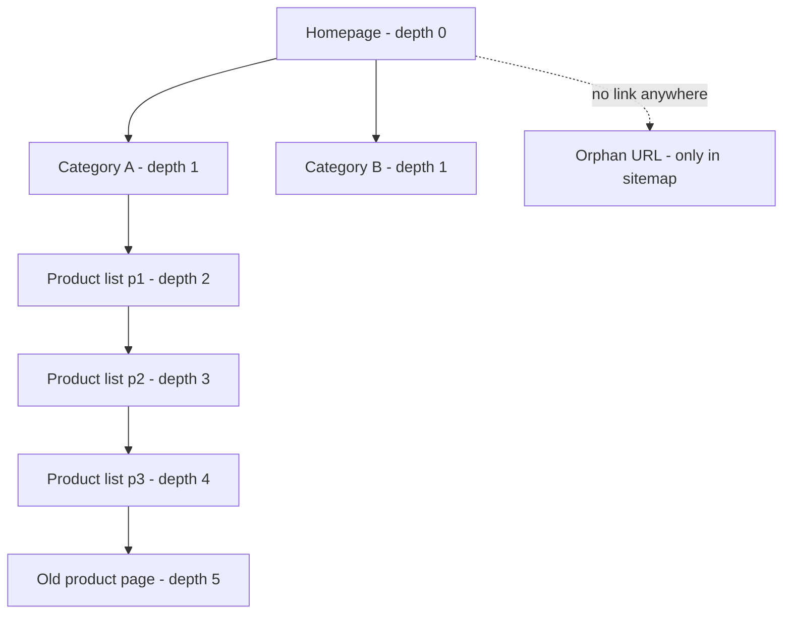

# Internal Linking in Next.js: Crawlable Links and Click Depth

You can ship a beautiful Next.js site, pass every Lighthouse check, and still have a third of your pages sitting in "Discovered – currently not indexed." Nothing is broken in the sense your error monitoring understands. The pages render. The routes work. The problem is quieter: Googlebot never found a clean path to them.

That's the thing about **internal linking in Next.js** and other JavaScript frameworks. The links look fine to a human with a mouse. To a crawler, they might not exist at all. And the pages those links were supposed to reach? They slide down the crawl queue, get fewer visits, and get indexed late or never.

This guide walks through what actually makes a link crawlable, how click depth affects indexing, which framework patterns break discovery, and how to audit all of it in an afternoon. If you've already read our pieces on [canonical tags in Next.js and Astro](/blog/canonical-tags-javascript-frameworks-nextjs-astro-2026/) and [pagination versus infinite scroll](/blog/pagination-infinite-scroll-seo-2026-crawlable-load-more-nextjs/), consider this the layer underneath both: before Google can pick a canonical or follow page 2, it has to find the URL.

## Why Internal Links Are Your Real Discovery System

Sitemaps get the glory, but they're a hint, not a guarantee. Internal links do three jobs at once:

1. **Discovery.** Crawlers find new URLs by following links from pages they already know.
2. **Prioritization.** Pages with more (and better-placed) internal links tend to be crawled more often.
3. **Context.** Anchor text tells Google what the target page is about.

Google's own documentation is blunt about the baseline: every page you want indexed should be linked from at least one other page on your site. A URL that exists only in your sitemap is an orphan. It might get crawled, but you've given Google no reason to think it matters.

Here's the part developers tend to miss. In a server-rendered world, links were just HTML. In a React world, "link" can mean an `<a>`, a router component, a button with a click handler, or a card that navigates on `onClick`. Only one of those four reliably gives a crawler a URL.

## What Makes a Link Crawlable (Per Google)

Google's [link best practices](https://developers.google.com/search/docs/crawling-indexing/links-crawlable) boil down to a short checklist:

- It's an `<a>` element with an `href` attribute.
- The `href` resolves to a real, requestable URL.
- The link is present without requiring a click, hover, or other interaction.
- If JavaScript inserts the link, it uses the same `<a href>` markup.

Extra attributes like `onclick` or `class` are fine alongside a valid `href`. What isn't fine, according to Google's examples:

```html
<!-- Not reliably crawlable -->
<span href="https://example.com/pricing">Pricing</span>
<a onclick="goto('/pricing')">Pricing</a>
<a href="javascript:goTo('pricing')">Pricing</a>
<a routerLink="pricing">Pricing</a>
<div onClick={() => router.push('/pricing')}>Pricing</div>
```

Every one of those works for a user. None of them hands Googlebot a dependable URL.

### The Next.js version of the same mistake

Next.js makes the right thing easy, which is why the wrong thing is so easy to miss. `next/link` renders a real anchor:

```tsx
import Link from 'next/link';

// Renders <a href="/pricing">Pricing</a> in the HTML
<Link href="/pricing">Pricing</Link>
```

The trouble starts when teams reach for `useRouter().push()` for anything that "feels like navigation":

```tsx
'use client';
import { useRouter } from 'next/navigation';

// Crawler sees a div. No URL. No discovery.
export function ProductCard({ slug, title }) {
  const router = useRouter();
  return (
    <div onClick={() => router.push(`/products/${slug}`)}>
      {title}
    </div>
  );
}
```

The fix is almost insulting in its simplicity:

```tsx
import Link from 'next/link';

export function ProductCard({ slug, title }) {
  return <Link href={`/products/${slug}`}>{title}</Link>;
}
```

Programmatic navigation is great after a form submit or a login. It's a discovery dead end when it replaces a link that should have existed in the first place.

## Click Depth: The Quiet Indexing Throttle

Click depth is the number of clicks from the homepage to a page. Homepage links are depth 1, their targets' links are depth 2, and so on.

Let me be careful here, because this topic attracts confident-sounding folklore. Google has never published a "three clicks" rule, and most of the numbers you'll see online (including the common guidance that priority pages should sit at depth 1–2 and anything past depth 3 is "likely under-crawled") are practitioner heuristics from tool vendors, not measured Google behavior. Treat them as sensible guardrails rather than laws.

What we can say with reasonable confidence:

- Google crawls by following links, so pages far from your well-linked hubs are reached later and less often.
- Pages deep in a structure generally receive less internal PageRank than pages linked from the homepage or major hubs.
- Orphan pages are the extreme case: depth effectively infinite.

For a small site with 300 URLs, none of this matters much. For a catalog, marketplace, or large blog with tens of thousands of URLs, click depth becomes one of the few levers you fully control.



That product at depth 5 gets recrawled rarely. The orphan only exists because your sitemap says so. If either one is a page that earns revenue, you've built a structural handicap without writing a single bug.

## SEO & Search Implications

This is where the framework choices turn into search outcomes.

**Links in the initial HTML versus links after hydration.** Google renders JavaScript, so links added client-side with proper `<a href>` markup can still be discovered. But rendering is a second step that may lag, and anything requiring an interaction never happens in the renderer. For links that matter (primary navigation, category hubs, "related" modules), serve them in the server-rendered HTML. In the App Router, that means rendering them in Server Components rather than fetching link data inside a `useEffect`.

**Hidden navigation.** Mega-menus that mount their links only on hover, accordions that fetch children on click, and "Load more" buttons that fetch the next set of URLs via an API are all patterns where the link list in the DOM at load time is far smaller than what a user can reach. If you've ever wondered why page 7 of a listing is never indexed, this is usually why. (We cover the fix in the pagination piece linked above.)

**Googlebot's HTML byte limit.** If you stuff a giant navigation or inline huge JSON blobs before your content, links can land past the point where Google stops reading the document. We broke that down in [Googlebot's 2 MB HTML limit](/blog/googlebot-2mb-html-limit-seo-truncation-fixes-2026/). A footer link block that's never fetched is a footer link block that doesn't count.

**Anchor text.** Google recommends concise, descriptive anchor text and warns against "click here" or "read more." For image links, the `alt` attribute acts as the anchor text, so an empty alt on a linked product image is a wasted opportunity. If JavaScript inserts the anchor text, confirm it appears in the rendered HTML with the URL Inspection tool.

**A fresh reminder from Google.** On October 23, 2026, Google updated its URL structure guidance to clarify hyphens versus underscores as word separators. It's a small change, but it's a nudge that URLs themselves are part of the link signal. Hyphens are still the safe default for slugs.

**Link equity and AI crawlers.** Many AI crawlers don't execute JavaScript at all, which means your internal links need to exist in the raw HTML if you want those bots to follow them. If you've been working on how AI systems read your pages, [JavaScript SEO in 2026](/blog/javascript-seo-ai-crawlers-react-nextjs-astro/) covers the rendering side in more depth.

## How to Audit Your Internal Links in Under an Hour

You don't need a six-figure tool. You need three views of your site: what the HTML says, what the browser renders, and what you intended.

### Step 1: Compare raw HTML to rendered DOM

```bash
# Raw HTML: count anchors a crawler gets without JS
curl -s https://example.com/category/shoes \
  | grep -o '<a [^>]*href="[^"]*"' | wc -l
```

Then open the same page in DevTools after load and run:

```js
document.querySelectorAll('a[href]').length
```

A big gap tells you which links depend on JavaScript. A big gap on a navigation-heavy template is a flag worth investigating.

### Step 2: Crawl with and without rendering

Run a crawler (Screaming Frog, Sitebulb, or a Playwright script) twice: once with JavaScript rendering off, once on. Diff the discovered URL sets. URLs that appear only in the rendered crawl are links you're relying on Google's renderer to find.

A minimal Playwright check for non-anchor "links":

```ts
import { chromium } from 'playwright';

const browser = await chromium.launch();
const page = await browser.newPage();
await page.goto('https://example.com/');

const suspects = await page.$$eval(
  '[onclick], [role="link"], [data-href]',
  els => els
    .filter(el => el.tagName !== 'A' || !el.getAttribute('href'))
    .map(el => el.outerHTML.slice(0, 120))
);
console.log(suspects);
await browser.close();
```

### Step 3: Find orphans

Export all URLs from your sitemap, then export every URL a link-following crawl discovered. Anything in the first list and not the second is an orphan. Cross-reference with Search Console's Page indexing report for "Discovered – currently not indexed" and "Crawled – currently not indexed." We cover similar log-versus-sitemap comparisons in [server log analysis for SEO and what Search Console misses](/blog/server-log-analysis-seo-2026-what-search-console-misses/).

### Step 4: Measure depth

Most crawlers report depth directly. Sort by depth descending, filter to indexable pages, and flag anything important at depth 4 or beyond. Then ask the only question that matters: what's the cheapest link I can add from a stronger page?

## Fixes That Actually Work

- **Add contextual links in content.** A blog post that mentions a product category should link to it. Hub pages should link to their best children, not just to "latest."
- **Build real hub pages.** Category and topic hubs flatten depth because they put dozens of URLs one click from a well-linked page.
- **Use "related" modules rendered on the server.** Related-products or related-articles blocks are an easy depth-reduction tool, provided they are in the HTML.
- **Add breadcrumbs as real links.** Breadcrumbs shorten the path upward and give every page a consistent parent link. Pair them with BreadcrumbList structured data.
- **Don't rely on the sitemap to rescue orphans.** Put them in the link graph or remove them from the sitemap.
- **Guard it in CI.** Add an automated check that flags non-anchor navigation and new pages with zero inbound internal links. It fits neatly into the approach in [SEO regression testing in 2026](/blog/seo-regression-testing-2026-ci-guardrails-ai-code/).

## Common Mistakes

**Overcorrecting with link spam.** Google says there's no ideal number of links, but excessive linking is a warning sign. Sitewide footers with 300 links dilute the value of every one of them.

**Using `nofollow` on internal links.** It's almost never what you want. Use it for untrusted external links, not to "sculpt" your own site.

**Trusting Markdown by default.** If your content comes from a CMS or MDX, a Markdown link only becomes a crawlable link if your renderer actually outputs an `<a href>`. Check the rendered HTML, including any URL rewriting or sanitization, especially in headless setups like the ones discussed in [headless CMS SEO mistakes in 2026](/blog/headless-cms-seo-mistakes-2026-indexing-fixes/).

**Forgetting that AI coding agents love `router.push`.** Generated components often navigate with handlers rather than links. Put "use `<Link>` for anything that should be discoverable" in your team's agent rules. The [AGENTS.md SEO rule-pack](/blog/agents-md-seo-rule-pack-2026/) has a ready-made starting point.

## Conclusion

Internal linking in Next.js isn't glamorous, and that's exactly why it's where indexing problems hide. The rules are simple: use real `<a href>` elements, serve important links in the initial HTML, keep your best pages within a few clicks of your hubs, and make sure nothing you care about is an orphan. The framework will happily let you break every one of those without a single warning.

Spend an hour this week on the audit above. Compare raw HTML to the rendered DOM, diff your sitemap against a crawl, and sort by depth. You'll likely find a handful of pages that were invisible by construction, and fixing them is one of the cheapest crawlability wins available.

## FAQ

### Does Google follow links added by JavaScript?

Yes, if they use standard `<a href>` markup and are present without needing a click or hover. But rendering can lag, so critical links belong in the server-rendered HTML.

### Is `router.push()` bad for SEO?

Not inherently. It's fine for actions like post-login redirects. It's a problem when it replaces a link that should be discoverable, because it gives crawlers no URL to follow.

### What's the ideal click depth?

Google hasn't published a number. Practitioners usually aim to keep important pages within about three clicks of the homepage. Treat that as a heuristic and verify with crawl and log data.

### Do orphan pages get indexed?

Sometimes, via sitemaps or external links, but with no internal links you give Google no signal about their importance. Link them or remove them.

### Does `next/link` prefetching affect crawling?

Prefetching is a browser optimization. What matters for crawlers is that `next/link` renders a real anchor with an `href`.

```json
{
  "@context": "https://schema.org",
  "@type": "BlogPosting",
  "headline": "Internal Linking in Next.js: Crawlable Links and Click Depth",
  "description": "Internal linking in Next.js breaks quietly. Learn which link patterns Googlebot follows, how click depth hurts indexing, and how to audit both in 2026.",
  "datePublished": "2026-10-24",
  "dateModified": "2026-10-24",
  "keywords": "Internal Linking, Technical SEO, Next.js, JS SEO, Crawlability, Click Depth"
}
```
