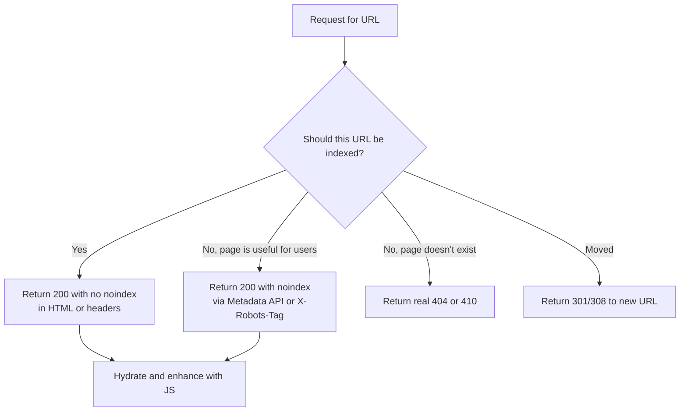

# noindex in Next.js: Meta Robots and X-Robots-Tag Done Right

Most indexing disasters don't come from a clever algorithm update. They come from a single line of config that somebody forgot to remove. A staging flag that leaked into production. A `noindex` added "just for now" to a template. A loading state that shipped a robots tag before the data arrived.

If you're searching for how to use **noindex in Next.js** properly, you're probably in one of two camps. Either you need to keep pages out of Google on purpose (thin filters, internal search, thank-you pages), or you're staring at Search Console wondering why pages you *want* indexed are marked "Excluded by 'noindex' tag." Both problems have the same root: noindex is a blunt, one-way instruction, and JavaScript frameworks give you five different places to set it.

This guide walks through where those places are, which ones Google actually honors, and how to catch mistakes before they cost you traffic.

## Why noindex Is Riskier Than It Looks

A `noindex` directive tells Google: crawl this page if you like, but don't put it in the search index. It's the right tool for pages that are useful to users but pointless in search results.

Here's the catch. It's a **page-level kill switch with no safety net**. There's no warning when it lands on the wrong page. Rankings don't decay gradually; the URL just drops out once Google recrawls it. And because recrawl timing varies, you may not notice for days or weeks.

In a classic server-rendered site, the robots tag lives in one template and you can grep for it. In a modern React or Next.js app, the directive can come from:

- the Metadata API (`metadata.robots` or `generateMetadata`)
- a hand-written `<meta>` tag in a layout
- an `X-Robots-Tag` HTTP header from `next.config.js`, middleware, or your CDN
- a client-side script that injects or removes a tag after hydration
- a third-party tool such as a tag manager or an SEO plugin

Five sources, zero guarantees they agree with each other. When they conflict, Google generally applies the most restrictive directive it sees. That means one stray `noindex` anywhere wins.

## Meta Robots vs. X-Robots-Tag: Which One When?

Both deliver the same directives. The difference is delivery and file type.

| | Meta robots tag | X-Robots-Tag header |
|---|---|---|
| Where it lives | `<head>` of an HTML document | HTTP response header |
| Works for PDFs, images, video | No | Yes |
| Visible before rendering | Only if present in the raw HTML | Yes, always |
| Easy to set per-route in Next.js | Yes (Metadata API) | Yes (`headers()` or middleware) |
| Best for | Normal HTML pages | Non-HTML files, bulk rules, staging environments |

For standard pages, use the meta tag through the Metadata API. For anything that isn't HTML, or when you need a blanket rule across a whole environment, use the header.

### The Next.js Metadata API (App Router)

For a single route, this is the cleanest option:

```ts
// app/search/page.tsx
import type { Metadata } from "next";

export const metadata: Metadata = {
  robots: {
    index: false,
    follow: true,
  },
};
```

For dynamic routes where indexability depends on data, use `generateMetadata`:

```ts
// app/products/[slug]/page.tsx
export async function generateMetadata({ params }): Promise<Metadata> {
  const product = await getProduct(params.slug);

  return {
    robots: product?.discontinued
      ? { index: false, follow: true }
      : { index: true, follow: true },
  };
}
```

That output is rendered on the server and lands in the initial HTML. Googlebot sees it on the first pass, no rendering required. That's exactly what you want.

### X-Robots-Tag in next.config.js

For PDFs, downloadable assets, or a whole path prefix:

```js
// next.config.js
module.exports = {
  async headers() {
    return [
      {
        source: "/downloads/:path*.pdf",
        headers: [{ key: "X-Robots-Tag", value: "noindex" }],
      },
      {
        source: "/internal/:path*",
        headers: [{ key: "X-Robots-Tag", value: "noindex, nofollow" }],
      },
    ];
  },
};
```

If you need conditional logic, do it in middleware:

```ts
// middleware.ts
import { NextResponse } from "next/server";
import type { NextRequest } from "next/server";

export function middleware(req: NextRequest) {
  const res = NextResponse.next();
  const host = req.headers.get("host") ?? "";

  if (!host.endsWith("example.com") || host.startsWith("staging.")) {
    res.headers.set("X-Robots-Tag", "noindex, nofollow");
  }
  return res;
}
```

Notice that the staging check keys off the hostname rather than an environment variable that somebody might copy into production by accident. More on that later.

## The Rule JavaScript Developers Keep Breaking

Here's the part that surprises people. Google updated its JavaScript SEO documentation in December 2025 to clarify how `noindex` interacts with rendering. According to the [Search Engine Journal report on the change](https://www.searchenginejournal.com/google-warns-noindex-can-block-javascript-from-running/563333/), when Google encounters a `noindex` tag, it **may skip rendering and JavaScript execution**. The practical consequence: JavaScript that tries to change or remove a `noindex` may never run.

Google's wording is that if you want the page indexed, you shouldn't use a `noindex` tag in the original page code. Older documentation said Google skips rendering outright; the new wording says it *may*, and describes rendering behavior as "not well defined and might change." That's a polite way of saying: don't build anything that depends on it.

So this pattern is a trap:

```tsx
// Anti-pattern: ships noindex in the initial HTML, then tries to undo it on the client
export default function Page() {
  const [loaded, setLoaded] = useState(false);

  useEffect(() => {
    fetchData().then(() => {
      document
        .querySelector('meta[name="robots"]')
        ?.setAttribute("content", "index, follow");
      setLoaded(true);
    });
  }, []);

  return (
    <>
      <meta name="robots" content="noindex" />
      {loaded ? <Content /> : <Spinner />}
    </>
  );
}
```

Googlebot fetches the HTML, sees `noindex`, and may never execute the effect that would have removed it. The page can end up out of the index even though a human visitor sees it working perfectly.

The reverse pattern is just as unreliable. Adding `noindex` with JavaScript to a page that shipped as indexable only works if Google renders the page and picks up the change. You're gambling on the rendering queue.

### The fix: decide on the server

Make the indexability decision where Google can see it on the first byte.



That diagram is the whole mental model. Four outcomes, all resolved on the server, none dependent on client-side code.

If your data fetch fails, don't flip a client-side tag. Return a proper error status from the server instead. The same logic applies to missing content, which is why [soft 404s in Next.js](/blog/nextjs-soft-404-notfound-streaming-status-code-2026/) deserve their own attention: streaming can send a 200 status before your component decides the page doesn't exist.

## SEO & Search Implications

Let's connect this to the search outcomes you actually care about.

**Index coverage.** An accidental `noindex` removes pages from search results entirely. It's the most direct way a front-end change becomes a traffic problem. Search Console surfaces it as "Excluded by 'noindex' tag," but only after Google has already recrawled.

**Crawl budget and link equity.** `noindex, follow` lets Google keep discovering links on the page, though Google has said that a long-term noindex page may eventually be treated like `nofollow`. Don't count on a permanently noindexed hub passing equity. If a page is important enough to carry links, it's probably important enough to index. Your [internal linking structure](/blog/internal-linking-nextjs-crawlable-links-click-depth-2026/) should route through pages you actually want ranked.

**Canonical interaction.** Mixing signals confuses things. A page that is `noindex` and also canonicalized to another URL sends contradictory messages: "don't index me" and "this other URL is my preferred version." Pick one intent. If you're consolidating duplicates, use [canonical tags](/blog/canonical-tags-javascript-frameworks-nextjs-astro-2026/). If you're removing a page from search, use noindex. Don't stack them.

**AI search visibility.** Noindex governs Google Search indexing. It does not stop AI crawlers from fetching your content, and it isn't the mechanism for controlling AI training or retrieval. For that, you work with crawler-specific rules in [robots.txt](/blog/robots-txt-mistakes-crawling-ai-bots-2026/) and, where supported, vendor-specific controls. Treat the two systems as separate switches.

## The robots.txt Trap

This one is a classic, and it still bites experienced teams.

If you block a URL in `robots.txt` **and** put `noindex` on it, Google can never see the `noindex`. It's not allowed to fetch the page, so it never reads the tag. The URL can still show up in results as a bare listing if other pages link to it.

The order of operations matters:

1. Leave the URL crawlable.
2. Add `noindex`.
3. Wait until Google has recrawled and dropped it.
4. Only then, if you need to, block crawling.

Also remember that `noindex` inside robots.txt hasn't been supported by Google for years. If you find a `Noindex:` line in an old robots file, it's doing nothing. Remove it and use a real directive.

Similarly, don't list noindexed URLs in your XML sitemap. A sitemap is a statement of "these are the URLs I want indexed," and including noindexed pages sends a mixed message. If you've been through our [sitemap mistakes guide](/blog/xml-sitemap-mistakes-lastmod-google-ignores-2026/), you already know sitemaps should be clean.

## Staging Leaks and Environment Flags

The most expensive noindex mistake is the *reverse* one: shipping a site-wide `noindex` to production because a staging config came along for the ride.

A pattern we see too often:

```ts
// Fragile: depends on one env var that might be set wrong
const robots = process.env.NEXT_PUBLIC_ENV === "production"
  ? { index: true }
  : { index: false };
```

If that variable is missing, mistyped, or inherited from a preview build, every page on the live site goes dark. Safer approaches:

- Key off the hostname or the platform's production flag, not a custom variable
- Fail *open* in production and *closed* everywhere else, and document which is which
- Add a smoke test that fetches the production homepage after every deploy and fails the pipeline if it contains `noindex`
- Protect staging with authentication, not just noindex. A password is a stronger boundary than a polite request

That deploy-time check is a perfect fit for the guardrails in our write-up on [SEO regression testing in CI](/blog/seo-regression-testing-2026-ci-guardrails-ai-code/). A five-line test catches the mistake that otherwise costs weeks.

## How to Audit noindex Across Your Site

You can't trust what you *think* is deployed. Check what Googlebot is actually served.

**1. Crawl with and without JavaScript.** Run a crawler in both modes and compare the robots directives. Any URL where the raw HTML says one thing and the rendered DOM says another is a problem.

**2. Check headers, not just HTML.** Many audits only inspect the page source and miss `X-Robots-Tag`. A quick check:

```bash
curl -sI https://example.com/some-page | grep -i x-robots-tag
```

Loop that over your sitemap URLs for a fast sweep.

**3. Compare against intent.** Export every URL with a noindex signal and diff it against the list you *meant* to exclude. Surprises are the point.

**4. Watch Search Console.** The Page indexing report lists "Excluded by 'noindex' tag." A sudden jump is your alarm. The URL Inspection tool shows the live-tested directive, which is the fastest way to confirm a fix.

**5. Use your logs.** If Googlebot keeps requesting a URL you've noindexed, that's fine for a while. If it stops requesting a URL you *haven't*, investigate. [Server log analysis](/blog/server-log-analysis-seo-2026-what-search-console-misses/) shows what Search Console can't.

## Common Mistakes

**Using noindex to fix duplicate content.** That's what canonicals and consolidation are for. Noindex just removes pages; it doesn't pass signals the way a canonical can.

**Noindexing paginated pages by default.** Pages 2, 3, and beyond often hold the only links to deeper content. Be careful here, and review the trade-offs in our [pagination guide](/blog/pagination-infinite-scroll-seo-2026-crawlable-load-more-nextjs/).

**Relying on `nofollow` in the meta tag as a crawl control.** It's a hint about links, not a gate. It doesn't stop crawling.

**Forgetting `unavailable_after`.** For expiring content like event pages or limited offers, `unavailable_after` lets you schedule removal without a redeploy. Underused, and handy.

**Assuming a noindex removes a page instantly.** It takes a recrawl. If you need something gone quickly, use the Removals tool in Search Console as a temporary measure, then keep the noindex in place so it stays gone.

## A Practical Checklist

Before you ship, confirm:

- Every noindex is set on the server (Metadata API or header), never injected by client code
- No page is both blocked in robots.txt and meant to be noindexed
- No noindexed URL appears in your sitemap
- No noindexed page carries a conflicting canonical
- Production has an automated post-deploy check for stray noindex
- Non-HTML assets that shouldn't rank use `X-Robots-Tag`

## Conclusion

Noindex is simple on paper and slippery in practice, because modern frameworks give you many ways to set it and few ways to see what ended up in production. The rule that holds up: **decide on the server, ship it in the first response, and verify it automatically.** Treat client-side noindex tricks as legacy behavior Google has now explicitly said it won't promise to honor.

If you take one action today, add a deploy check that fetches your live homepage and key templates and fails when it finds `noindex`. It takes minutes and protects every other SEO investment you've made in indexing, rankings, and AI search visibility.

## FAQ

**Does Google honor noindex added with JavaScript?**
Sometimes, but Google doesn't guarantee it. Its documentation says rendering behavior isn't well defined and might change, and that JavaScript may not be able to alter a noindex it finds in the original HTML. Set it on the server.

**Can JavaScript remove a noindex tag?**
You shouldn't count on it. Google says it may skip rendering when it sees noindex, so the script that would remove the tag may never run. If a page should be indexed, keep noindex out of the initial HTML.

**Should I use meta robots or X-Robots-Tag in Next.js?**
Use the Metadata API's `robots` field for HTML pages. Use `X-Robots-Tag` for PDFs and other non-HTML files, and for environment-wide rules such as staging.

**Why isn't my noindex working?**
The most common cause is that the URL is blocked in robots.txt, so Google can't fetch the page to read the tag. Allow crawling, then add noindex.

**Is noindex or robots.txt better for keeping pages out of Google?**
They do different jobs. Noindex controls indexing and requires crawling. Robots.txt controls crawling and doesn't reliably prevent indexing on its own. For removal from search, use noindex.

**How long does noindex take to work?**
Until Google recrawls the URL, which can take days or weeks depending on how often it visits. Use the Search Console Removals tool for a temporary fast hide.

```json
{
  "@context": "https://schema.org",
  "@type": "BlogPosting",
  "headline": "noindex in Next.js: Meta Robots and X-Robots-Tag Done Right",
  "description": "noindex in Next.js fails in ways your tests won't catch. Learn when meta robots or X-Robots-Tag works, why JavaScript can't undo it, and how to audit it.",
  "datePublished": "2026-10-25",
  "dateModified": "2026-10-25",
  "keywords": "SEO, JavaScript, Web Development, noindex, Meta Robots, X-Robots-Tag, Next.js, Indexing"
}
```
