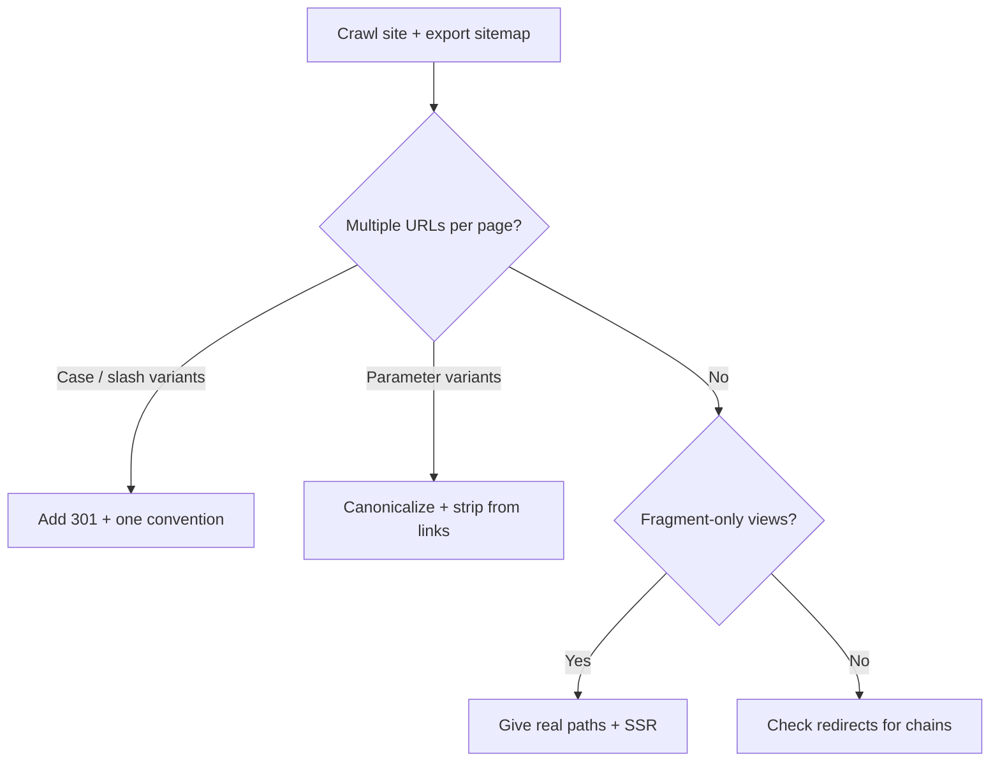

# 7 URL Structure Mistakes Hurting Your SEO in 2026 (Fixes Included)

Last week Google quietly edited its URL structure documentation. Barry Schwartz at Search Engine Roundtable spotted it on October 21, 2026: the "use hyphens to separate words" section got reworded. Underscores are still discouraged, and the new text now says hyphens "clearly signal a word boundary." The meaning didn't change. But the edit is a nice reminder that URL structure SEO is still a live topic, and that Google is still telling us the same boring, important things.

Here's the thing. Most URL problems aren't about whether you picked a hyphen or an underscore. They're about the *same page* answering at three different addresses, a JavaScript app that changes content behind a `#`, or a tracking parameter that spawns ten thousand crawlable variants. These are the bugs that split signals, burn crawl budget, and make your Search Console reports look haunted.

This list ranks seven URL mistakes by how often they do real damage on modern JavaScript sites, and by how cheap they are to fix. Each one comes with a concrete fix for Next.js or Astro, and a one-line SEO consequence. We drew on [Google's URL structure guidelines](https://developers.google.com/search/docs/crawling-indexing/url-structure) rather than folklore, and where a claim is a heuristic instead of a Google rule, we say so.

## 1. Letting the Same Page Live at Multiple Casings

Google's documentation is blunt: URLs are case sensitive for Googlebot, so `/Pricing` and `/pricing` are two different URLs. If your server treats them as the same page, Google's advice is to pick one case and make the rest point to it.

This one bites hardest on Linux hosting, where file paths are case sensitive, and on sites where marketing teams share links typed by hand. Somebody tweets `/Blog/My-Post`, it resolves, and now there's a duplicate with its own (weak) backlinks.

**SEO impact:** duplicate URLs split link signals and give Google a canonical decision it may not make the way you'd like.

**Fix:** redirect any URL containing uppercase letters to its lowercase twin with a 301, ideally at the edge or in middleware (`proxy.ts` in Next.js 16).

```ts
// middleware.ts (or proxy.ts in Next.js 16)
import { NextResponse, type NextRequest } from "next/server";

export function middleware(req: NextRequest) {
  const { pathname } = req.nextUrl;
  if (pathname !== pathname.toLowerCase()) {
    const url = req.nextUrl.clone();
    url.pathname = pathname.toLowerCase();
    return NextResponse.redirect(url, 301);
  }
}
```

Then keep your slugs lowercase at the source so you never need the redirect for internal links.

## 2. Serving Both Trailing-Slash and Non-Slash Versions

`/services` and `/services/` are technically different URLs. Plenty of stacks will happily serve both with a 200. Google can usually figure out they're the same, but "usually" is a weak foundation for a site with thousands of pages.

**SEO impact:** two crawlable URLs per page doubles the canonicalization work and muddies your logs.

**Fix:** choose one convention and enforce it with a redirect. In Next.js that's one line, and Astro has an equivalent:

```js
// next.config.js
module.exports = { trailingSlash: false }; // non-slash URLs win, slash versions 308 to them
```

```js
// astro.config.mjs
export default defineConfig({
  trailingSlash: "never",
  build: { format: "file" },
});
```

One warning from experience: Astro's `trailingSlash` setting affects the dev server, and static hosts have their own redirect rules, so verify the *production* behavior with `curl -I` rather than trusting dev. Your canonical tags, sitemap entries and internal links must all use the same form. If that last sentence made you wince, read our guide to [canonical tags in Next.js and Astro](/blog/canonical-tags-javascript-frameworks-nextjs-astro-2026/).

## 3. Using Fragments (`#`) to Change Page Content

This is the single-page-app classic. A tab, a filter or a "section" changes the content, and the URL just gets a `#something` tacked on. Google's docs say not to use fragments to change content and to use the History API instead, because Google generally ignores everything after the `#` when indexing.

Practically, that means `/products#shoes` and `/products#bags` are *one* URL in Google's eyes. If those views are meant to rank, they'll never be indexed separately.

**SEO impact:** content that only exists behind a fragment can't earn its own ranking.

**Fix:** give any view that deserves search traffic a real path, and render it on the server.

```tsx
// app/products/[category]/page.tsx
export default async function CategoryPage({ params }: { params: Promise<{ category: string }> }) {
  const { category } = await params;
  const items = await getProducts(category);
  return <ProductGrid items={items} />;
}
```

Use `<Link href="/products/shoes">` for navigation so there's a real `<a href>` in the HTML. We covered why crawlers need that in our guide to [internal linking in Next.js and crawlable links](/blog/internal-linking-nextjs-crawlable-links-click-depth-2026/).

## 4. Letting Parameters Multiply Without a Plan

Parameters are not evil. Google's docs even spell out the right syntax: `=` between key and value, `&` between pairs, and a comma for multiple values under one key. The advice that matters more is "use as few parameters as you can" and drop the ones that don't change the content.

The usual suspects are `utm_*` tags, `sort`, `view`, `ref`, session-like tokens, and every filter on a category page. Combine four of them and a hundred real pages become a hundred thousand crawlable URLs.

**SEO impact:** wasted crawl budget on near-duplicates, and diluted signals on the pages you actually want to rank.

**Fix:** decide which parameters are *content-defining* (a page worth ranking) and which are *noise*. For noise, strip them from internal links, canonicalize to the clean URL, and never let them appear in your sitemap. A quick note, since old guides still mention it: the Search Console URL Parameters tool was retired years ago, so this has to be solved in your own code and canonical logic. For e-commerce filters in particular, our [faceted navigation SEO guide](/blog/faceted-navigation-seo-2026-crawl-budget-ecommerce/) goes deeper.

## 5. Putting Session IDs and Tracking State in the URL

Google's guidance here is short: wherever possible avoid session IDs in URLs and use cookies instead. It sounds like a 2008 problem, but it keeps coming back through A/B testing tools, affiliate wrappers and "helpful" middleware that appends a visitor token so personalization works.

Every visitor then gets a unique URL for the same page. Googlebot, to its credit, tends to meet fewer of these than humans do, but the ones it does find show up as duplicates, or as thousands of "Discovered, currently not indexed" entries.

**SEO impact:** infinite unique URLs for finite content.

**Fix:** keep state in cookies or server-side storage, and if a legacy flow forces an identifier into the URL, canonicalize to the clean version and block the pattern from internal links. If you run experiments, assign variants at the edge with a cookie rather than rewriting the visible URL.

## 6. Using Underscores, Mashed Words, and Unreadable Slugs

Yes, this is the one in the news. Google still recommends hyphens over underscores, because hyphens clearly mark a word boundary, and it also discourages joining words together with no separator. So `/best-running-shoes` beats `/best_running_shoes`, and both beat `/bestrunningshoes`.

Let's keep this in proportion, though. Switching an old underscore URL to hyphens is not a ranking hack. Google hasn't said slugs are a strong ranking factor, and an unnecessary migration puts a working URL through a redirect for a tiny, unproven gain. Apply the rule to *new* URLs. Leave established ones alone unless you're migrating anyway.

**SEO impact:** small. Mostly readability, clarity of the word boundary, and click confidence in the SERP.

**Fix:** generate slugs with a function that lowercases, swaps spaces and underscores for hyphens, and strips stop-characters.

```ts
export const slugify = (s: string) =>
  s.normalize("NFKD").replace(/[̀-ͯ]/g, "")
   .toLowerCase().replace(/[^a-z0-9]+/g, "-").replace(/^-+|-+$/g, "");
```

For non-ASCII languages, don't panic. Google says non-ASCII characters should be percent-encoded in links, which frameworks do automatically. Just make sure your sitemap and canonical use the same encoded form.

## 7. Changing URLs Without a Redirect Map

Here's where the real damage happens. A CMS update changes a slug pattern, a redesign flattens `/blog/2024/post` into `/post`, or somebody "cleans up" URLs across the site on a Friday afternoon. Old URLs start returning 404, backlinks die, and rankings slide.

Cleaner URLs are only a win if you do the unglamorous part: a one-to-one redirect map, a sitemap update, updated internal links and a post-launch check of your logs. Avoid chains (old → intermediate → new), because each hop is another thing to break.

**SEO impact:** lost link equity and weeks of ranking volatility if the map is incomplete.

**Fix:** treat any URL change as a migration, even a small one. Keep a versioned redirect file in the repo and test it in CI.

```ts
// next.config.js
async redirects() {
  return [
    { source: "/blog/:year(\\d{4})/:slug", destination: "/:slug", permanent: true },
  ];
}
```

Full playbook: our [site migration redirect map guide](/blog/site-migration-redirect-map-testing-ci-log-validation-2026/). And make sure the *old* paths don't quietly return 200 with an error message, which is its own trap: see [Next.js soft 404s and notFound() status codes](/blog/nextjs-soft-404-notfound-streaming-status-code-2026/).

## Honorable Mentions

**Very deep folder paths.** You'll often read that pages five or six levels deep get less crawl priority, or that URLs should stay under some character count. Treat these as heuristics. Google's documentation doesn't set a length limit; it simply warns against overly complex URLs with many parameters. Keep paths simple and descriptive and don't obsess over the exact number.

**Relative links that create bogus URLs.** Google notes that parent-relative links can generate repeated path segments when the server answers nonexistent pages incorrectly. Use root-relative links (`/guides/seo`) and return real 404s.

## How to Audit Your URL Structure in an Afternoon

You don't need a paid crawler to spot most of the above. Run through this once, then put it in CI.



1. Export every URL from your sitemap and every internal `href` from a crawl, then diff them. URLs that appear in one list but not the other are your first suspects.
2. `curl -I` four variants of five key pages: uppercase, trailing slash flipped, with a junk parameter, and with `http://`. Each should 301 once to the canonical or return it with a correct canonical tag.
3. Search your logs for Googlebot hitting parameterized or uppercase URLs. That's your real crawl-budget leak, measured rather than guessed. Our guide to [server log analysis for SEO](/blog/server-log-analysis-seo-2026-what-search-console-misses/) shows how.
4. Add the checks to your pipeline so a refactor can't undo them. See our guide to [SEO regression testing in CI](/blog/seo-regression-testing-2026-ci-guardrails-ai-code/).
5. Keep your sitemap clean: canonical URLs only, same casing and slash style as your canonicals. Related reading: [XML sitemap mistakes and why Google ignores lastmod](/blog/xml-sitemap-mistakes-lastmod-google-ignores-2026/).

## Conclusion

If you only remember one thing from this URL structure SEO list, make it this: one page, one URL. Casing, slashes, fragments, parameters and session IDs are all just different ways of breaking that rule. The hyphen-versus-underscore tweak that made headlines this week is real, but it's the smallest item here. The biggest wins come from consolidation (items 1, 2, 4 and 5), from giving ranking-worthy views real paths (item 3), and from treating URL changes as migrations (item 7).

Pick the cheapest fix first. For most sites that's the lowercase and trailing-slash redirects, which take about ten minutes and quietly remove a whole class of duplicates. Then work down the list. Your future self, staring at a calm Search Console report, will thank you.

## FAQ

### Do underscores in URLs hurt rankings?

Google recommends hyphens because they clearly signal a word boundary, but it hasn't said underscores cause a ranking penalty. Use hyphens for new URLs and don't migrate old ones just for this.

### Is there a maximum URL length for SEO?

Google's documentation doesn't give a limit. It advises against overly complex URLs, especially with many parameters. Shorter, descriptive URLs are easier for people, and that's the practical reason to keep them tidy.

### Are URLs case sensitive for Google?

Yes. Google treats `/APPLE` and `/apple` as different URLs, so choose one case and redirect the rest.

### Should I use a trailing slash?

Either works. What matters is picking one, redirecting the other, and keeping canonicals, links and sitemaps consistent.

### Can I use `#` fragments for filters or tabs?

Not if the content should be indexed separately. Google advises using the History API with real URLs rather than fragments to change content.

```json
{
  "@context": "https://schema.org",
  "@type": "BlogPosting",
  "headline": "7 URL Structure Mistakes Hurting Your SEO in 2026 (Fixes Included)",
  "description": "URL structure SEO mistakes quietly create duplicate pages and waste crawl budget. Here are 7 to fix in 2026, with Next.js and Astro code for each.",
  "datePublished": "2026-10-26",
  "dateModified": "2026-10-26",
  "keywords": "Technical SEO, URL Structure, Crawl Budget, Next.js, Astro, Canonicalization"
}
```
